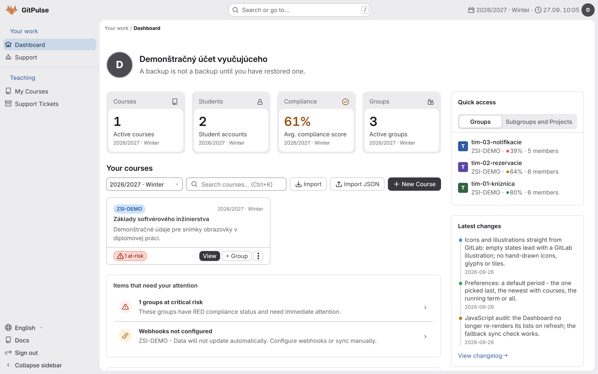
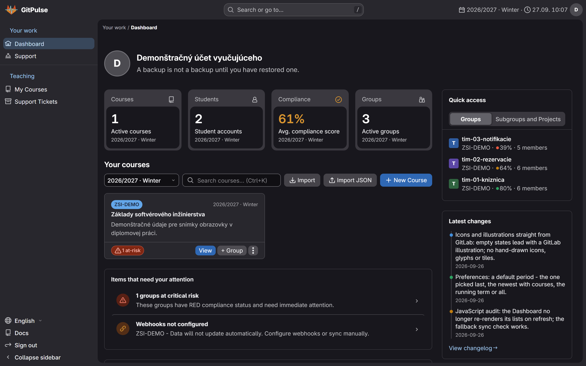
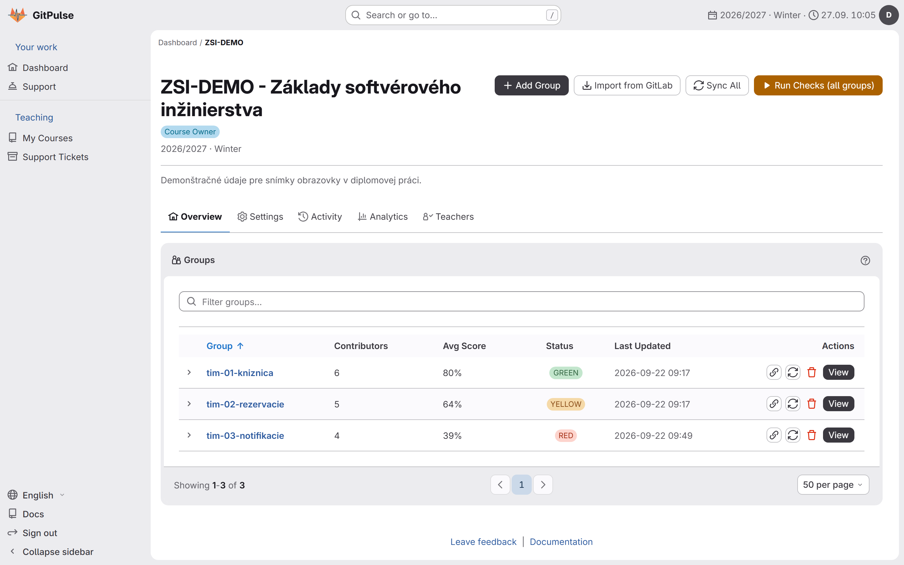
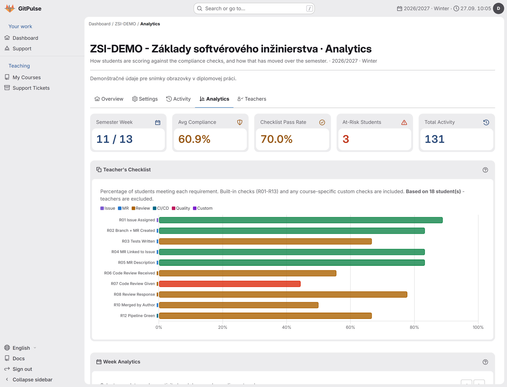
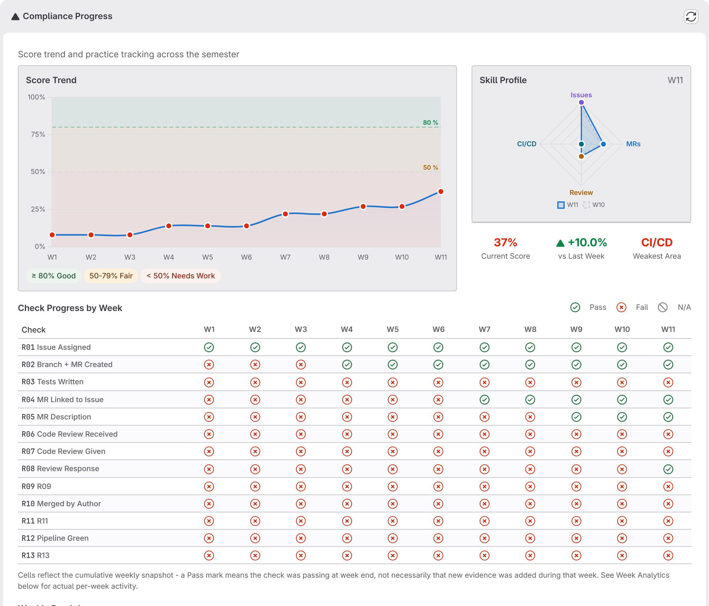
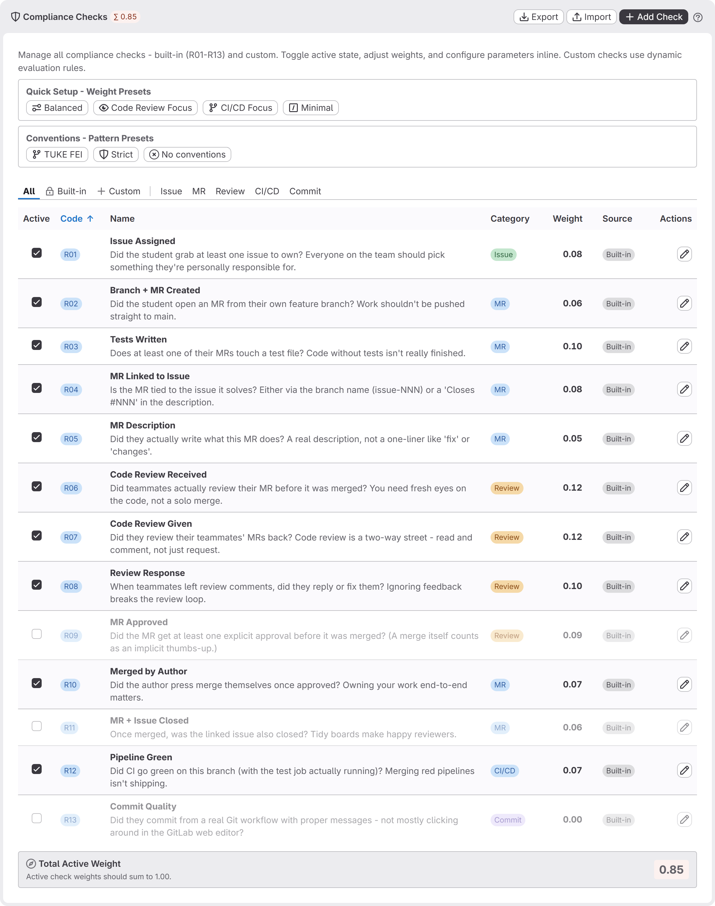
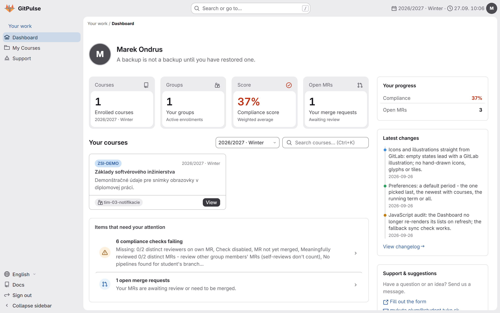
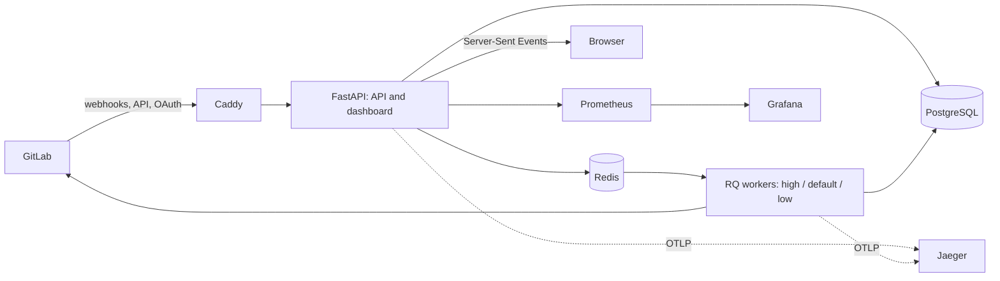

<div align="center">


### Teamwork and assessment on GitLab, for university courses

GitPulse reads what student teams actually do in GitLab - issues, branches, merge requests,
reviews, pipelines - and turns it into one live picture of every group and every student.

**[Documentation](docs/)** &nbsp;·&nbsp;
**[Changelog](CHANGELOG.md)** &nbsp;·&nbsp;
**[Slovenčina](README.sk.md)**

</div>

<br />

| Light | Dark |
| :---: | :---: |
|  |  |

<div align="center"><sub>The teacher's dashboard on the seeded demo course: stat tiles, the course, the items that need attention and quick access to every group.</sub></div>

---

## What it is

A course taught on GitLab produces a trail of evidence that nobody has time to read:
who picked up an issue, who opened a merge request from their own branch, who reviewed
whom, whose pipeline went green. GitPulse listens to that trail through GitLab webhooks,
scores every student against thirteen teamwork checks, and shows the result in an
interface that looks and behaves like GitLab itself - its icons, illustrations, layout
and motion come straight from GitLab's own design system, Pajamas.

<table>
  <tr>
    <th width="33%">For teachers</th>
    <th width="33%">For students</th>
    <th width="33%">For administrators</th>
  </tr>
  <tr>
    <td valign="top">
      <ul>
        <li>every group's compliance at a glance, with the groups at risk surfaced first</li>
        <li>a per-student history: score trend, skill profile and a week-by-week check heatmap</li>
        <li>checks you can weight, switch off or add as custom rules per course</li>
        <li>optional AI review of merge requests, author names redacted before sending</li>
        <li>CSV and JSON exports, import of a whole course from a GitLab group</li>
        <li>an optional classroom assistant: a bot, on its own token, that reviews pushes and merge requests and plants a merge conflict for the exercises</li>
      </ul>
    </td>
    <td valign="top">
      <ul>
        <li>their own score and exactly which checks are failing, in plain words</li>
        <li>open merge requests and what they are waiting for</li>
        <li>the same view the teacher sees of their work - no hidden grading</li>
      </ul>
    </td>
    <td valign="top">
      <ul>
        <li>users, roles, courses and academic periods</li>
        <li>webhook and job monitoring, event replay, system health</li>
        <li>Prometheus metrics, a provisioned Grafana dashboard and Jaeger traces</li>
      </ul>
    </td>
  </tr>
</table>

Course, group, project and analytics pages update live over Server-Sent Events, the whole
interface is available in English and Slovak, and it works on a phone as well as on a desktop.

## A short tour

<table>
  <tr>
    <td width="50%" valign="top">
      
      <p align="center"><b>Course overview</b><br /><sub>Groups with their average score and a status the course is judged by, one click from every project.</sub></p>
    </td>
    <td width="50%" valign="top">
      
      <p align="center"><b>Course analytics</b><br /><sub>How many students pass each check, semester week, at-risk students and total activity.</sub></p>
    </td>
  </tr>
  <tr>
    <td width="50%" valign="top">
      
      <p align="center"><b>A student's progress</b><br /><sub>Score trend against the 50 % and 80 % thresholds, skill profile, and every check week by week.</sub></p>
    </td>
    <td width="50%" valign="top">
      
      <p align="center"><b>Compliance checks</b><br /><sub>Built-in and custom checks with weights, presets and conventions - per course.</sub></p>
    </td>
  </tr>
  <tr>
    <td colspan="2" valign="top">
      
      <p align="center"><b>The student's own dashboard</b><br /><sub>What is failing and why, the merge requests still open, and the latest activity.</sub></p>
    </td>
  </tr>
</table>

## The thirteen checks

Each student is scored every week against these checks; a course can reweight them,
switch any of them off, or add its own.

| Code | Check | Asks | Area |
| :---: | --- | --- | :---: |
| R01 | Issue Assigned | Did the student take at least one issue as their own? | Issue |
| R02 | Branch + MR Created | Did they open a merge request from their own feature branch, not push to main? | MR |
| R03 | Tests Written | Does at least one of their merge requests touch a test file? | MR |
| R04 | MR Linked to Issue | Is the merge request tied to the issue it solves - by branch name or `Closes #NNN`? | MR |
| R05 | MR Description | Does the merge request say what it does, beyond "fix" or "changes"? | MR |
| R06 | Code Review Received | Did a teammate review it before it was merged? | Review |
| R07 | Code Review Given | Did the student review their teammates' merge requests in return? | Review |
| R08 | Review Response | Did they answer or fix the review comments they got? | Review |
| R09 | MR Approved | Did the merge request get an explicit approval before the merge? | Review |
| R10 | Merged by Author | Did the author merge their own work once it was approved? | MR |
| R11 | MR + Issue Closed | Was the linked issue closed after the merge? | MR |
| R12 | Pipeline Green | Did CI pass on the branch, with the test job actually running? | CI/CD |
| R13 | Commit Quality | Were the commits made through a real Git workflow, with proper messages? | Commit |

## How it works



GitPulse is webhook-first: there is **no recurring scheduler and no GitLab polling**.
A webhook is stored, processed, the affected team's metrics are recomputed, caches are
invalidated and every open page is told over SSE. Every background job is started by an
incoming event, an explicit sync, or - throttled - by a dashboard view.

| Layer | Components |
| --- | --- |
| Edge | Caddy - automatic TLS, zstd and gzip, security headers |
| Application | FastAPI - `/api/v1` (REST), `/dashboard` (server-rendered UI), SSE streams; 195 routes |
| Background work | RQ workers on `high`, `default` and `low` queues, `with_scheduler=False` |
| Data | PostgreSQL 16 (37 model classes, 27 migration files, head `027_drop_usage_telemetry`), Redis 7 (cache, pub/sub, rate limits) |
| Observability (optional profile) | Prometheus, Grafana (18 panels in 5 rows, 18 alert rules), Jaeger |

<details>
<summary><b>Background jobs</b></summary>

| Job (`app.workers.*`) | Trigger | Queue | Purpose |
| --- | --- | --- | --- |
| `event_processor.process_event` | each stored webhook event | high | Dispatch merge request, issue, note, pipeline, push and member events |
| `metrics_job.compute_metrics` | after an event changes a team's data | default | Recompute the team's compliance metrics |
| `enrich_mr` / `enrich_issue` | merge request / issue events | default | Fetch diffs, notes and the rest of the GitLab context |
| `sweep.refresh_project_gitlab_intel` | webhook | default | Refresh a project's stored GitLab snapshot |
| `sweep.sync_single_team_members` | push / member event | default | Sync a team's member roster |
| `sweep.compliance_snapshot_for_team` | after a team sync | low | Capture the week's compliance snapshot |
| `llm_job.analyze_single_mr` | teacher action / enabled auto-analysis | low | Analyze a merge request with the configured LLM |
| `sweep_auto_archive.run_auto_archive_sweep` | dashboard view, at most about once an hour | low | Archive courses past the end of their term |

Delayed retries use RQ's `Retry` with exponential backoff.

</details>

<details>
<summary><b>Security model</b></summary>

1. Dashboard sign-in through GitLab OAuth; a signed `gitpulse_session` cookie (30 days idle, 90 days absolute).
2. REST API: `Authorization: Bearer <TEACHER_API_TOKEN>` or a valid dashboard session.
3. Webhooks: a per-project `X-Gitlab-Token`, stored hashed and compared in constant time.
4. CSRF: a double-submit token on every state-changing request made with the session cookie.
5. Middleware: CSP, HSTS, `X-Frame-Options`, trusted hosts, correlation IDs, request logging.
6. Rate limits per project and globally on webhooks.
7. Stored GitLab tokens encrypted with Fernet.
8. Private pages and APIs carry `X-Robots-Tag: noindex`; `/robots.txt`, `/sitemap.xml` and `/llms.txt` are generated.

</details>

## Quick start

**1. Configure** - copy the example environment and fill in the required values:

```bash
cp .env.example .env
```

`DATABASE_URL`, `POSTGRES_PASSWORD`, `SECRET_KEY`, `TEACHER_API_TOKEN`,
`GITLAB_OAUTH_CLIENT_ID`, `GITLAB_OAUTH_CLIENT_SECRET`, `GITLAB_API_TOKEN`.

**2. Migrate and start**

```bash
docker compose --profile migrate run --rm migrate
docker compose up -d
```

**3. Check it is up**

```bash
curl http://localhost:8000/health/ready
```

Then open `http://localhost/dashboard/`.

<details>
<summary><b>Monitoring</b></summary>

```bash
docker compose --profile monitoring up -d
```

| Service | URL | What it shows |
| --- | --- | --- |
| Grafana | `http://localhost:3000` | The provisioned `gitpulse.json` dashboard: health, webhooks, queues, HTTP, database pool, GitLab API, enrichment |
| Prometheus | `http://localhost:9090` | Metrics every 15 s, kept for 30 days, 18 alert rules in `monitoring/prometheus/alerts.yml` |
| Jaeger | `http://localhost:16686` | Distributed traces over OTLP gRPC |

The alerts that matter most day to day:

| Alert | Fires when | Severity |
| --- | --- | --- |
| `WorkerDown` | no RQ worker for 2 min | critical |
| `ApiDown` | the API target is down for 1 min | critical |
| `HighFailureRate` | webhook errors above 0.1/s for 3 min | critical |
| `QueueStuck` | a queue deeper than 50 for 5 min | warning |
| `HighProcessingLatency` | p95 above 10 s for 5 min | warning |
| `DBPoolExhausted` | the pool over 90 % for 3 min | warning |
| `HighHTTPErrorRate` | 5xx above 5 % for 5 min | warning |

</details>

## Quality gates

Every commit has to pass the same six gates locally that CI runs:

```bash
ruff check src/ tests/ scripts/
ruff format --check src/ tests/ scripts/
python scripts/build_bundle.py --check      # the dist/ build succeeds, every asset resolves
python scripts/check_static_artifacts.py
mypy src/app/                                # strict
python scripts/run_unit_tests.py            # 4 155 unit tests
```

The pipeline (`.gitlab-ci.yml`) runs lint, a security stage, the unit suite with coverage
and the 64 integration tests against real PostgreSQL and Redis, then the image build and
the release.

## Repository map

| Path | What lives there |
| --- | --- |
| `src/app/api` | REST API, server-rendered dashboard and SSE streams |
| `src/app/compliance` | The compliance engine, the check registry and custom rules |
| `src/app/services` | GitLab client, LLM analysis, academic periods, compliance history and support |
| `src/app/workers` | RQ jobs, the event pipeline and event-driven sweeps |
| `src/app/models` | SQLAlchemy models (37 model classes) |
| `src/app/security` | OAuth, sessions, bearer tokens, CSRF, rate limits, encryption |
| `src/app/observability` | Logging, Prometheus metrics, OpenTelemetry tracing |
| `src/app/i18n` | The Slovak catalogue (3 489 strings); English is the source language |
| `src/app/templates` | Jinja2 pages, component macros and static assets |
| `alembic/versions` | Database migrations (26 migration files) |
| `monitoring` | Prometheus rules, the Grafana dashboard and its provisioning |
| `docs` | Engineering documents - architecture, API, security, access control |
| `docs-site` | The published Slovak and English documentation |
| `scripts` | Bundle build, demo data, admin CLI, security scan, load tests |

## Documentation

| Document | Contents |
| --- | --- |
| [Documentation site](https://gitpulse.kpi.fei.tuke.sk/docs/) | User and administrator guide, in Slovak and English |
| [`docs/02-architecture.md`](docs/02-architecture.md) | Architecture in depth |
| [`docs/04-api-spec.md`](docs/04-api-spec.md) | Every API route |
| [`docs/12_security.md`](docs/12_security.md) | Security architecture |
| [`docs/13_observability.md`](docs/13_observability.md) | Metrics, logs and traces |
| [`docs/17_quality_gates.md`](docs/17_quality_gates.md) | CI/CD quality gates |
| [`docs/21_access_control.md`](docs/21_access_control.md) | Roles and access control |
| [`CHANGELOG.md`](CHANGELOG.md) | Every release |

---

<div align="center">

GitPulse is the practical part of a diploma thesis at the
Department of Computers and Informatics, Faculty of Electrical Engineering and Informatics,
Technical University of Košice.

<sub>Mykyta Olym &nbsp;·&nbsp; released under the [MIT licence](LICENSE) &nbsp;·&nbsp; icons and illustrations from GitLab's Pajamas design system (MIT)</sub>

</div>
