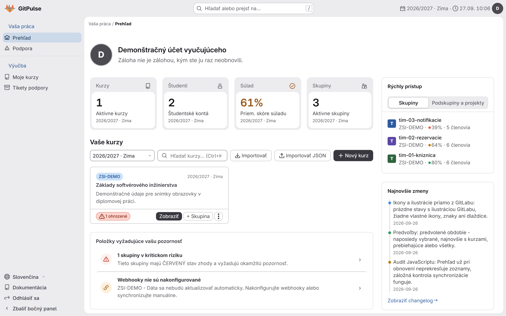
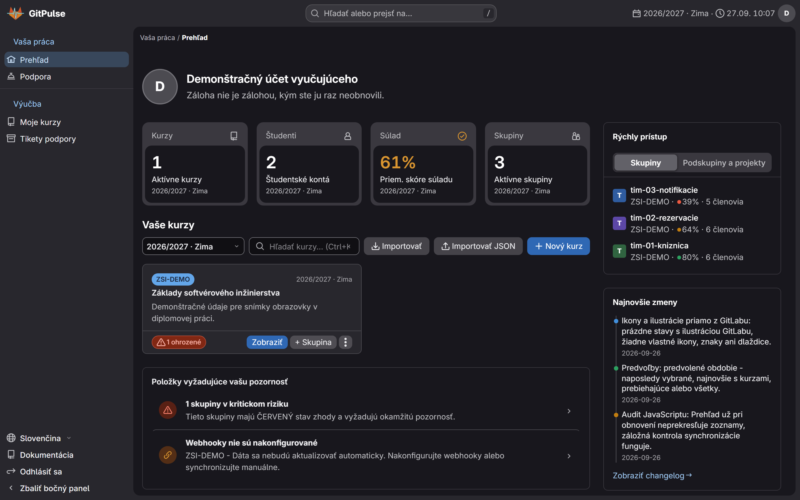
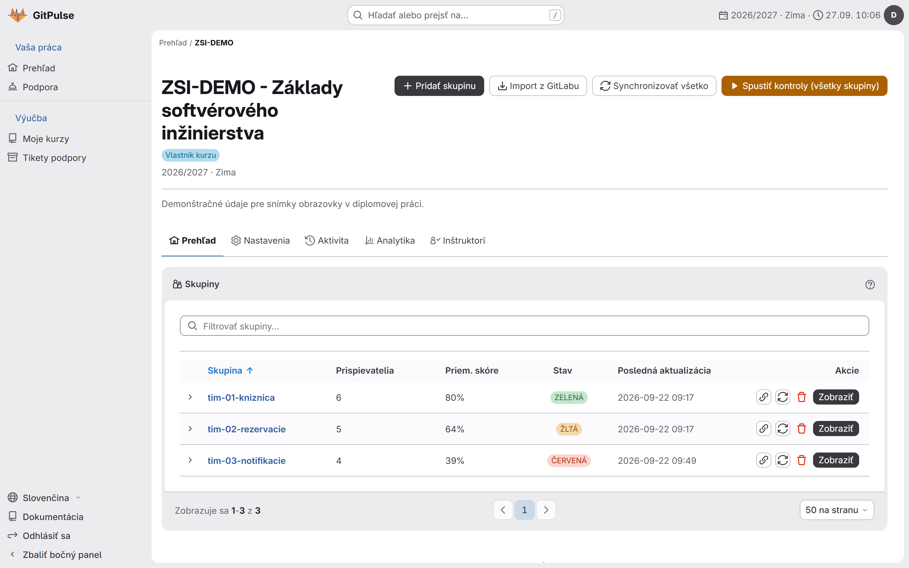
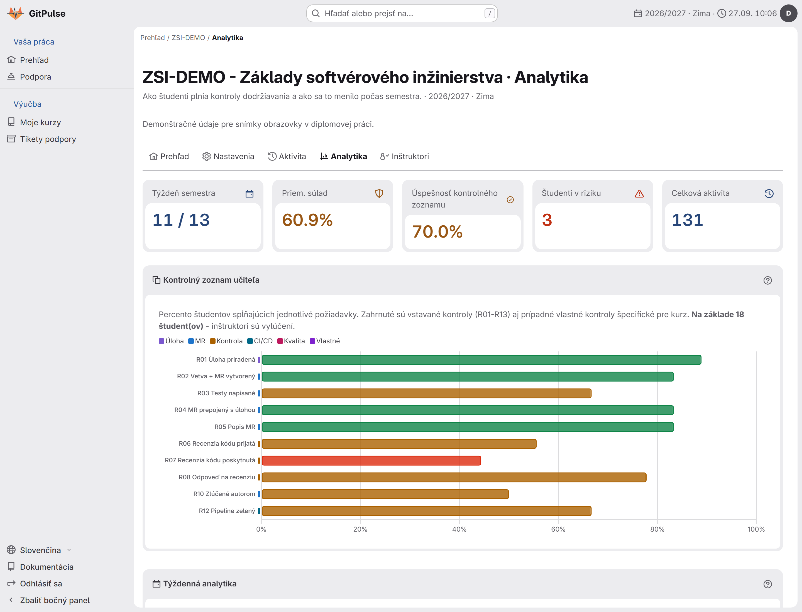
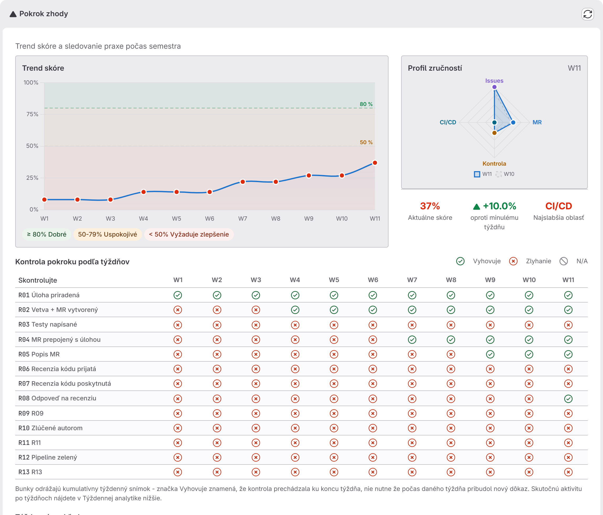
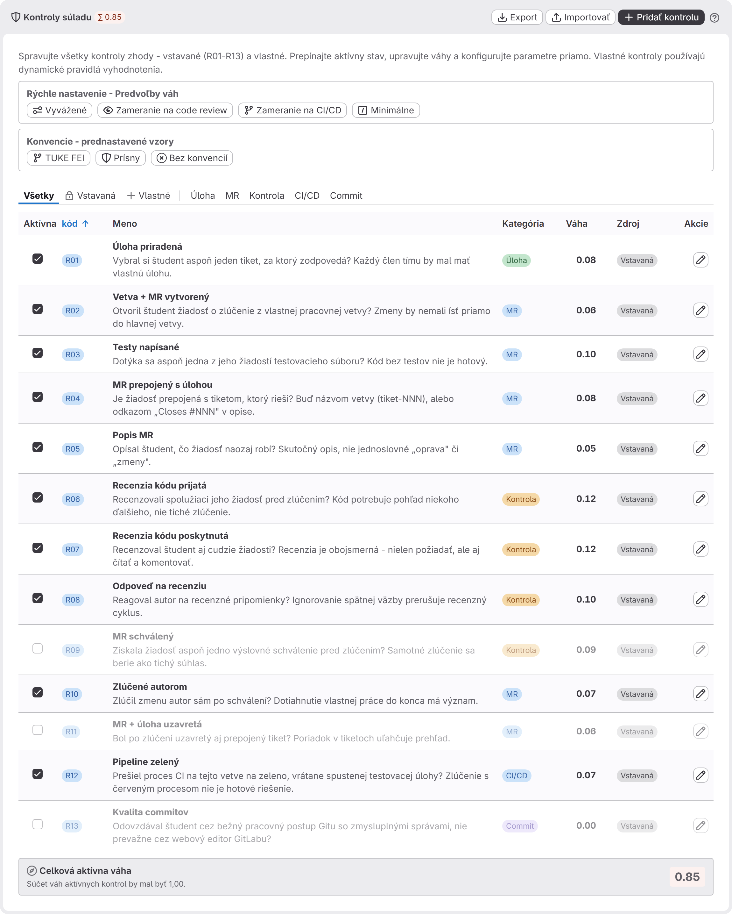
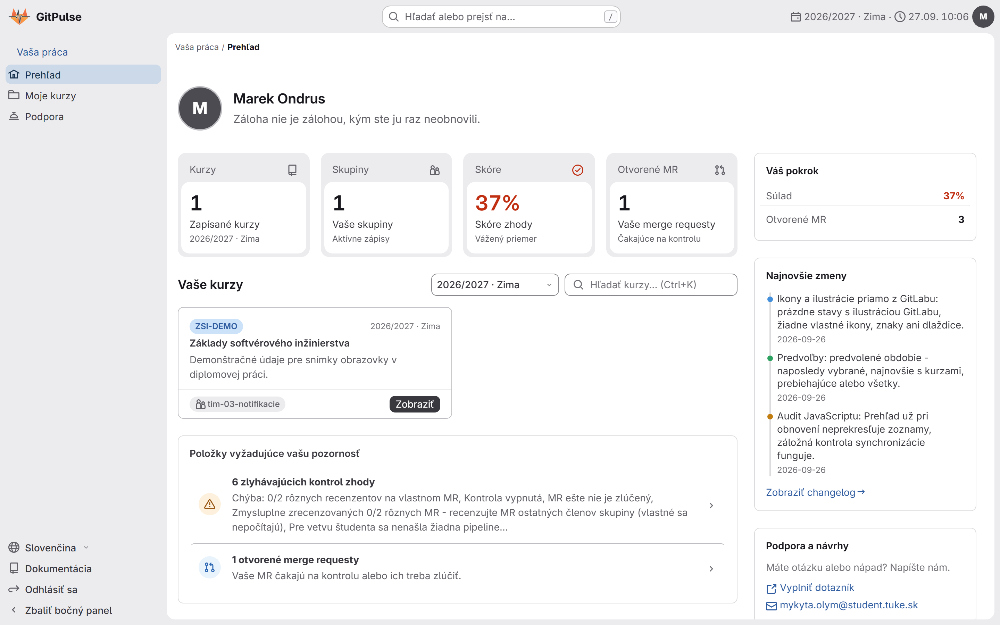
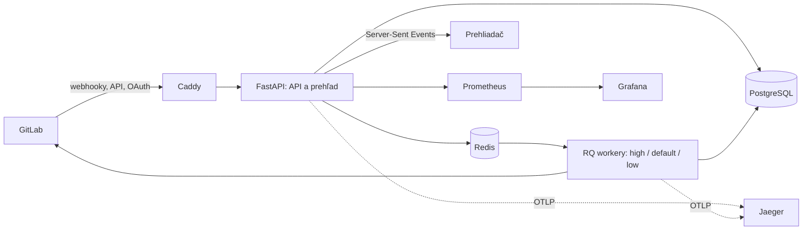

<div align="center">


### Tímová práca a hodnotenie v GitLabe pre univerzitné predmety

GitPulse číta, čo študentské tímy v GitLabe naozaj robia - tikety, vetvy, žiadosti o zlúčenie,
recenzie, pipeline - a skladá z toho jeden živý obraz každej skupiny a každého študenta.

<a href="https://gitlab.example.com/kpi-zp/2027/dp.mykyta.olym/workspace/workspace/-/pipelines"></a>
<a href="https://gitlab.example.com/kpi-zp/2027/dp.mykyta.olym/workspace/workspace/-/pipelines"></a>

**[Otvoriť aplikáciu](https://gitpulse.kpi.fei.tuke.sk/dashboard/)** &nbsp;·&nbsp;
**[Dokumentácia](https://gitpulse.kpi.fei.tuke.sk/docs/)** &nbsp;·&nbsp;
**[Zmeny](CHANGELOG.md)** &nbsp;·&nbsp;
**[English](README.md)**

</div>

<br />

| Svetlá téma | Tmavá téma |
| :---: | :---: |
|  |  |

<div align="center"><sub>Prehľad učiteľa na ukážkovom kurze: dlaždice so štatistikami, kurz, položky vyžadujúce pozornosť a rýchly prístup ku každej skupine.</sub></div>

---

## Čo to je

Predmet vedený v GitLabe zanecháva stopu, ktorú nikto nestíha čítať: kto si zobral tiket,
kto otvoril žiadosť o zlúčenie z vlastnej vetvy, kto koho recenzoval, komu prešla pipeline.
GitPulse túto stopu počúva cez webhooky GitLabu, hodnotí každého študenta trinástimi
kontrolami tímovej práce a výsledok ukazuje v rozhraní, ktoré vyzerá a správa sa ako
samotný GitLab - ikony, ilustrácie, rozloženie aj pohyb sú priamo z jeho dizajnového
systému Pajamas.

<table>
  <tr>
    <th width="33%">Pre učiteľov</th>
    <th width="33%">Pre študentov</th>
    <th width="33%">Pre administrátorov</th>
  </tr>
  <tr>
    <td valign="top">
      <ul>
        <li>súlad každej skupiny na prvý pohľad, ohrozené skupiny navrchu</li>
        <li>história každého študenta: trend skóre, profil zručností a týždenná mapa kontrol</li>
        <li>kontroly s vlastnými váhami, vypnuteľné, aj vlastné pravidlá pre každý kurz</li>
        <li>voliteľná AI analýza žiadostí o zlúčenie, mená autorov sa pred odoslaním skryjú</li>
        <li>export do CSV a JSON, import celého kurzu zo skupiny v GitLabe</li>
        <li>voliteľný asistent cvičení: bot s vlastným tokenom, ktorý kontroluje pushe a merge requesty a na cvičenia pripraví konflikt pri zlučovaní</li>
      </ul>
    </td>
    <td valign="top">
      <ul>
        <li>vlastné skóre a presne, ktoré kontroly neprechádzajú, zrozumiteľne</li>
        <li>otvorené žiadosti o zlúčenie a na čo čakajú</li>
        <li>rovnaký pohľad na vlastnú prácu, aký má učiteľ - žiadne skryté hodnotenie</li>
      </ul>
    </td>
    <td valign="top">
      <ul>
        <li>používatelia, roly, kurzy a akademické obdobia</li>
        <li>sledovanie webhookov a úloh, opätovné prehranie udalostí, stav systému</li>
        <li>metriky pre Prometheus, pripravený prehľad v Grafane a trasovanie v Jaegeri</li>
      </ul>
    </td>
  </tr>
</table>

Stránky kurzu, skupiny, projektu a analytiky sa aktualizujú naživo cez Server-Sent Events,
celé rozhranie je v slovenčine aj angličtine a funguje na telefóne rovnako ako na počítači.

## Krátka prehliadka

<table>
  <tr>
    <td width="50%" valign="top">
      
      <p align="center"><b>Prehľad kurzu</b><br /><sub>Skupiny s priemerným skóre a stavom, podľa ktorého sa kurz hodnotí, na jedno kliknutie od každého projektu.</sub></p>
    </td>
    <td width="50%" valign="top">
      
      <p align="center"><b>Analytika kurzu</b><br /><sub>Koľko študentov spĺňa ktorú kontrolu, týždeň semestra, ohrození študenti a celková aktivita.</sub></p>
    </td>
  </tr>
  <tr>
    <td width="50%" valign="top">
      
      <p align="center"><b>Pokrok študenta</b><br /><sub>Trend skóre voči hraniciam 50 % a 80 %, profil zručností a každá kontrola po týždňoch.</sub></p>
    </td>
    <td width="50%" valign="top">
      
      <p align="center"><b>Kontroly súladu</b><br /><sub>Vstavané aj vlastné kontroly s váhami, predvoľbami a konvenciami - pre každý kurz zvlášť.</sub></p>
    </td>
  </tr>
  <tr>
    <td colspan="2" valign="top">
      
      <p align="center"><b>Vlastný prehľad študenta</b><br /><sub>Čo neprechádza a prečo, ešte otvorené žiadosti o zlúčenie a posledná aktivita.</sub></p>
    </td>
  </tr>
</table>

## Trinásť kontrol

Každý študent sa hodnotí každý týždeň podľa týchto kontrol; kurz im môže zmeniť váhu,
ktorúkoľvek vypnúť alebo pridať vlastnú.

| Kód | Kontrola | Pýta sa | Oblasť |
| :---: | --- | --- | :---: |
| R01 | Úloha priradená | Vybral si študent aspoň jeden tiket, za ktorý zodpovedá? | Issue |
| R02 | Vetva + MR vytvorený | Otvoril žiadosť o zlúčenie z vlastnej pracovnej vetvy, nie priamo do hlavnej? | MR |
| R03 | Testy napísané | Dotýka sa aspoň jedna z jeho žiadostí testovacieho súboru? | MR |
| R04 | MR prepojený s úlohou | Je žiadosť prepojená s tiketom, ktorý rieši - názvom vetvy alebo `Closes #NNN`? | MR |
| R05 | Popis MR | Hovorí žiadosť, čo robí, viac než „oprava" či „zmeny"? | MR |
| R06 | Recenzia kódu prijatá | Recenzoval ju spolužiak pred zlúčením? | Recenzia |
| R07 | Recenzia kódu poskytnutá | Recenzoval študent na oplátku žiadosti spolužiakov? | Recenzia |
| R08 | Odpoveď na recenziu | Reagoval na recenzné pripomienky alebo ich opravil? | Recenzia |
| R09 | MR schválený | Získala žiadosť pred zlúčením výslovné schválenie? | Recenzia |
| R10 | Zlúčené autorom | Zlúčil autor svoju prácu sám po schválení? | MR |
| R11 | MR + úloha uzavretá | Bol po zlúčení uzavretý aj prepojený tiket? | MR |
| R12 | Pipeline zelený | Prešlo CI na vetve na zeleno, vrátane spustenej testovacej úlohy? | CI/CD |
| R13 | Kvalita commitov | Vznikli commity cez bežný postup Gitu so zmysluplnými správami? | Commit |

## Ako to funguje



GitPulse stojí na webhookoch: **nemá opakovaný plánovač a GitLab sa nikdy nepolluje**.
Webhook sa uloží, spracuje, metriky dotknutého tímu sa prepočítajú, cache sa zneplatní
a každá otvorená stránka sa to dozvie cez SSE. Každú úlohu na pozadí spustí prichádzajúca
udalosť, výslovná synchronizácia alebo - s obmedzením - zobrazenie prehľadu.

| Vrstva | Komponenty |
| --- | --- |
| Okraj | Caddy - automatické TLS, zstd a gzip, bezpečnostné hlavičky |
| Aplikácia | FastAPI - `/api/v1` (REST), `/dashboard` (rozhranie vykresľované na serveri), SSE prúdy; 195 ciest |
| Práca na pozadí | RQ workery na frontoch `high`, `default` a `low`, `with_scheduler=False` |
| Dáta | PostgreSQL 16 (37 ORM modelových tried, 27 migračných súborov, head `027_drop_usage_telemetry`), Redis 7 (cache, pub/sub, limity) |
| Pozorovateľnosť (voliteľný profil) | Prometheus, Grafana (18 panelov v 5 riadkoch, 18 alert pravidiel), Jaeger |

<details>
<summary><b>Úlohy na pozadí</b></summary>

| Úloha (`app.workers.*`) | Spúšťač | Front | Účel |
| --- | --- | --- | --- |
| `event_processor.process_event` | každá uložená udalosť webhooku | high | Rozdelí udalosti žiadostí, tiketov, poznámok, pipeline, pushu a členov |
| `metrics_job.compute_metrics` | keď udalosť zmení dáta tímu | default | Prepočíta metriky súladu tímu |
| `enrich_mr` / `enrich_issue` | udalosti žiadostí / tiketov | default | Stiahne diffy, poznámky a ďalší kontext z GitLabu |
| `sweep.refresh_project_gitlab_intel` | webhook | default | Obnoví uložený snímok projektu z GitLabu |
| `sweep.sync_single_team_members` | push / udalosť členstva | default | Synchronizuje zoznam členov tímu |
| `sweep.compliance_snapshot_for_team` | po synchronizácii tímu | low | Zaznamená týždenný snímok súladu |
| `llm_job.analyze_single_mr` | akcia učiteľa / zapnutá automatická analýza | low | Analyzuje žiadosť o zlúčenie nastaveným LLM |
| `sweep_auto_archive.run_auto_archive_sweep` | zobrazenie prehľadu, najviac asi raz za hodinu | low | Archivuje kurzy po skončení ich obdobia |

Opakované pokusy používajú `Retry` z RQ s exponenciálnym odstupom.

</details>

<details>
<summary><b>Bezpečnostný model</b></summary>

1. Prihlásenie do prehľadu cez GitLab OAuth; podpísaná cookie `gitpulse_session` (30 dní nečinnosti, 90 dní najviac).
2. REST API: `Authorization: Bearer <TEACHER_API_TOKEN>` alebo platná relácia prehľadu.
3. Webhooky: token `X-Gitlab-Token` pre každý projekt, uložený ako hash a porovnávaný v konštantnom čase.
4. CSRF: token double-submit pri každej meniacej požiadavke s cookie relácie.
5. Middleware: CSP, HSTS, `X-Frame-Options`, dôveryhodné hostiteľské mená, korelačné ID, logovanie požiadaviek.
6. Limity rýchlosti webhookov pre každý projekt aj globálne.
7. Uložené tokeny GitLabu šifrované cez Fernet.
8. Súkromné stránky a API nesú `X-Robots-Tag: noindex`; `/robots.txt`, `/sitemap.xml` a `/llms.txt` sa generujú.

</details>

## Rýchly štart

**1. Nastavenie** - skopírujte ukážkové prostredie a doplňte povinné hodnoty:

```bash
cp .env.example .env
```

`DATABASE_URL`, `POSTGRES_PASSWORD`, `SECRET_KEY`, `TEACHER_API_TOKEN`,
`GITLAB_OAUTH_CLIENT_ID`, `GITLAB_OAUTH_CLIENT_SECRET`, `GITLAB_API_TOKEN`.

**2. Migrácie a spustenie**

```bash
docker compose --profile migrate run --rm migrate
docker compose up -d
```

**3. Kontrola**

```bash
curl http://localhost:8000/health/ready
```

Potom otvorte `http://localhost/dashboard/`.

<details>
<summary><b>Monitorovanie</b></summary>

```bash
docker compose --profile monitoring up -d
```

| Služba | URL | Čo ukazuje |
| --- | --- | --- |
| Grafana | `http://localhost:3000` | Pripravený prehľad `gitpulse.json`: stav, webhooky, fronty, HTTP, pool databázy, GitLab API, obohacovanie |
| Prometheus | `http://localhost:9090` | Metriky každých 15 s, uchované 30 dní, 18 alert pravidiel v `monitoring/prometheus/alerts.yml` |
| Jaeger | `http://localhost:16686` | Distribuované trasovanie cez OTLP gRPC |

Upozornenia, na ktorých v bežnej prevádzke záleží najviac:

| Upozornenie | Spustí sa, keď | Závažnosť |
| --- | --- | --- |
| `WorkerDown` | 2 min nebeží žiadny RQ worker | critical |
| `ApiDown` | cieľ API je 1 min nedostupný | critical |
| `HighFailureRate` | chyby webhookov nad 0,1/s počas 3 min | critical |
| `QueueStuck` | front hlbší ako 50 počas 5 min | warning |
| `HighProcessingLatency` | p95 nad 10 s počas 5 min | warning |
| `DBPoolExhausted` | pool nad 90 % počas 3 min | warning |
| `HighHTTPErrorRate` | 5xx nad 5 % počas 5 min | warning |

</details>

## Brány kvality

Každý commit musí lokálne prejsť tými istými šiestimi bránami, ktoré spúšťa CI:

```bash
ruff check src/ tests/ scripts/
ruff format --check src/ tests/ scripts/
python scripts/build_bundle.py --check      # vygenerované JS/CSS balíky sú aktuálne
python scripts/check_static_artifacts.py
mypy src/app/                                # striktne
python scripts/run_unit_tests.py            # 4 155 jednotkových testov
```

Pipeline (`.gitlab-ci.yml`) spúšťa lint, bezpečnostnú fázu, jednotkové testy s pokrytím
a 64 integračných testov nad skutočným PostgreSQL a Redisom, potom zostavenie obrazu
a vydanie.

## Mapa repozitára

| Cesta | Čo tam je |
| --- | --- |
| `src/app/api` | REST API, rozhranie vykresľované na serveri a SSE prúdy |
| `src/app/compliance` | Nástroj súladu, register kontrol a vlastné pravidlá |
| `src/app/services` | Klient GitLabu, analýza LLM, akademické obdobia, telemetria |
| `src/app/workers` | Úlohy RQ, spracovanie udalostí a prehľadávania riadené udalosťami |
| `src/app/models` | Modely SQLAlchemy (37 ORM modelových tried) |
| `src/app/security` | OAuth, relácie, bearer tokeny, CSRF, limity, šifrovanie |
| `src/app/observability` | Logovanie, metriky Prometheus, trasovanie OpenTelemetry |
| `src/app/i18n` | Slovenský katalóg (3 489 reťazcov); zdrojovým jazykom je angličtina |
| `src/app/templates` | Stránky Jinja2, makrá komponentov a statické súbory |
| `alembic/versions` | Migrácie databázy (26 migračných súborov) |
| `monitoring` | Pravidlá Promethea, prehľad Grafany a jeho zriadenie |
| `docs` | Inžinierske dokumenty - architektúra, API, bezpečnosť, riadenie prístupu |
| `docs-site` | Zverejnená slovenská a anglická dokumentácia |
| `scripts` | Zostavenie balíkov, ukážkové dáta, admin CLI, bezpečnostný sken, záťažové testy |

## Dokumentácia

| Dokument | Obsah |
| --- | --- |
| [Stránka dokumentácie](https://gitpulse.kpi.fei.tuke.sk/docs/) | Príručka pre používateľov a administrátorov, po slovensky aj anglicky |
| [`docs/02-architecture.md`](docs/02-architecture.md) | Architektúra do hĺbky |
| [`docs/04-api-spec.md`](docs/04-api-spec.md) | Všetky cesty API |
| [`docs/12_security.md`](docs/12_security.md) | Bezpečnostná architektúra |
| [`docs/13_observability.md`](docs/13_observability.md) | Metriky, logy a trasovanie |
| [`docs/17_quality_gates.md`](docs/17_quality_gates.md) | Brány kvality CI/CD |
| [`docs/21_access_control.md`](docs/21_access_control.md) | Roly a riadenie prístupu |
| [`CHANGELOG.md`](CHANGELOG.md) | Každé vydanie |

---

<div align="center">

GitPulse je praktická časť diplomovej práce na Katedre počítačov a informatiky,
Fakulte elektrotechniky a informatiky Technickej univerzity v Košiciach.

<sub>Mykyta Olym &nbsp;·&nbsp; vydané pod [licenciou MIT](LICENSE) &nbsp;·&nbsp; ikony a ilustrácie z dizajnového systému GitLabu Pajamas (MIT)</sub>

</div>
