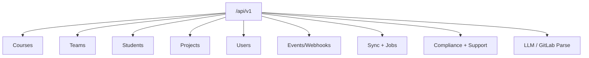


- For: Developer
- Requires: An API token

> Verified against implementation on **2026-09-09**.

## Contract source of truth

1. `src/app/api/*`
2. `src/app/schemas/*`
3. runtime `GET /openapi.json` (development/debug mode)
4. shared error contracts in `src/app/api/contracts.py`

## Important clarification

GitPulse does not use a JWT login endpoint such as `/api/v1/auth/login`.

Authentication uses three modes:

1. Dashboard: GitLab OAuth + session cookie.
2. API: static bearer token (`TEACHER_API_TOKEN`) or dashboard session.
3. Webhook endpoint: `X-Gitlab-Token`.

## Base prefixes

| Area | Prefix | Notes |
|---|---|---|
| REST API | `/api/v1` | CRUD, sync, compliance history, support, jobs |
| Dashboard | `/dashboard` | server-rendered UI + JSON endpoints |
| Ops | `/health`, `/metrics` | health checks and Prometheus scrape |

## Health, ops, and public metadata endpoints

- `GET /health`
- `GET /health/live`
- `GET /health/ready`
- `GET /metrics`
- `GET /robots.txt` - Dynamic search engine indexing rules
- `GET /sitemap.xml` - XML sitemap listing public-facing pages with hreflang alternates
- `GET /llms.txt` - Developer-focused prompt configuration declaring private boundaries
- `GET /google32f411f09f436ae2.html` - Google Search Console ownership verification token
- `GET /privacy` - GDPR Privacy Policy redirect to documentation site
- `GET /terms` - Terms of Service redirect to documentation site

Example:

```bash
curl http://localhost:8000/health
curl http://localhost:8000/robots.txt
curl http://localhost:8000/sitemap.xml
curl http://localhost:8000/llms.txt
curl http://localhost:8000/metrics
```

## API authentication examples

### Bearer token

```bash
curl http://localhost:8000/api/v1/courses/ \
  -H "Authorization: Bearer ${TEACHER_API_TOKEN}"
```

### Webhook endpoint

```bash
curl -X POST http://localhost:8000/api/v1/webhooks/gitlab \
  -H "X-Gitlab-Token: ${WEBHOOK_SECRET}" \
  -H "Content-Type: application/json" \
  -d '{"object_kind":"push"}'
```

## Endpoint inventory (grouped)

Current scan: **206 route handlers** (189 under `/api/v1` and `/dashboard`,
plus 17 operational/public handlers).

### Core API

- Courses: `/api/v1/courses/*`
- Teams: `/api/v1/teams/*`
- Students: `/api/v1/students/*`
- Projects: `/api/v1/projects/*`
- Users: `/api/v1/users/*`

### Event pipeline

- Webhook ingest: `POST /api/v1/webhooks/gitlab`
- DLQ/replay: `/api/v1/events/*`

### Sync and jobs

- Sync: `/api/v1/teams/{team_id}/sync`, `/api/v1/courses/{course_id}/sync-all`
- Recheck: `/api/v1/teams/{team_id}/run-checks` - immediate metric recomputation (force all checks)
- Job status/SSE: `/api/v1/jobs/{job_id}`, `/api/v1/jobs/{job_id}/stream`

### Extensions

- LLM: `/api/v1/llm/mr/{project_id}/{mr_iid}`
- GitLab parse: `/api/v1/gitlab/parse-url`

### Compliance, support and service status

- `/api/v1/compliance/*`, `/api/v1/support/*`, `/api/v1/observability/status`

## Dashboard routes

`/dashboard/*` includes:

- login/logout/OAuth callback
- dashboards for courses, teams, students, projects
- admin sections (users, courses, system, events)

## Mermaid API domain map



## OpenAPI export

```bash
curl http://localhost:8000/openapi.json > openapi.json
```

Note: `openapi.json`, `/docs`, and `/redoc` are available in development/debug mode.

## Related docs

- [Architecture](../uvod/architektura.md)
- [GitLab webhooks](../gitlab/webhooky.md)
- [Monitoring](../operatori/monitoring.md)
- Detailed route inventory: `docs/04-api-spec.md`
