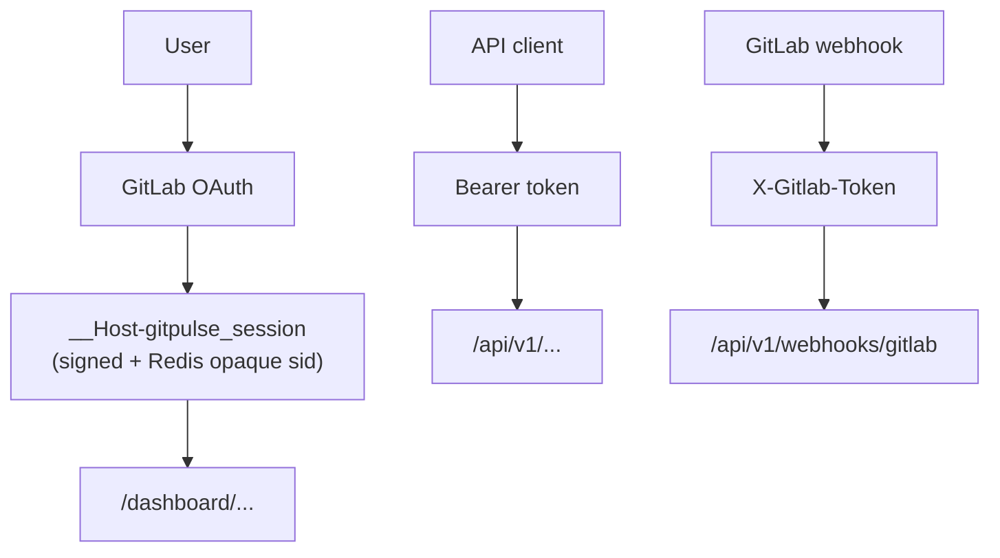


- For: Operator
- Requires: Access to the deployment settings

> Verified against `src/app/security/*`, `src/app/dependencies.py`, and middleware layers on **2026-09-09**.

## Security pillars

1. Multi-layer authentication (OAuth, Bearer, webhook secret)
2. RBAC authorization (admin, teacher, student)
3. Web-layer protection (CSRF, security headers, `__Host-` cookie prefix)
4. Auditability (request logging, correlation ID, telemetry)

## Authentication and authorization

| Layer | Mechanism | Usage |
|---|---|---|
| Dashboard | GitLab OAuth + signed session cookie (`__Host-` prefix) + Redis opaque session ID | UI routes `/dashboard/*` |
| API | `Authorization: Bearer <TEACHER_API_TOKEN>` or session | `/api/v1/*` |
| Webhooks | `X-Gitlab-Token` (per-project secret) | `/api/v1/webhooks/gitlab` |
| RBAC | `admin`, `teacher`, `student` | role-based access |

## Key protections

- `__Host-` cookie prefix (browser-enforced: Secure + Path=/ + no Domain)
- Opaque session ID in the cookie + server-side session blob in Redis (server-side revocation)
- 30-day sliding TTL + **absolute 90-day ceiling** (AUTH-06) - bounds the blast radius of a stolen cookie regardless of how often the sliding TTL refreshes
- Service Worker bypass for `/dashboard` navigations and `no-store` / `private` responses
- User-Agent fingerprint binding as _opt-in_ defence-in-depth (`SESSION_STRICT_UA_FINGERPRINT`, default `false` - the UA hash isn't stable across mobile<->desktop switches and browser auto-updates)
- CSRF tokens for state-changing form operations (HMAC-SHA256)
- `FEATURE_RBAC=false` hard-fails at startup in production (AUTH-04 - no fail-open RBAC)
- Rate-limit fails closed in production (AUTH-05 - when Redis is unavailable we return `HTTP 503` instead of allowing the request)
- Redis requires a password in production (SEC-03/04 - the validator refuses to start if `REDIS_URL` lacks a password segment)
- Security headers middleware
- Constant-time comparison for sensitive tokens
- Trusted-host enforcement (optional with `ALLOWED_HOSTS`)
- Rate limiting for webhook and API operations

## Documents in this section

- [Security model](model.md)
- [Threat model](hrozby.md)
- [Hardening](hardening.md)
