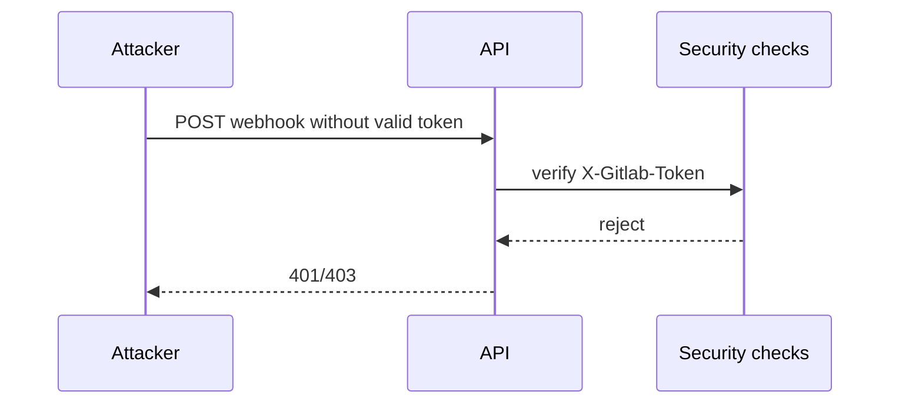


- For: Operator
- Requires: Access to the deployment settings

## STRIDE overview

| Category | Risk | Mitigation |
|---|---|---|
| Spoofing | forged webhook | `X-Gitlab-Token` + bcrypt verification |
| Tampering | manipulated session/tokens | signed cookies, constant-time comparisons |
| Repudiation | insufficient auditability | structured logs + correlation IDs |
| Information disclosure | sensitive data leak | security headers, limited endpoint exposure |
| DoS | webhook/API flooding | rate limiting + queue backpressure controls |
| Elevation of privilege | unauthorized admin access | RBAC dependency checks |

## Critical flows

## Risks to monitor

1. repeated 401/403 attempts on sensitive endpoints
2. sudden rise in `rq_queue_depth`
3. elevated `5xx` and webhook processing error rates
4. long-running worker failure alerts

## Minimum incident response

1. identify impacted endpoints and time window
2. correlate metrics + logs + traces via `correlation_id`
3. if credentials leak is suspected, rotate tokens immediately
4. restore service and document postmortem
