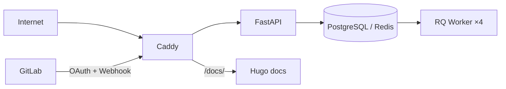


- For: Operator
- Requires: Access to the deployment settings

## Trust boundaries

Boundary levels:

1. Public zone: internet and external GitLab.
2. Edge zone: reverse proxy and TLS termination.
3. App zone: API, dashboard, workers, docs.
4. Data zone: DB and queue backend.

## Assets

| Asset | Example |
|---|---|
| Credentials | OAuth tokens, session cookie, API token |
| Operational data | webhook payloads, metrics, reports |
| Configuration | `.env`, feature flags, role mapping |
| Audit trail | logs, correlation IDs, telemetry events |

## Protection mechanisms

- Signed session cookie (`itsdangerous`) + 30-day sliding TTL + **90-day absolute lifetime ceiling** (AUTH-06: bounds the blast radius of a stolen cookie regardless of how often the sliding TTL refreshes)
- Opaque session ID in the cookie + server-side session blob in Redis (enables server-side revocation and sweep)
- `__Host-` cookie prefix for HTTPS (browser-enforced: Secure + Path=/ + no Domain)
- User-Agent fingerprint binding (`ua` claim) as **opt-in** defence-in-depth - default `false`, because the UA hash isn't stable across mobile<->desktop switches and browser auto-updates
- `BUILD_HASH` binding (`av` claim) - sessions are invalidated after redeploy
- boot nonce (`bn` claim) - sessions are invalidated after server restart
- constant-time bearer token check (`hmac.compare_digest`)
- bcrypt webhook secret verification
- CSRF protection for forms (HMAC-SHA256)
- security headers middleware (CSP, HSTS, X-App-Version, X-Frame-Options)
- Fernet encryption of GitLab OAuth tokens at rest (AES-128-CBC + HMAC-SHA256)
- RBAC enforcement through dependency layer
- `Clear-Site-Data` header on logout (clears browser cache + storage)
- Service Worker bypass for `/dashboard` navigations and `no-store` / `private`
  responses, so authenticated HTML is not retained in the browser Cache API

## Role model

| Role | Access |
|---|---|
| `admin` | full access including admin routes |
| `teacher` | evaluation, dashboard, most API operations |
| `student` | restricted read-oriented access by policy |

## Session model

Session cookie stores user identity and role; it is signed and time-bounded.
With `PERSISTENT_SESSIONS=false`, boot nonce invalidates old sessions after restart.

### Cookie attributes

| Attribute | Value |
|---|---|
| Name | `__Host-gitpulse_session` (HTTPS) / `gitpulse_session` (HTTP) |
| HttpOnly | `true` |
| Secure | `true` (HTTPS) |
| SameSite | `Lax` |
| Max-Age | sliding 2 592 000 s (30 d) + absolute ceiling 7 776 000 s (90 d) |

### Payload claims

| Claim | Purpose |
|---|---|
| `user` | GitLab username |
| `role` | `admin` / `teacher` / `student` |
| `bn` | Boot nonce - invalidates sessions after server restart |
| `av` | `BUILD_HASH` - invalidates sessions after redeploy |
| `ua` | SHA-256(User-Agent)[:16] - detects cookie theft across browsers |
| `ts` | ISO 8601 creation timestamp |

### Invalidation layers

1. **Sliding TTL** - `itsdangerous` rejects cookies that have been idle for more than 30 days (the TTL is bumped on each request)
2. **Absolute ceiling** (AUTH-06) - a cookie whose `created_at` is older than 90 days is rejected regardless of how often the sliding TTL was refreshed
3. **Boot nonce** - new nonce generated on every server restart (when `PERSISTENT_SESSIONS=false`)
4. **Build hash** - new hash on every deploy
5. **UA fingerprint** - when `SESSION_STRICT_UA_FINGERPRINT=true` (opt-in), a cookie presented from a different browser is rejected
6. **HMAC signature** - tampered cookies are rejected
