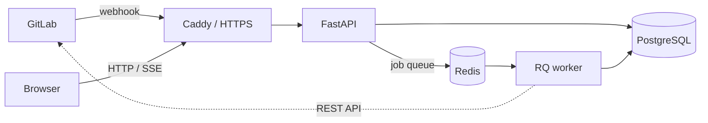


- For: Thesis reader
- Requires: Nothing

The main user is the teacher. At the start of the term they import the course from
a GitLab group; during the term they look for the group that needs attention and
move from there to a student and to the original object in GitLab. A student signs
in with a GitLab account and sees only data about their own work, read-only.

## 5.1 Architecture

The webhook receiver checks the project and the secret token, stores the body,
computes the event key and queues its identifier with high priority. A duplicate
delivery creates no second record. The worker processes the event, enriches it
through the REST API, recomputes the group's checks and notifies open pages over
SSE. There are three queues (high, default and low priority) and no periodic
scheduler.

## 5.2 Data model

A course holds the check settings, thresholds and memberships. A group belongs to
one course and may have several projects. The import merges members by their GitLab
identifier and marks inherited membership so it stays out of scoring. Objects keep
their GitLab identifier, so repeated enrichment creates no duplicates.

## 5.3 Check scoring

Each check returns an identifier, a state, an explanation, a weight and a partial
score. A student's score is the sum of the partial scores of the enabled checks
divided by their total weight, so a switched-off check neither distorts the score
nor shows to the student as failed. R09, R11 and R13 are off by default. The traffic
light defaults to 80 and 50 percent and orders the teacher's attention; it is not a
grade. A course can set from which week a check applies and add custom checks. The
optional language model analysis is disabled in production and does not feed
R01 to R13.

## 5.4 Classroom assistant

The assistant works in GitLab under the course's own bot account and has three
tools: a review of pushed commits, a prepared merge conflict, and an exercise with
issues and merge requests. The exercise is a finite state machine over the events
GitPulse already receives. Its rules are fixed, without a language model. The
assistant never uses the sync token, by default only approves a merge request and
leaves the merge to the student, because R10 does not count a merge by a bot, and
R08 does not count bot comments as threads. See the [assistant guide](../../ucitelia/asistent/).

## 5.5 Security

Sign-in uses GitLab OAuth and permissions are checked on the server against the
specific course. A webhook secret has a scope (course, group or list of projects),
only its hash is stored and after rotation the previous value is still accepted for
24 hours. The enrichment token only needs read access; the assistant token belongs
to one course and is stored encrypted.
