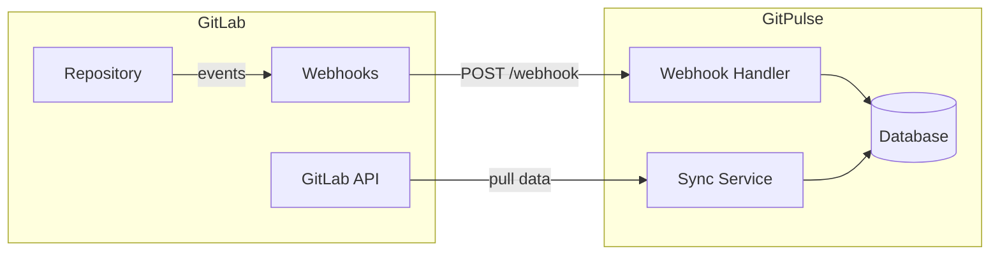
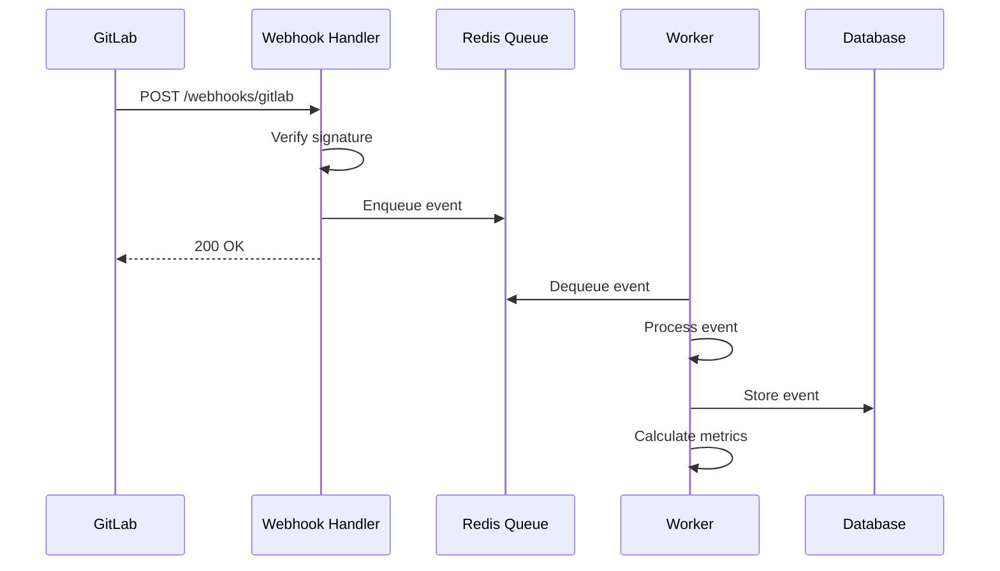


- For: Teacher, Operator
- Requires: A GitLab personal access token

This section describes the integration of GitPulse with GitLab.

## Integration overview



## Supported features

| Function | Description | Status |
|---------|-------|------|
| **Commits** | Tracking commit history | Yes |
| **Merge Requests** | MR creation, review, merge | Yes |
| **Issues** | Creating and closing issues | Yes |
| **Pipelines** | CI/CD pipeline status | Yes |
| **Comments** | Discussions on MR and issues | Yes |
| **Branches** | Branch creation/deletion | Yes |
| **Tags** | Release tags | Yes |

## What you will find in this section

  - [Tokens](./tokeny/) - Configuring GitLab access tokens
  - [Webhooks](./webhooky/) - Setting up real-time notifications
  - [CI/CD Pipeline](./cicd/) - Integration with GitLab CI

## Quick start

### 1. Token creation

1. Go to GitLab -> Settings -> Access Tokens
2. Create a token with permissions:
   - `api` - Full API access
   - `read_repository` - Read repository
3. Store the token in `.env`:

```bash
GITLAB_URL=https://gitlab.example.com
GITLAB_TOKEN=glpat_placeholder_token
```

### 2. Webhook configuration

1. In the GitLab project: Settings -> Webhooks
2. URL: `https://gitpulse.kpi.fei.tuke.sk/api/v1/webhooks/gitlab`
3. Secret Token: Generate and save to `.env`
4. Trigger events: Push, Issues, Merge requests, Comments (Notes), Pipeline

### 3. Connection test

```bash
# Test API connection
curl -H "Private-Token: ${GITLAB_TOKEN}" \
  "${GITLAB_URL}/api/v4/user"

# Webhook delivery endpoint (requires the X-Gitlab-Token header)
# Send a test delivery from GitLab itself:
#   Settings -> Webhooks -> Test -> Push events
curl -sS -o /dev/null -w '%{http_code}
' http://localhost:8000/health
```

## Architecture



## Supported event types

### Push Events

```json
{
  "object_kind": "push",
  "event_name": "push",
  "ref": "refs/heads/main",
  "commits": [
    {
      "id": "abc123...",
      "message": "feat: add new feature",
      "author": {
        "name": "John Doe",
        "email": "john@example.com"
      },
      "added": ["file1.py"],
      "modified": ["file2.py"],
      "removed": []
    }
  ]
}
```

### Merge Request Events

```json
{
  "object_kind": "merge_request",
  "event_type": "merge_request",
  "object_attributes": {
    "iid": 1,
    "title": "Feature: Add login",
    "state": "merged",
    "source_branch": "feature/login",
    "target_branch": "main",
    "author_id": 123
  }
}
```

### Pipeline Events

```json
{
  "object_kind": "pipeline",
  "object_attributes": {
    "id": 456,
    "status": "success",
    "duration": 120,
    "stages": ["build", "test", "deploy"]
  }
}
```

## Limits and rate limiting

| Resource | Limit | Note |
|----------|-------|----------|
| API requests | 600/min | Per token |
| Webhook payload | 25 MB | Max payload size |
| Concurrent webhooks | 10 | Per project |

## Security

- All tokens are stored encrypted
- Webhook signature verification
- IP whitelist for webhook endpoints (recommended)
- Audit logs of all API calls

## Next steps

1. [Token Configuration](tokeny.md)
2. [Setting Webhooks](webhooky.md)
3. [GitLab CI integration](cicd.md)

