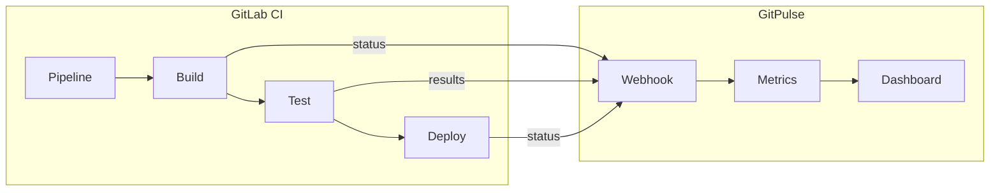
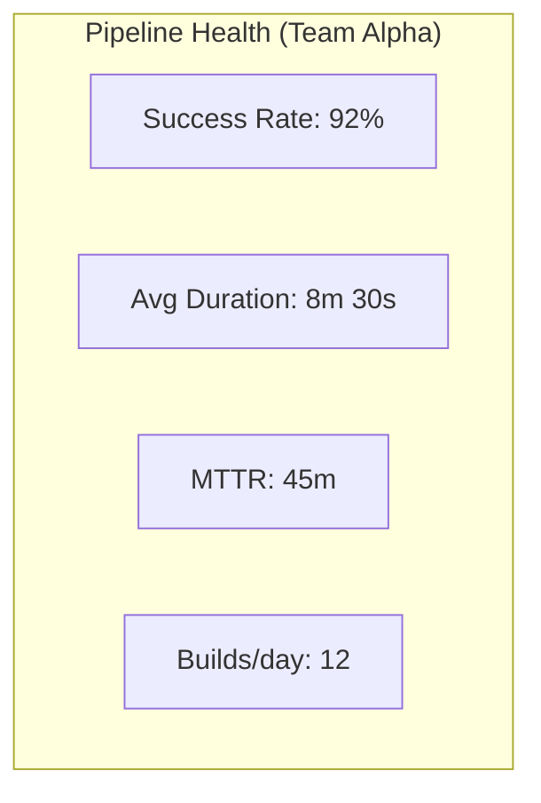


- For: Teacher, Operator
- Requires: A GitLab personal access token

A guide to integrating GitPulse with GitLab CI/CD pipelines.

## Overview



## Pipeline metrics

GitPulse tracks the following CI/CD metrics:

| Metric | Description | Calculation |
|---------|-------|---------|
| Pipeline Success Rate | % of successful pipelines | `success / total` |
| Mean Time to Recovery | Time to fix crash | Average time between failure and success |
| Pipeline Duration | Pipeline duration | Time from start to finish |
| Build Frequency | Number of builds per day | Count per day |
| Test Coverage Trend | Development of test coverage | Coverage from JUnit reports |

## GitLab CI configuration

### Basic .gitlab-ci.yml

```yaml
# .gitlab-ci.yml
stages:
  - build
  - test
  - analyze
  - deploy

variables:
  DOCKER_DRIVER: overlay2

# === BUILD ===
build:
  stage: build
  image: docker:24
  services:
    - docker:24-dind
  script:
    - docker build -t $CI_REGISTRY_IMAGE:$CI_COMMIT_SHA .
    - docker push $CI_REGISTRY_IMAGE:$CI_COMMIT_SHA
  only:
    - main
    - merge_requests

# === TEST ===
test:
  stage: test
  image: python:3.12-slim
  script:
    - pip install --constraint requirements.lock -e ".[dev,otel]"
    - pytest --junitxml=report.xml --cov=app --cov-report=xml
  coverage: '/TOTAL.*\s+(\d+%)$/'
  artifacts:
    reports:
      junit: report.xml
      coverage_report:
        coverage_format: cobertura
        path: coverage.xml

# === ANALYZE ===
lint:
  stage: analyze
  image: python:3.12-slim
  script:
    - pip install ruff
    - ruff check . --output-format=gitlab > ruff-report.json
  artifacts:
    reports:
      codequality: ruff-report.json

security-scan:
  stage: analyze
  image: python:3.12-slim
  script:
    - pip install bandit pip-audit
    - bandit -r src -f json -o bandit-report.json || true
    - pip-audit --format json --output pip-audit-report.json || true
  artifacts:
    paths:
      - bandit-report.json
      - pip-audit-report.json

# === DEPLOY ===
deploy:staging:
  stage: deploy
  environment:
    name: staging
    url: https://staging.gitpulse.kpi.fei.tuke.sk
  script:
    - echo "Deploying to staging..."
  only:
    - main
```

### How a pipeline reaches GitPulse

**You add nothing to `.gitlab-ci.yml` for GitPulse's sake.** There is no
"report a pipeline" endpoint - status, duration and coverage all arrive via
GitLab's **Pipeline webhook** (and via the GitLab API during a sync). Just have
the webhook set up as described in [Webhooks](webhooky.md).

For coverage to be filled in, keep a `coverage:` regex on the job - GitPulse
reads the value GitLab computes.

## Pipeline Events

### Webhook payload

GitLab sends pipeline events automatically:

```json
{
  "object_kind": "pipeline",
  "object_attributes": {
    "id": 12345,
    "iid": 42,
    "ref": "main",
    "sha": "abc123def456...",
    "status": "success",
    "detailed_status": "passed",
    "stages": ["build", "test", "deploy"],
    "created_at": "2026-01-15T10:00:00Z",
    "finished_at": "2026-01-15T10:15:30Z",
    "duration": 930,
    "queued_duration": 10
  },
  "builds": [
    {
      "id": 100,
      "stage": "build",
      "name": "build",
      "status": "success",
      "duration": 120,
      "runner": {
        "description": "shared-runner-1"
      }
    },
    {
      "id": 101,
      "stage": "test",
      "name": "test",
      "status": "success",
      "duration": 300,
      "coverage": 85.5
    }
  ],
  "project": {
    "id": 123,
    "path_with_namespace": "kpi/tp-2026/team-alpha"
  }
}
```

### GitPulse processing

```python
# src/app/services/pipeline_service.py
from dataclasses import dataclass
from datetime import datetime

@dataclass
class PipelineMetrics:
    success_rate: float
    avg_duration: float
    mttr: float  # Mean Time To Recovery

class PipelineService:
    async def process_pipeline_event(self, event: dict) -> None:
        """Process GitLab pipeline webhook."""
        attrs = event["object_attributes"]
        
        # Store pipeline record
        pipeline = await self.repository.create({
            "gitlab_id": attrs["id"],
            "project_id": event["project"]["id"],
            "status": attrs["status"],
            "duration": attrs["duration"],
            "started_at": attrs["created_at"],
            "finished_at": attrs["finished_at"],
            "stages": attrs["stages"],
        })
        
        # Store build records
        for build in event.get("builds", []):
            await self.build_repository.create({
                "pipeline_id": pipeline.id,
                "stage": build["stage"],
                "name": build["name"],
                "status": build["status"],
                "duration": build.get("duration"),
                "coverage": build.get("coverage"),
            })
        
        # Update metrics
        await self.update_team_metrics(pipeline)
```

## Dashboard display

### Pipeline health widget



### Trend graph

```python
# API endpoint for pipeline trends
@router.get("/teams/{team_id}/pipelines/trends")
async def get_pipeline_trends(
    team_id: int,
    days: int = 30,
    db: AsyncSession = Depends(get_db)
):
    """Get pipeline metrics trends."""
    service = PipelineService(db)
    
    return {
        "success_rate": await service.get_success_rate_trend(team_id, days),
        "duration": await service.get_duration_trend(team_id, days),
        "frequency": await service.get_build_frequency(team_id, days),
    }
```

## CI/CD Best Practices for Students

### Assessed aspects

GitPulse evaluates the following CI/CD practices:

| Aspect | Point rating |
|--------|-------------------|
| Pipeline exists | Yes Basic |
| Automated tests | Yes Basic |
| Code quality checks | Yes Recommended |
| Security scanning | Bonus |
| Coverage > 60% | Bonus |
| Multi-stage pipeline | Bonus |

### Example sample pipeline

```yaml
# Ideal student pipeline
stages:
  - validate
  - build
  - test
  - quality
  - deploy

# Quick validation
validate:
  stage: validate
  script:
    - python -m py_compile src/**/*.py

# Build Docker image
build:
  stage: build
  script:
    - docker build -t $CI_REGISTRY_IMAGE .

# Unit tests with coverage
test:
  stage: test
  script:
    - pytest --cov=src --cov-report=term --cov-fail-under=60
  coverage: '/TOTAL.*\s+(\d+%)$/'

# Linting
lint:
  stage: quality
  script:
    - ruff check src/
    - ruff format --check src/

# Deploy to staging (main branch only)
deploy:
  stage: deploy
  script:
    - echo "Deploying..."
  environment:
    name: production
  only:
    - main
```

## Troubleshooting

### Pipeline status is not in GitPulse

```bash
# 1. Verify webhook configuration
# GitLab -> Settings -> Webhooks
# Trigger: Pipeline events

# 2. Check webhook logs
# GitLab -> Settings -> Webhooks -> Recent deliveries

# 3. GitPulse logs
docker compose logs api | grep pipeline
```

### Coverage is not reported

```yaml
# Make sure you have the correct coverage regex
test:
  script:
    - pytest --cov=app --cov-report=term
  coverage: '/TOTAL.*\s+(\d+%)$/'  # <- This regex must match the output
  
# Pytest output must contain:
# TOTAL    100    10    90%
```

### A pipeline looks different in GitPulse than in GitLab

GitPulse never builds anything and never validates `.gitlab-ci.yml` - it only
shows the status GitLab reported. A mismatch is almost always lag or a lost
webhook:

```bash
# 1. Compare against the source of truth in GitLab
curl -H "Private-Token: ${GITLAB_TOKEN}" \
  "${GITLAB_URL}/api/v4/projects/${CI_PROJECT_ID}/pipelines"

# 2. Pull the missing events in (replaces a missed webhook)
curl -X POST "${GITPULSE_URL}/api/v1/projects/<project_id>/sync" \
  -H "Authorization: Bearer ${GITPULSE_TOKEN}"
```

## Integration with compliance controls

GitPulse uses pipeline results directly in R12 and in course-specific custom controls. For a CI/CD course, usually track:

- presence of `.gitlab-ci.yml`,
- a successful test job,
- linting or static analysis,
- a security scan when it is part of the assignment.

## Further reading

- [Tokens](tokeny.md)
- [Webhooks](webhooky.md)
- [API reference](../api/index.md)
