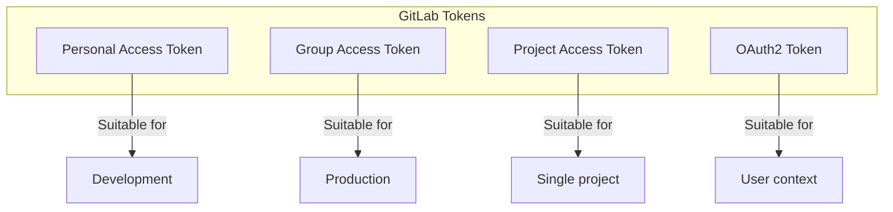


- For: Teacher, Operator
- Requires: A GitLab personal access token

Guide to configuring GitLab access tokens for GitPulse.

## Types of tokens



| Type | Using | Scope | Lifetime |
|-----|----------|-------|-----------|
| Personal Access Token | Development | User-level | Configurable |
| Group Access Token | Production | Group-level | Max 1 year |
| Project Access Token | Single project | Project-level | Max 1 year |
| OAuth2 Token | User auth | User-level | Short-lived |

## Personal Access Token

### Creation

1. Sign in to GitLab
2. Click on avatar -> **Preferences**
3. In the left menu: **Access Tokens**
4. Fill in:
   - **Token name**: `GitPulse Production` or `GitPulse Development`
   - **Expiration date**: Max 1 year (365 days)
   - **Scopes**: See below

### Required scopes

```
Yes api           - Full API access
Yes read_api      - Read-only API access
Yes read_user     - Read user info
Yes read_repository - Clone/fetch repositories
- [ ] write_repository - Push (not needed)
```


**Minimum privilege.** For production, use only the minimum required permissions. For read-only access, the following are sufficient: `read_api`, `read_repository`.

### An example

```bash
# Token looks like this:
GITLAB_TOKEN=glpat_placeholder_token

# Test the token
curl -H "Private-Token: ${GITLAB_TOKEN}" \
  "https://gitlab.example.com/api/v4/user"
```

## Group Access Token

For production deployment, we recommend Group Access Token.

### Creation

1. Go to GitLab Group (eg `/kpi/tp-2026`)
2. **Settings** -> **Access Tokens**
3. Fill in:
   - **Token name**: `GitPulse Sync Token`
   - **Expiration date**: End of semester
   - **Role**: `Reporter` or `Developer`
   - **Scopes**: `api`, `read_repository`

### Advantages

- It is not tied to a specific user
- It works even if the user leaves
- More granular scope control
- Audit log at group level

## Project Access Token

For single-project integration:

```bash
# At the project level: Settings -> Access Tokens
# Create a token with the Reporter role and read_api scope
```

## The classroom assistant's token

The [classroom assistant](../../ucitelia/asistent/) is the one part of GitPulse that writes to GitLab (it comments, commits, opens issues, approves and merges). So it does not use the `GITLAB_TOKEN` from `.env`; each course gets a token of its own:

- **Type:** a Group Access Token in the course's group (GitLab creates a bot user for it)
- **Role:** Maintainer - the assistant commits to the protected default branch and merges merge requests
- **Scope:** `api`
- **Storage:** a teacher pastes it on the course's **Assistant** tab; GitPulse checks it with GitLab and stores it encrypted. A read-only token is refused.

The sync token therefore stays read-only, and the expiry or revocation of one token never affects the other.

## Configuration in GitPulse

### Environment variables

```bash
# .env
GITLAB_URL=https://gitlab.example.com
GITLAB_TOKEN=glpat_placeholder_token
```

### Docker secrets (production)

```yaml
# docker-compose.yml
services:
  api:
    secrets:
      - gitlab_token
    environment:
      GITLAB_TOKEN_FILE: /run/secrets/gitlab_token

secrets:
  gitlab_token:
    file: ./secrets/gitlab_token.txt
```

```bash
# Create the secret file
mkdir -p secrets
echo "glpat_placeholder_token" > secrets/gitlab_token.txt
chmod 600 secrets/gitlab_token.txt
```

## Token rotation

### Automatic notification

```python
# Monitoring token expiration
from datetime import datetime, timedelta

def check_token_expiry(token_info: dict) -> bool:
    expiry = datetime.fromisoformat(token_info['expires_at'])
    warning_threshold = datetime.now() + timedelta(days=30)
    
    if expiry < warning_threshold:
        send_alert(f"Token expires in {(expiry - datetime.now()).days} days")
        return True
    return False
```

### Manual rotation

```bash
# 1. Create a new token (see above)

# 2. Update .env
nano .env
# Change GITLAB_TOKEN to the new one

# 3. Restart services
docker compose restart api worker

# 4. Verify functionality
curl http://localhost:8000/health/gitlab

# 5. Revoke the old token in GitLab UI
```

### Zero-downtime rotation

```bash
# 1. Add the new token as secondary
GITLAB_TOKEN_NEW=glpat_placeholder_token

# 2. Update configuration to use both
# (application tries primary, then fallback)

# 3. Switch to the new one as primary
GITLAB_TOKEN=${GITLAB_TOKEN_NEW}

# 4. Remove the old one
```

## Troubleshooting

### The token does not work

```bash
# Test basic access
curl -I -H "Private-Token: ${GITLAB_TOKEN}" \
  "https://gitlab.example.com/api/v4/user"

# Expected response: HTTP 200
# If 401: Token is invalid or expired
# If 403: Insufficient permissions
```

### Rate limiting

```bash
# Check rate limit headers
curl -i -H "Private-Token: ${GITLAB_TOKEN}" \
  "https://gitlab.example.com/api/v4/projects" | head -20

# RateLimit-Limit: 600
# RateLimit-Remaining: 599
# RateLimit-Reset: 1699999999
```

### Scope problems

```bash
# Test read-only scope
curl -H "Private-Token: ${GITLAB_TOKEN}" \
  "https://gitlab.example.com/api/v4/projects/123/repository/commits"

# Test API scope
curl -H "Private-Token: ${GITLAB_TOKEN}" \
  "https://gitlab.example.com/api/v4/projects/123/issues"
```

## Safety recommendations

### Best practices

1. **Use Group/Project tokens** instead of Personal tokens
2. **Minimum permissions** - only necessary scopes
3. **Short expiration** - max 6 months for production
4. **Rotation** - regular exchange of tokens
5. **Audit** - monitor token usage

### What to avoid

1. ~~Token sharing between environments~~
2. ~~Tokens in Git repository~~
3. ~~Personal tokens in production~~
4. ~~Tokens without expiration~~

## Audit log

All administrative actions and operational changes are recorded in the immutable platform audit log (`audit_log`):

```sql
-- Recent audit records in the database
SELECT 
    timestamp,
    action,
    actor,
    actor_ip,
    entity_type,
    detail
FROM audit_log
ORDER BY timestamp DESC
LIMIT 100;
```

## Further reading

- [Webhooks](webhooky.md)
- [CI/CD integration](cicd.md)
- [Security](../bezpecnost/model.md)

