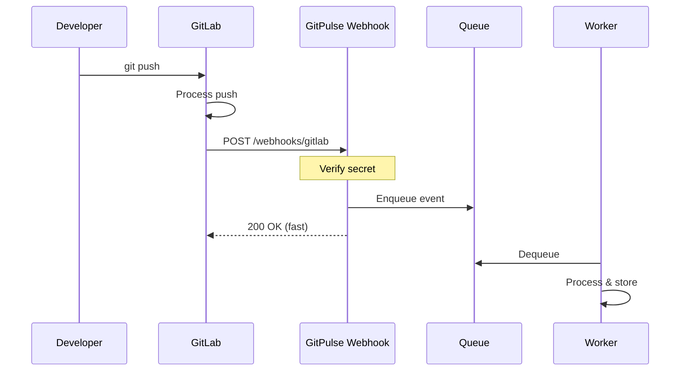


- For: Teacher, Operator
- Requires: A GitLab personal access token

Guide to configuring GitLab webhooks for real-time notifications.

## Overview



## Configuration in GitLab

### At the project level

1. Go to the project in GitLab
2. **Settings** -> **Webhooks**
3. Complete the configuration:

| Field | The value |
|------|---------|
| URL | `https://gitpulse.kpi.fei.tuke.sk/api/v1/webhooks/gitlab` |
| Secret token | Generated secret (see below) |
| Trigger | Push, **Comments**, Issues, Merge request, Pipeline |
| SSL verification | enabled |


**Without "Comments", three rules never pass.** This table listed only Push,
MR, Issues and Pipelines. GitLab sends comments as the `note` event, and that
is what R06 (review received), R07 (review given) and R08 (response to
review) are computed from - **0.32 of the total score weight** between them.
A webhook configured from the old table delivered everything else, so it
looked healthy while those three rules stayed unmet for good. The application
itself lists the same set under *Course settings -> Webhooks*.


### At the group level

For bulk configuration of all projects:

1. Go to the group
2. **Settings** -> **Webhooks**
3. Same configuration as above


**Group webhooks.** Group webhooks automatically apply to all projects in the group.

## Where the webhook secret comes from

**You do not generate it by hand and it does not belong in `.env`.** GitPulse
creates it for you:

- **Per project** - when you link a project (Link Project), GitPulse generates a
  secret for that project and shows it together with the setup instructions.
  Only its bcrypt hash is stored, so you see the secret once.
- **Per group / course** - create a webhook configuration
  (`POST /api/v1/courses/{course_id}/webhook-configs`) and use the secret it
  returns. One configuration covers every project in its scope.

Paste that secret into the GitLab webhook's **Secret token** field. To rotate:
`POST /api/v1/webhook-configs/{config_id}/rotate` - the old secret keeps working
for a short grace window so you can swap it without downtime.

## Trigger events

### Push Events

```json
{
  "object_kind": "push",
  "event_name": "push",
  "before": "abc123...",
  "after": "def456...",
  "ref": "refs/heads/main",
  "checkout_sha": "def456...",
  "user_name": "John Doe",
  "user_email": "john@example.com",
  "project": {
    "id": 123,
    "name": "my-project",
    "path_with_namespace": "group/my-project"
  },
  "commits": [
    {
      "id": "def456...",
      "message": "feat: add feature X",
      "timestamp": "2026-01-15T10:30:00Z",
      "author": {
        "name": "John Doe",
        "email": "john@example.com"
      },
      "added": ["new_file.py"],
      "modified": ["existing.py"],
      "removed": []
    }
  ],
  "total_commits_count": 1
}
```

**Processed metrics:**
- Number of commits
- Author (mapping to team member)
- Added/modified/deleted files
- Time distribution

### Merge Request Events

```json
{
  "object_kind": "merge_request",
  "event_type": "merge_request",
  "user": {
    "id": 1,
    "username": "johndoe"
  },
  "object_attributes": {
    "iid": 42,
    "title": "Feature: User authentication",
    "description": "Implements OAuth2 login",
    "state": "merged",
    "source_branch": "feature/auth",
    "target_branch": "main",
    "author_id": 1,
    "assignee_id": 2,
    "created_at": "2026-01-10T10:00:00Z",
    "updated_at": "2026-01-15T14:30:00Z",
    "action": "merge"
  },
  "changes": {
    "state": {
      "previous": "opened",
      "current": "merged"
    }
  }
}
```

**Processed metrics:**
- MR creation/merge rate
- Time to merge
- Review participation
- Branch activity

### Issue Events

```json
{
  "object_kind": "issue",
  "event_type": "issue",
  "user": {
    "id": 1,
    "username": "johndoe"
  },
  "object_attributes": {
    "iid": 15,
    "title": "Bug: Login fails on mobile",
    "state": "closed",
    "action": "close",
    "labels": [
      {"title": "bug"},
      {"title": "priority:high"}
    ]
  }
}
```

### Pipeline Events

```json
{
  "object_kind": "pipeline",
  "object_attributes": {
    "id": 789,
    "status": "success",
    "duration": 245,
    "created_at": "2026-01-15T10:00:00Z",
    "finished_at": "2026-01-15T10:04:05Z"
  },
  "builds": [
    {
      "id": 1001,
      "stage": "build",
      "name": "compile",
      "status": "success",
      "duration": 60
    },
    {
      "id": 1002,
      "stage": "test",
      "name": "unit-tests",
      "status": "success",
      "duration": 120
    }
  ]
}
```

## How GitPulse verifies a webhook

GitLab does not send an HMAC signature - it sends the secret itself in a header:

```
X-Gitlab-Token: <secret>
```

GitPulse compares it against the stored **bcrypt hash** in constant time
(`app/security/webhook_auth.py`), trying in this order:

1. the **webhook configuration** matching the project / path (multi-scope system),
2. the **legacy course-level secret** (`CourseSettings.webhook_secret_hash`),
3. the **project's own secret** (`GitLabProject.webhook_secret_hash`).

After a rotation the previous secret still works until its grace window expires.

## What the handler does

`POST /api/v1/webhooks/gitlab` (`src/app/api/webhooks.py`) handles a delivery
like this - the response is always fast, the real work happens in the background:

1. Rejects oversized payloads and applies the rate limit.
2. Resolves the project by GitLab project ID and verifies the secret (above).
3. Drops deliveries for an **unlinked project** and for an **archived course** -
   an archived course is read-only, so its data must stop changing.
4. Triple deduplication: `X-Gitlab-Delivery`, `X-Gitlab-Event-UUID` and a payload
   hash.
5. Stores a `WebhookEvent` and enqueues it for processing.

Failed events land in the dead-letter queue and can be replayed from
**Admin -> System -> Events**.

## Testing webhooks

### Manual test

```bash
# Simulate a push event
curl -X POST http://localhost:8000/api/v1/webhooks/gitlab \
  -H "Content-Type: application/json" \
  -H "X-Gitlab-Token: ${WEBHOOK_SECRET}" \
  -H "X-Gitlab-Event: Push Hook" \
  -d '{
    "object_kind": "push",
    "ref": "refs/heads/main",
    "commits": [{
      "id": "test123",
      "message": "Test commit",
      "author": {"name": "Test", "email": "test@example.com"}
    }]
  }'
```

### GitLab webhook test

1. In GitLab webhooks settings
2. Click **Test** on the saved webhook
3. Select event type
4. Check the response and GitPulse logs

### Ngrok for local development

```bash
# Start an ngrok tunnel
ngrok http 8000

# Use the generated URL in GitLab
# https://abc123.ngrok.io/api/v1/webhooks/gitlab
```

## Troubleshooting

### Webhook not delivered

```bash
# 1. Check GitLab webhook logs
# Project -> Settings -> Webhooks -> Recent deliveries

# 2. Verify GitPulse availability
curl -I https://gitpulse.kpi.fei.tuke.sk/health

# 3. Check the firewall
sudo ufw status
```

### 401 Unauthorized

```text
The secret does not match the stored hash.
1. Check the Secret token field on the GitLab webhook (no stray whitespace).
2. If you lost the secret, rotate it:
   POST /api/v1/webhook-configs/{config_id}/rotate
   and paste the new one into GitLab. No GitPulse restart is needed - the
   secret lives in the database, not in .env.
```

### 500 Server Error

```bash
# Check GitPulse logs
docker compose logs api | grep webhook

# Common causes:
# - Malformed JSON payload
# - Database connection error
# - Redis unavailable
```

### Duplicate events

```python
# GitPulse uses an idempotency key
# An event with the same ID is processed only once

# If you see duplicates, check:
# 1. Whether webhooks are configured at both project and group level
# 2. Retry logic in GitLab
```

## Webhook monitoring

### Prometheus metrics

```promql
# Webhook request rate
rate(gitlab_webhook_requests_total[5m])

# Error rate
sum(rate(gitlab_webhook_requests_total{status="error"}[5m])) /
sum(rate(gitlab_webhook_requests_total[5m]))

# Processing latency
histogram_quantile(0.99, 
  rate(gitlab_webhook_duration_seconds_bucket[5m])
)
```

### Alerting

```yaml
# monitoring/prometheus/alerts/webhooks.yml
groups:
  - name: webhooks
    rules:
      - alert: WebhookHighErrorRate
        expr: |
          sum(rate(gitlab_webhook_requests_total{status="error"}[5m])) /
          sum(rate(gitlab_webhook_requests_total[5m])) > 0.1
        for: 5m
        labels:
          severity: warning
        annotations:
          summary: "High webhook error rate"
```

## Security

### IP Whitelist

```nginx
# Caddy/Nginx - allow only GitLab IPs
location /api/v1/webhooks/ {
    allow 10.0.0.0/8;      # GitLab server IP range
    deny all;
    
    proxy_pass http://api:8000;
}
```

### Rate limiting

```python
# src/app/api/webhooks.py
from slowapi import Limiter
from slowapi.util import get_remote_address

limiter = Limiter(key_func=get_remote_address)

@router.post("/webhooks/gitlab")
@limiter.limit("100/minute")
async def gitlab_webhook(...):
    ...
```

## Further reading

- [Tokens](tokeny.md)
- [CI/CD integration](cicd.md)
- [Monitoring](../operatori/monitoring.md)

