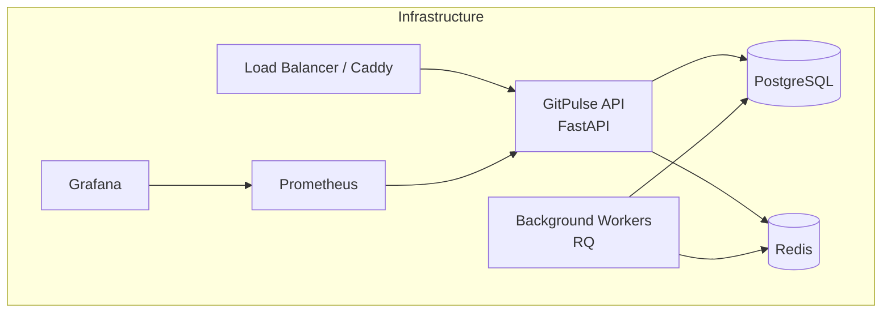
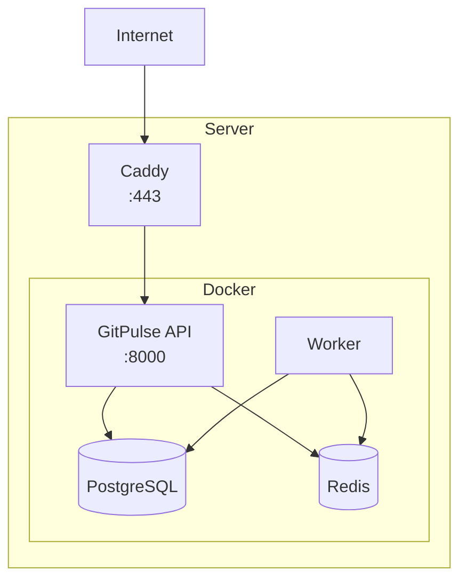
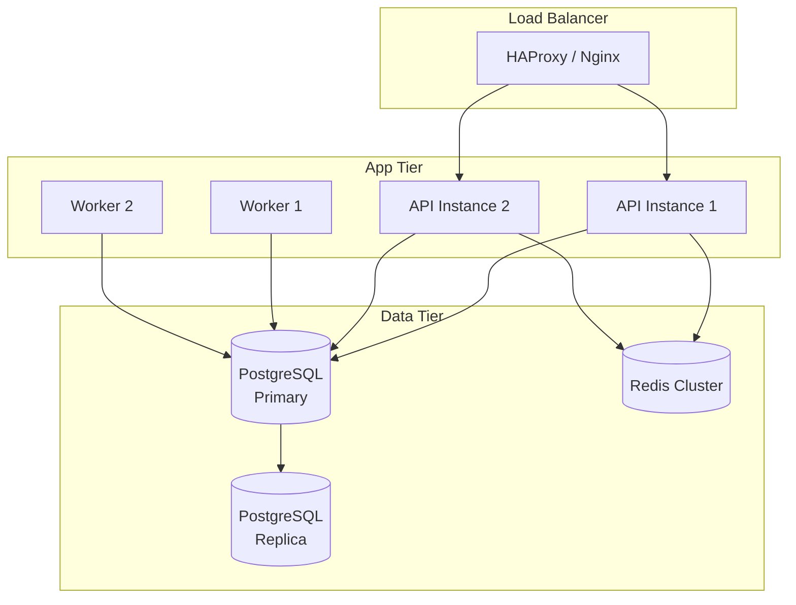


- For: Operator
- Requires: Server and deployment access

This section is intended for administrators and DevOps engineers responsible for deploying and operating GitPulse.

## Overview



## What You'll Find in This Section

  - [Deployment](./nasadenie/) - Installation and configuration on a production server
  - [Updates](./aktualizacie/) - Process for updating to a new version
  - [Backup](./zalohovanie/) - Backup and recovery strategy
  - [Monitoring](./monitoring/) - Prometheus, Grafana, alerting
  - [Troubleshooting](./troubleshooting/) - Solving common problems

## Minimum Requirements

### Hardware

| Component | Minimum | Recommended |
|-----------|---------|-------------|
| CPU | 2 cores | 4 cores |
| RAM | 4 GB | 8 GB |
| Disk | 20 GB SSD | 50 GB SSD |
| Network | 100 Mbps | 1 Gbps |

### Software

| Component | Version |
|-----------|---------|
| Docker | 24.0+ |
| Docker Compose | 2.20+ |
| PostgreSQL | 16+ |
| Redis | 7+ |

### Network Requirements

| Port | Service | Access |
|------|---------|--------|
| 443 | HTTPS (Caddy) | Public |
| 80 | HTTP redirect | Public |
| 5432 | PostgreSQL | Internal |
| 6379 | Redis | Internal |
| 8000 | API (internal) | Internal |
| 9090 | Prometheus | Internal |
| 3000 | Grafana | Internal/VPN |

## Deployment Architecture

### Simple Deployment (1 server)



### Scalable Deployment



## Quick Start

### 1. Server Preparation

```bash
# System update
sudo apt update && sudo apt upgrade -y

# Install Docker
curl -fsSL https://get.docker.com | sh
sudo usermod -aG docker $USER

# Install Docker Compose
sudo apt install docker-compose-plugin
```

### 2. Clone the Repository

```bash
git clone https://gitlab.example.com/kpi-zp/2027/dp.mykyta.olym/workspace/workspace.git gitpulse
cd gitpulse
```

### 3. Configuration

```bash
# Copy template
cp .env.example .env

# Edit configuration
nano .env
```

### 4. Start

```bash
docker compose up -d
```

### 5. Verification

```bash
# Health check
curl http://localhost:8000/health

# Logs
docker compose logs -f
```

## Next Steps

1. [Detailed Deployment](nasadenie.md) - Complete guide
2. [TLS Configuration](nasadenie.md) - HTTPS setup
3. [GitLab Integration](../gitlab/tokeny.md) - Connecting to GitLab
4. [Monitoring](monitoring.md) - Setting up alerts
