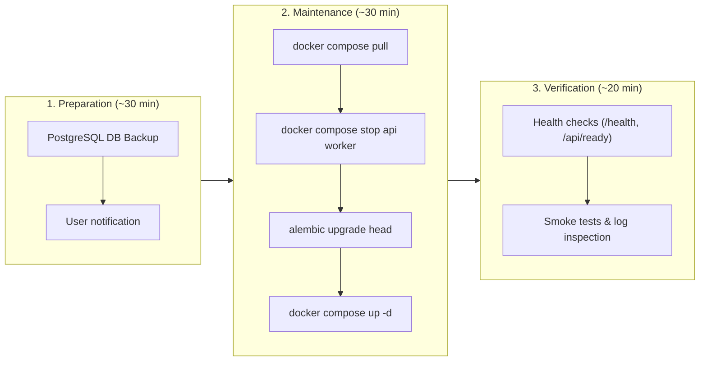


- For: Operator
- Requires: Server and deployment access

Guide for safely updating GitPulse to a new version.

## Version Release Strategy

### Calendar Versioning

```
YYYY.M.D[.postN]
  |     |     |
  |     |     +- Optional same-day follow-up
  |     +------- Release month
  +------------- Release year
```

| Version | Example | Requires |
|---------|---------|----------|
| Dated release | 2026.6.2.post24 -> 2026.6.3 | Container restart; possible migrations |
| Same-day follow-up | 2026.6.3 -> 2026.6.3.post1 | Container restart |
| Breaking release | Any version | Explicit release notes and operator action |

### Current Baseline

GitPulse currently runs `2026.9.13`; the CalVer baseline starts from
`2026.5.15`.

- The repository started as a full-codebase initial commit, not as a tagged
  `0.1.0` release.
- Before this baseline was recorded, the audit found 1 875 commits, 19 Alembic
  migration files, and no previous release tags.
- Commit and migration counts are operational context, not stable public version
  components. Current releases therefore use Calendar Versioning (`YYYY.M.D`).
- Same-day follow-ups use `.postN`; breaking changes must be called out in
  release notes and rollout docs.

## Before Updating

### 1. Check Release Notes

```bash
# View release notes
open https://gitlab.example.com/kpi-zp/2027/dp.mykyta.olym/workspace/workspace/-/releases
```

### 2. Database Backup

```bash
# Create backup before update
./scripts/backup.sh

# Verify backup
ls -la backups/
```

### 3. Check Available Space

```bash
# Disk space
df -h

# Docker images
docker system df
```

### 4. Plan Maintenance Window



## Update Process

### Standard Update (Patch/Minor)

```bash
# 1. Switch to the correct version
cd /home/gitpulse/gitpulse
git fetch --tags
git checkout 2026.9.1

# 2. Pull new Docker images
docker compose pull

# 3. Stop services gracefully
docker compose stop api worker

# 4. Run migrations (if needed)
docker compose run --rm api alembic upgrade head

# 5. Start new versions
docker compose up -d

# 6. Verification
docker compose ps
curl https://gitpulse.kpi.fei.tuke.sk/health
```

### Zero-Downtime Update

For production with availability requirements:

```bash
# 1. Pull new images
docker compose pull

# 2. Scale up new instances
docker compose up -d --scale api=2 --no-recreate

# 3. Wait for health check on new instances
sleep 30

# 4. Rolling restart
docker compose up -d --force-recreate

# 5. Verify
curl https://gitpulse.kpi.fei.tuke.sk/health
```

### Major Version Upgrade

Major versions may contain breaking changes:

```bash
# 1. Read migration guide
cat docs/UPGRADING.md

# 2. Backup everything
./scripts/backup.sh --full

# 3. Maintenance mode
docker compose exec api \
  python -c "from app.config import settings; settings.MAINTENANCE_MODE = True"

# 4. Stop all services
docker compose down

# 5. Update code
git fetch --tags
git checkout v2.0.0

# 6. Update configuration (if needed)
# Check .env.example for new variables
diff .env .env.example

# 7. Build/pull new images
docker compose pull

# 8. Migrations
docker compose run --rm api alembic upgrade head

# 9. Start
docker compose up -d

# 10. Disable maintenance mode
docker compose exec api \
  python -c "from app.config import settings; settings.MAINTENANCE_MODE = False"
```

## Rollback

### Quick Rollback

```bash
# If something failed, rollback to previous version

# 1. Stop problematic version
docker compose down

# 2. Checkout previous version
git checkout v1.0.5

# 3. Restore database (if migrations were run)
./scripts/restore.sh backups/backup_20261115_080000.sql

# 4. Start
docker compose up -d
```

### Database Rollback

```bash
# If migration caused problems
docker compose exec api \
  alembic downgrade -1

# Or to a specific revision
docker compose exec api \
  alembic downgrade 018
```

## Automation

### GitLab CI Deployment

```yaml
# .gitlab-ci.yml
deploy:production:
  stage: deploy
  environment:
    name: production
    url: https://gitpulse.kpi.fei.tuke.sk
  only:
    - tags
  when: manual
  script:
    - ssh gitpulse@server "cd gitpulse && git pull && docker compose pull && docker compose up -d"
```

### Ansible Playbook

```yaml
# deploy.yml
---
- hosts: production
  become: yes
  become_user: gitpulse
  vars:
    app_dir: /home/gitpulse/gitpulse
    version: "{{ lookup('env', 'VERSION') | default('latest') }}"
  
  tasks:
    - name: Pull latest code
      git:
        repo: https://gitlab.example.com/kpi-zp/2027/dp.mykyta.olym/workspace/workspace.git
        dest: "{{ app_dir }}"
        version: "{{ version }}"
    
    - name: Pull Docker images
      community.docker.docker_compose:
        project_src: "{{ app_dir }}"
        files:
          - docker-compose.yml
        pull: yes
        state: present
    
    - name: Run migrations
      community.docker.docker_container_exec:
        container: gitpulse-api-1
        command: alembic upgrade head
    
    - name: Restart services
      community.docker.docker_compose:
        project_src: "{{ app_dir }}"
        files:
          - docker-compose.yml
        restarted: yes
```

## Checklist

### Before Update

- [ ] Release notes read
- [ ] Database backup created
- [ ] Disk space verified
- [ ] Maintenance window planned
- [ ] User notification sent

### During Update

- [ ] Old services stopped
- [ ] Migrations run
- [ ] New services started
- [ ] Health checks passing

### After Update

- [ ] Smoke tests
- [ ] Log monitoring
- [ ] Performance metrics
- [ ] Rollback plan ready (24h)

## Troubleshooting

### Migration Failed

```bash
# View error
docker compose logs api | grep -i error

# Manually run migration for debug
docker compose exec api alembic upgrade head --sql

# Rollback if needed
docker compose exec api alembic downgrade -1
```

### Container Won't Start

```bash
# Check logs
docker compose logs api

# Check configuration
docker compose config

# Run interactively for debug
docker compose run --rm api /bin/bash
```

### Health Check Failing

```bash
# Manual health check
curl -v http://localhost:8000/health

# Check database connection
docker compose exec api \
  python -c "from app.db.session import engine; print(engine.url)"
```

## Further Reading

- [Backup](zalohovanie.md)
- [Monitoring](monitoring.md)
- [Troubleshooting](troubleshooting.md)
