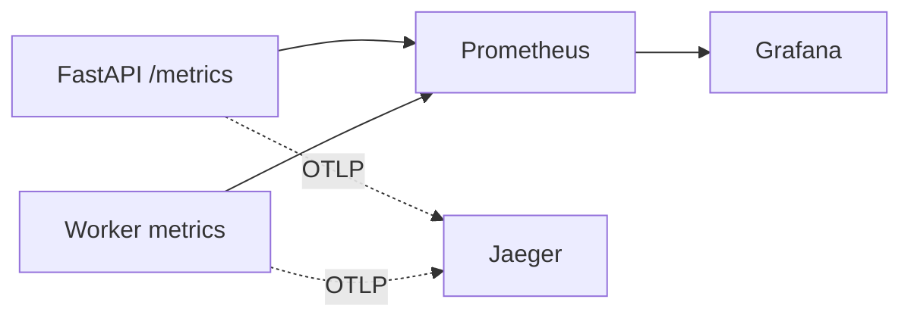


- For: Operator
- Requires: Server and deployment access

> Verified against `monitoring/*` and `src/app/observability/*` on **2026-09-09**.

## Stack

Current monitoring profile (`docker compose --profile monitoring`) starts:

- Prometheus
- Grafana
- Jaeger



## Access and Startup

### Local Development
To start monitoring locally:
```bash
docker compose --profile monitoring up -d
```
Local access points (no authentication required):
- **Grafana**: `http://localhost:3000` (or `http://localhost:3000/grafana/`)
- **Prometheus**: `http://localhost:9090`
- **Jaeger**: `http://localhost:16686` (or `http://localhost:16686/jaeger/`)

### Production Environment
In production, monitoring services are exposed behind a reverse proxy (Caddy) and open for a signed-in GitPulse administrator.
- **Grafana**: [https://gitpulse.kpi.fei.tuke.sk/grafana/](https://gitpulse.kpi.fei.tuke.sk/grafana/)
- **Prometheus**: [https://gitpulse.kpi.fei.tuke.sk/prometheus/](https://gitpulse.kpi.fei.tuke.sk/prometheus/)
- **Jaeger**: [https://gitpulse.kpi.fei.tuke.sk/jaeger/](https://gitpulse.kpi.fei.tuke.sk/jaeger/)
- **Alertmanager**: [https://gitpulse.kpi.fei.tuke.sk/alertmanager/](https://gitpulse.kpi.fei.tuke.sk/alertmanager/)

**Access:** sign in to GitPulse as an administrator and open the links above -
there is no separate password. Caddy asks GitPulse before every request
(`/internal/monitoring-authz`); without a session you are sent to sign in and
back, with another role you get 403. Grafana signs you in under your GitPulse
login. While GitPulse itself is down the tools are closed too; on the host they
stay at 127.0.0.1 (see DEPLOY.md, "Monitoring access").

## Key metrics (implemented)

| Metric | Type | Labels | Meaning |
|---|---|---|---|
| `webhook_events_received_total` | Counter | `event_type` | incoming webhooks |
| `webhook_events_processed_total` | Counter | `event_type`, `status` | processing outcome |
| `webhook_processing_duration_seconds` | Histogram | `event_type` | processing latency |
| `gitlab_api_requests_total` | Counter | `endpoint`, `status` | GitLab API calls |
| `gitlab_api_duration_seconds` | Histogram | `endpoint` | GitLab API latency |
| `http_requests_total` | Counter | `method`, `path`, `status` | HTTP traffic |
| `http_request_duration_seconds` | Histogram | `method`, `path` | HTTP latency |
| `rq_queue_depth` | Gauge | `queue_name` | queue depth |
| `rq_failed_jobs` | Gauge | - | retained RQ failure records, including historical failures |
| `rq_job_failures_total` | Counter | `queue_name` | execution errors, including retry attempts |
| `rq_workers_active` | Gauge | - | active workers |
| `metrics_compute_total` | Counter | `status` | metric computations |
| `metrics_compute_duration_seconds` | Histogram | - | metric compute latency |
| `db_pool_size` | Gauge | - | DB pool size |
| `db_pool_checked_out` | Gauge | - | used DB connections |

## Grafana dashboard

Provisioned dashboard:

- `monitoring/grafana/dashboards/gitpulse.json`

Main panels:

1. Webhook rate (received/processed)
2. Processing latency (p50/p95/p99)
3. Queue depth
4. Success/failure rate
5. DB pool utilization
6. HTTP request rate
7. GitLab API latency
8. Active workers
9. Metrics compute duration

## Alerts

Alert rules: `monitoring/prometheus/alerts.yml`

| Alert | Condition |
|---|---|
| `QueueStuck` | `rq_queue_depth > 50` for 5 minutes |
| `HighFailureRate` | `rate(webhook_events_processed_total{status="error"}[5m]) > 0.1` |
| `ApiDown` | `up{job="gitpulse-api"} == 0` |
| `HighProcessingLatency` | webhook p95 latency > 10 s |
| `WorkerDown` | `rq_workers_active == 0` |
| `DBPoolExhausted` | `db_pool_checked_out / db_pool_size > 0.9` |
| `HighHTTPErrorRate` | 5xx share > 5% |

A firing or resolved alert arrives by email at `ALERT_EMAIL_TO` (in `.env.production`), sent through the application's own SMTP account and laid out like GitPulse's other mail (`monitoring/alertmanager-templates/gitpulse.tmpl`). Its **Silence** link opens Alertmanager at `/alertmanager/`, open for GitPulse administrators like the rest.

## Operational checklist

1. `/health` and `/metrics` return 200.
2. `http://localhost:9090/targets` shows `gitpulse-api` as UP.
3. Grafana datasource points to `http://prometheus:9090`.
4. During incidents, correlate `correlation_id` across logs, metrics, and traces.

### Failure diagnostics

Administrators can open **System → Background Jobs** for the latest 100 retained RQ failures, their last activity, causes and remediation hints. Expand the row’s **Job details** for the job ID, exception type and source locations; use the ID in worker container logs for the full trace. Arguments, exception messages and credentials are excluded from the page. Refresh uses the shared loading and retry states. Teachers and students receive role-specific service notices on their existing pages. The journal combines tracked jobs and the latest 100 RQ failures, deduplicated by RQ ID. RQ-only rows cannot be selected individually; Purge Old removes tracked terminal jobs and retained RQ failures by their last activity.

Retained failures are history, not a count of current incidents. The one-hour execution-error panel and alert use the Redis-backed `rq_job_failures_total` counter; deleting or expiring history cannot change this counter. It starts with this release and is not backfilled from historical records.
