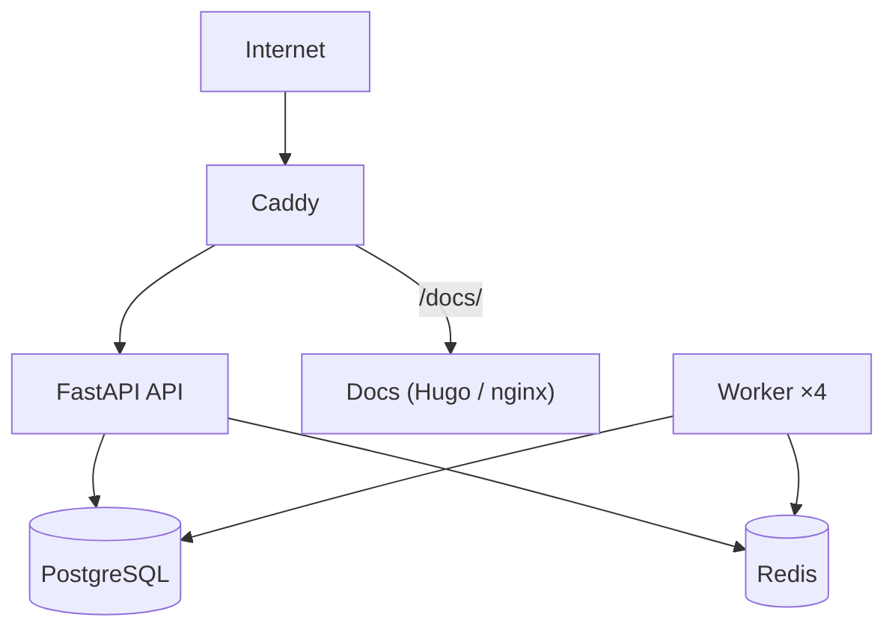


- For: Operator
- Requires: Server and deployment access

> Verified against `docker-compose.yml`, `.env.production.example`, and `deploy-production.ps1` on **2026-09-09**.

## Deployment model

GitPulse runs as a Docker Compose stack:

- `postgres`
- `redis`
- `api`
- `worker`
- `gitpulse-docs`
- `caddy`

Optional (`--profile monitoring`):

- `prometheus`
- `grafana`
- `jaeger`



## Prerequisites

- Docker 24+
- Docker Compose 2.20+
- `.env.production` based on `.env.production.example`
- GitLab OAuth application (for dashboard login)

## Required configuration

At minimum, set:

- `DATABASE_URL`
- `POSTGRES_PASSWORD`
- `REDIS_PASSWORD` (the `APP_ENV=production` validator refuses to start when `REDIS_URL` lacks a password segment)
- `SECRET_KEY`
- `TEACHER_API_TOKEN`
- `GITLAB_OAUTH_CLIENT_ID`
- `GITLAB_OAUTH_CLIENT_SECRET`
- `GITLAB_API_TOKEN` (or legacy alias `GITLAB_TOKEN`)
- `DOMAIN`

## Quick production deploy (PowerShell)

```powershell
cp .env.production.example .env.production
# fill values

.\deploy-production.ps1 -Build -Migrate
```

With monitoring profile:

```powershell
.\deploy-production.ps1 -Monitoring
```

## Manual deploy (cross-platform)

### 1. Migrations

```bash
docker compose --env-file .env.production --profile migrate run --rm migrate
```

### 2. Start stack

```bash
docker compose --env-file .env.production up -d
```

### 3. Monitoring (optional)

```bash
docker compose --env-file .env.production --profile monitoring up -d
```

## Post-deploy verification

```bash
curl http://localhost:8000/health
curl http://localhost:8000/health/ready
curl http://localhost:8000/metrics
```

UI endpoints:

- dashboard: `http://localhost/dashboard/`
- docs (production, via Caddy): `http://localhost/docs/`
- docs (fallback, via FastAPI): `http://localhost:8000/project-docs/`

## Service ports

| Service | Port |
|---|---|
| Caddy HTTP/HTTPS | `80`, `443` |
| API (local bind) | `127.0.0.1:8000` |
| PostgreSQL | `127.0.0.1:5433` |
| Redis | `127.0.0.1:6379` |
| Grafana (monitoring profile) | `127.0.0.1:3000` |
| Prometheus (monitoring profile) | `127.0.0.1:9090` |
| Jaeger (monitoring profile) | `127.0.0.1:16686` |

## Rollback

```bash
docker compose --env-file .env.production down
# or with monitoring profile
# docker compose --env-file .env.production --profile monitoring down
```

## Related docs

- [Monitoring](monitoring.md)
- [Updates](aktualizacie.md)
- [Backup](zalohovanie.md)
