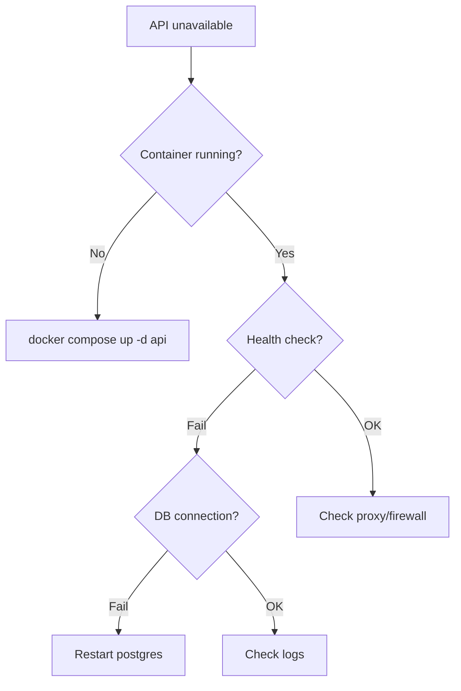


- For: Operator
- Requires: Server and deployment access

Guide for solving common problems with GitPulse.

## Diagnostic Tools

### Quick Status Check

```bash
# Container status
docker compose ps

# API health check
curl -s http://localhost:8000/health | jq

# Database connection
docker compose exec postgres pg_isready

# Redis ping
docker compose exec redis redis-cli ping
```

### Logs

```bash
# All logs
docker compose logs -f

# API logs only
docker compose logs -f api

# Last 100 lines
docker compose logs --tail=100 api

# Filter errors
docker compose logs api 2>&1 | grep -i error
```

## Common Problems

### API Unavailable



#### Solution

```bash
# 1. Check container status
docker compose ps api

# 2. If not running, check reason
docker compose logs api | tail -50

# 3. Verify dependencies
docker compose exec api \
  python -c "from app.db.session import engine; print('DB OK')"

# 4. Restart
docker compose restart api
```

### Database Unavailable

#### Symptoms
- API returns 500 error
- Logs contain "connection refused" or "timeout"

#### Solution

```bash
# 1. PostgreSQL status
docker compose ps postgres
docker compose logs postgres | tail -20

# 2. Disk space
df -h
docker system df

# 3. Connect to DB
docker compose exec postgres \
  psql -U gitpulse -c "SELECT 1;"

# 4. If corrupted, restore
./scripts/restore.sh backups/latest.dump

# 5. Restart
docker compose restart postgres
```

### GitLab Sync Not Working

#### Symptoms
- Events are not updated
- Dashboard shows old data

#### Diagnostics

```bash
# 1. Test GitLab API
curl -H "Private-Token: ${GITLAB_TOKEN}" \
  "https://gitlab.example.com/api/v4/user"

# 2. Check worker queue
docker compose exec redis \
  redis-cli LLEN rq:queue:default

# 3. Worker logs
docker compose logs worker | tail -50

# 4. Manual team sync
curl -X POST http://localhost:8000/api/v1/teams/<team_id>/sync \
  -H "Authorization: Bearer ${TEACHER_API_TOKEN}"
```

#### Solution

```bash
# Token expired/invalid
# 1. Generate new token in GitLab
# 2. Update .env
# 3. Restart
docker compose restart api worker
```

### High Latency

#### Diagnostics

```bash
# 1. API metrics
curl http://localhost:8000/metrics | grep http_request_duration

# 2. Slow queries
docker compose exec postgres \
  psql -U gitpulse -c "
    SELECT query, mean_exec_time, calls
    FROM pg_stat_statements
    ORDER BY mean_exec_time DESC
    LIMIT 10;
  "

# 3. CPU/Memory
docker stats --no-stream
```

#### Solution

```bash
# 1. Scale API
docker compose up -d --scale api=2

# 2. Vacuum database
docker compose exec postgres \
  psql -U gitpulse -c "VACUUM ANALYZE;"

# 3. Clear Redis cache (if needed)
docker compose exec redis \
  redis-cli FLUSHDB
```

### Worker Stuck/Crashed

#### Symptoms
- Jobs remain in queue
- No worker logs

#### Solution

```bash
# 1. Worker status
docker compose ps worker

# 2. Stuck jobs
docker compose exec redis \
  redis-cli LRANGE rq:queue:failed 0 10

# 3. Clear failed queue
docker compose exec redis \
  redis-cli DEL rq:queue:failed

# 4. Restart workers
docker compose restart worker
```

### Out of Memory

#### Symptoms
- Container killed (OOMKilled)
- System becomes unresponsive

#### Diagnostics

```bash
# 1. Memory usage
free -h
docker stats --no-stream

# 2. OOM events
dmesg | grep -i oom

# 3. Container limits
docker compose config | grep -A5 resources
```

#### Solution

```yaml
# Increase memory limits in docker-compose.yml
services:
  api:
    deploy:
      resources:
        limits:
          memory: 4G
        reservations:
          memory: 2G
```

### Disk Full

#### Symptoms
- Database errors
- No new logs

#### Solution

```bash
# 1. Identify the problem
df -h
du -sh /var/lib/docker/*

# 2. Docker cleanup
docker system prune -a --volumes

# 3. Log rotation
docker compose logs --tail=0

# 4. Old backups
find /home/gitpulse/backups -mtime +30 -delete
```

### SSL/TLS Problems

#### Symptoms
- Certificate errors in browser
- curl: SSL certificate problem

#### Diagnostics

```bash
# 1. Certificate info
echo | openssl s_client -connect gitpulse.kpi.fei.tuke.sk:443 2>/dev/null | openssl x509 -text

# 2. Caddy logs
docker compose logs caddy | grep -i cert

# 3. Let's Encrypt rate limits
curl "https://crt.sh/?q=gitpulse.kpi.fei.tuke.sk&output=json" | jq length
```

#### Solution

```bash
# Force certificate renewal
docker compose exec caddy \
  caddy reload --config /etc/caddy/Caddyfile

# Or restart Caddy
docker compose restart caddy
```

## Escalation Matrix

| Severity | Response Time | Who |
|----------|--------------|-----|
| Critical (P1) | 15 min | On-call + Team Lead |
| High (P2) | 1 hour | DevOps team |
| Medium (P3) | 4 hours | DevOps team |
| Low (P4) | Next business day | DevOps team |

### P1 - Critical

- API completely unavailable
- Data loss
- Security incident

### P2 - High

- Significant performance degradation
- GitLab sync not working
- Backup failures

### P3 - Medium

- Partial problems
- Single component issues
- Performance warnings

### P4 - Low

- Cosmetic issues
- Non-critical features

## Incident Response Checklist

- [ ] Problem identification
- [ ] Stakeholder notification
- [ ] Backup before changes
- [ ] Fix implementation
- [ ] Verification
- [ ] Documentation (post-mortem)

## Useful Commands

```bash
# === Docker ===
# Interactive shell in container
docker compose exec api /bin/bash

# Copy files from container
docker cp gitpulse-api-1:/app/logs ./local-logs

# Resource usage
docker stats

# === Database ===
# Interactive psql
docker compose exec postgres psql -U gitpulse

# Dump schema
docker compose exec postgres \
  pg_dump -U gitpulse --schema-only gitpulse

# === Network ===
# DNS test
docker compose exec api \
  nslookup gitlab.example.com

# Port test
docker compose exec api \
  nc -zv postgres 5432
```

## Further Reading

- [Monitoring](monitoring.md)
- [Backup](zalohovanie.md)
- [Deployment](nasadenie.md)
