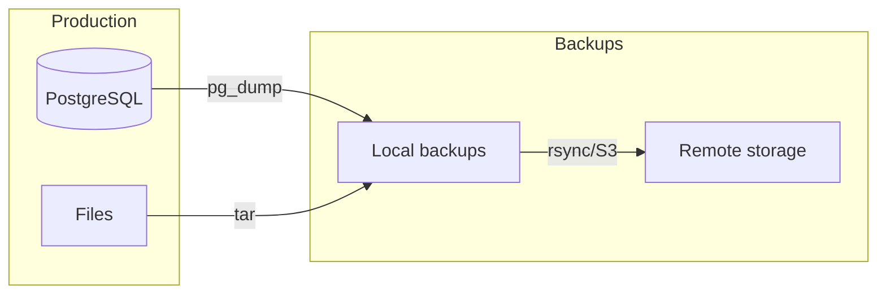
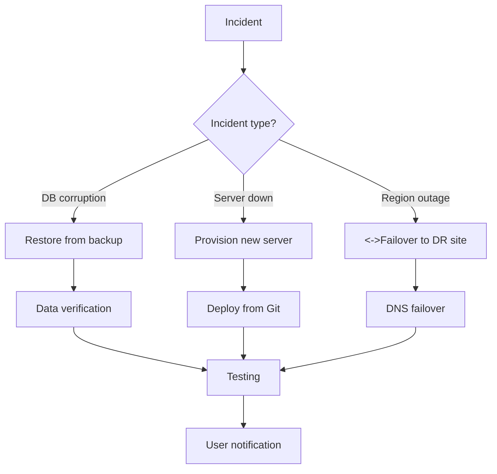


- For: Operator
- Requires: Server and deployment access

Complete backup and disaster recovery strategy for GitPulse.

## Overview



## What to Back Up

| Component | Priority | Frequency | Retention |
|-----------|----------|-----------|-----------|
| PostgreSQL database | Critical | Daily | 30 days |
| Configuration files | High | On change | 90 days |
| Docker volumes | Medium | Weekly | 14 days |
| Logs | Low | Daily | 7 days |

## Automatic Backup

### Backup Script

```bash
#!/bin/bash
# scripts/backup.sh

set -euo pipefail

# === Configuration ===
BACKUP_DIR="/home/gitpulse/backups"
RETENTION_DAYS=30
TIMESTAMP=$(date +%Y%m%d_%H%M%S)
BACKUP_NAME="gitpulse_backup_${TIMESTAMP}"

# Colors for output
RED='\033[0;31m'
GREEN='\033[0;32m'
NC='\033[0m'

log() {
    echo -e "${GREEN}[$(date +'%Y-%m-%d %H:%M:%S')]${NC} $1"
}

error() {
    echo -e "${RED}[ERROR]${NC} $1" >&2
    exit 1
}

# === Create directory ===
mkdir -p "${BACKUP_DIR}"

# === 1. PostgreSQL Backup ===
log "Backing up PostgreSQL database..."
docker compose exec -T postgres \
    pg_dump -U gitpulse -Fc gitpulse \
    > "${BACKUP_DIR}/${BACKUP_NAME}.dump" \
    || error "Database backup failed"

log "Database backed up: ${BACKUP_NAME}.dump ($(du -h ${BACKUP_DIR}/${BACKUP_NAME}.dump | cut -f1))"

# === 2. Configuration Backup ===
log "Backing up configuration files..."
tar -czf "${BACKUP_DIR}/${BACKUP_NAME}_config.tar.gz" \
    --exclude='.git' \
    --exclude='__pycache__' \
    --exclude='.venv' \
    .env Caddyfile docker-compose.yml \
    || error "Configuration backup failed"

# === 3. Redis Backup (optional) ===
log "Backing up Redis..."
docker compose exec -T redis \
    redis-cli BGSAVE
sleep 5
docker cp "$(docker compose ps -q redis):/data/dump.rdb" \
    "${BACKUP_DIR}/${BACKUP_NAME}_redis.rdb" 2>/dev/null || true

# === 4. Clean old backups ===
log "Cleaning backups older than ${RETENTION_DAYS} days..."
find "${BACKUP_DIR}" -name "gitpulse_backup_*" -mtime +${RETENTION_DAYS} -delete

# === 5. Verification ===
log "Verifying backup..."
pg_restore --list "${BACKUP_DIR}/${BACKUP_NAME}.dump" > /dev/null \
    || error "Backup verification failed"

# === Summary ===
log "Backup completed successfully!"
echo "========================================"
echo "Backup files:"
ls -lh "${BACKUP_DIR}/${BACKUP_NAME}"*
echo "========================================"
```

### Cron Job

```bash
# Daily backup at 2:00
0 2 * * * /home/gitpulse/gitpulse/scripts/backup.sh >> /var/log/gitpulse-backup.log 2>&1

# Weekly full backup on Sunday at 3:00
0 3 * * 0 /home/gitpulse/gitpulse/scripts/backup.sh --full >> /var/log/gitpulse-backup.log 2>&1
```

## Remote Backups

### S3 Compatible Storage

```bash
#!/bin/bash
# scripts/backup-to-s3.sh

# Configuration
S3_BUCKET="s3://gitpulse-backups"
S3_ENDPOINT="https://s3.example.com"

# Upload
aws s3 cp "${BACKUP_DIR}/${BACKUP_NAME}.dump" \
    "${S3_BUCKET}/database/" \
    --endpoint-url "${S3_ENDPOINT}"

# Retention is handled by S3 lifecycle policy
```

### Rsync to Remote Server

```bash
#!/bin/bash
# scripts/sync-backups.sh

REMOTE_HOST="backup.example.com"
REMOTE_DIR="/backups/gitpulse"

rsync -avz --delete \
    "${BACKUP_DIR}/" \
    "${REMOTE_HOST}:${REMOTE_DIR}/"
```

## Recovery (Restore)

### Database Recovery

```bash
#!/bin/bash
# scripts/restore.sh

set -euo pipefail

BACKUP_FILE="${1:-}"

if [ -z "${BACKUP_FILE}" ]; then
    echo "Usage: $0 <backup_file>"
    echo "Available backups:"
    ls -la /home/gitpulse/backups/*.dump
    exit 1
fi

echo "WARNING: This will delete the existing database!"
read -p "Continue? (yes/no): " confirm

if [ "${confirm}" != "yes" ]; then
    echo "Cancelled."
    exit 0
fi

# 1. Stop application
echo "Stopping application..."
docker compose stop api worker

# 2. Drop and recreate database
echo "Preparing database..."
docker compose exec -T postgres \
    psql -U gitpulse -c "DROP DATABASE IF EXISTS gitpulse_restore;"
docker compose exec -T postgres \
    psql -U gitpulse -c "CREATE DATABASE gitpulse_restore;"

# 3. Restore
echo "Restoring from ${BACKUP_FILE}..."
docker compose exec -T postgres \
    pg_restore -U gitpulse -d gitpulse_restore < "${BACKUP_FILE}"

# 4. Swap databases
echo "Swapping databases..."
docker compose exec -T postgres \
    psql -U gitpulse -c "
        SELECT pg_terminate_backend(pid) FROM pg_stat_activity 
        WHERE datname = 'gitpulse';
        DROP DATABASE gitpulse;
        ALTER DATABASE gitpulse_restore RENAME TO gitpulse;
    "

# 5. Start application
echo "Starting application..."
docker compose start api worker

echo "[OK] Recovery completed!"
```

### Point-in-Time Recovery (PITR)

For critical deployments with WAL archiving:

```yaml
# docker-compose.yml
services:
  postgres:
    environment:
      POSTGRES_INITDB_ARGS: "--data-checksums"
    command: >
      postgres
      -c archive_mode=on
      -c archive_command='cp %p /var/lib/postgresql/wal_archive/%f'
      -c wal_level=replica
    volumes:
      - wal_archive:/var/lib/postgresql/wal_archive
```

```bash
# PITR recovery
pg_restore --target-time="2026-11-15 10:30:00" \
    -d gitpulse /backups/base_backup.dump
```

## Backup Testing

### Automatic Test

```bash
#!/bin/bash
# scripts/test-backup.sh

# 1. Create backup
./scripts/backup.sh

# 2. Create test database
docker compose exec -T postgres \
    psql -U gitpulse -c "CREATE DATABASE backup_test;"

# 3. Restore to test database
LATEST_BACKUP=$(ls -t /home/gitpulse/backups/*.dump | head -1)
docker compose exec -T postgres \
    pg_restore -U gitpulse -d backup_test < "${LATEST_BACKUP}"

# 4. Verification
PROD_COUNT=$(docker compose exec -T postgres psql -U gitpulse -t -c "SELECT COUNT(*) FROM teams;")
TEST_COUNT=$(docker compose exec -T postgres psql -U gitpulse -t -d backup_test -c "SELECT COUNT(*) FROM teams;")

if [ "${PROD_COUNT}" = "${TEST_COUNT}" ]; then
    echo "[OK] Backup test PASSED"
else
    echo "[FAIL] Backup test FAILED: counts don't match"
    exit 1
fi

# 5. Cleanup
docker compose exec -T postgres \
    psql -U gitpulse -c "DROP DATABASE backup_test;"
```

### Monthly Restore Test

```bash
# Add to crontab (first Sunday of the month)
0 4 1-7 * 0 /home/gitpulse/gitpulse/scripts/test-backup.sh
```

## Disaster Recovery

### RTO and RPO

| Scenario | RPO | RTO |
|----------|-----|-----|
| Database failure | 24h | 1h |
| Server failure | 24h | 4h |
| Regional outage | 24h | 8h |

### DR Playbook



### Recovery Steps

1. **Assess** - Determine the scope of the problem
2. **Communicate** - Notify stakeholders
3. **Recover** - Restore services
4. **Validate** - Test functionality
5. **Document** - Post-mortem

## Backup Monitoring

### Alerting

```yaml
# monitoring/prometheus/alerts.yml
groups:
  - name: backups
    rules:
      - alert: BackupTooOld
        expr: time() - backup_last_success_timestamp > 86400 * 2
        for: 1h
        labels:
          severity: critical
        annotations:
          summary: "Backup is older than 2 days"
      
      - alert: BackupFailed
        expr: backup_last_status != 1
        for: 5m
        labels:
          severity: critical
        annotations:
          summary: "Last backup failed"
```

### Metrics

```bash
# scripts/backup-metrics.sh
# Exports metrics for Prometheus

BACKUP_SIZE=$(du -b /home/gitpulse/backups/*.dump | tail -1 | cut -f1)
BACKUP_COUNT=$(ls /home/gitpulse/backups/*.dump 2>/dev/null | wc -l)
BACKUP_AGE=$(( $(date +%s) - $(stat -c %Y /home/gitpulse/backups/*.dump | sort -rn | head -1) ))

cat << EOF > /var/lib/prometheus/backups.prom
# HELP backup_size_bytes Size of latest backup
# TYPE backup_size_bytes gauge
backup_size_bytes ${BACKUP_SIZE}

# HELP backup_count Number of backup files
# TYPE backup_count gauge
backup_count ${BACKUP_COUNT}

# HELP backup_age_seconds Age of latest backup
# TYPE backup_age_seconds gauge
backup_age_seconds ${BACKUP_AGE}
EOF
```

## Checklist

### Weekly

- [ ] Verify automatic backups are running
- [ ] Check backup log
- [ ] Verify free disk space

### Monthly

- [ ] Test restore from backup
- [ ] Verify remote backups
- [ ] Review retention policy

### Yearly

- [ ] DR test (full restore on new server)
- [ ] Update DR documentation
- [ ] Review RTO/RPO targets

## Further Reading

- [Deployment](nasadenie.md)
- [Monitoring](monitoring.md)
- [Troubleshooting](troubleshooting.md)
