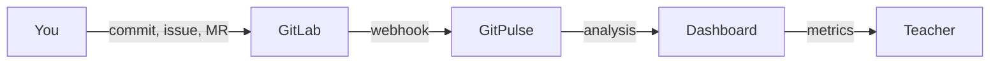


- For: Student
- Requires: A university GitLab account

Welcome to the GitPulse student guide. This section will help you understand how GitPulse works, what the system tracks, and how to effectively use the dashboard information.

## Guide Contents

  - [Getting Started](./zaciname/) - First login, dashboard navigation, and basic features.
  - [Understanding Metrics](./metriky/) - What compliance rules R01-R13 mean and how they affect your evaluation.
  - [FAQ](./faq/) - Frequently asked questions and answers for students.

---

## What is GitPulse?

GitPulse is a tool supporting DevOps education that automatically analyzes your work in GitLab projects. The system tracks:

- **Commit activity** - regularity and work distribution over time
- **Issue management** - creating, assigning, and closing tasks
- **Merge requests** - code review and code integration
- **CI/CD pipeline** - automated testing and deployment
- **Teamwork** - work distribution among team members


**GitPulse is not a surveillance tool.** GitPulse only analyzes publicly available data from your GitLab projects. It does not track your personal activity, record your screen, or monitor time spent at the computer. The system evaluates **teamwork outputs**, not individual productivity.

## How does it work?

1. **You work in GitLab** - creating commits, issues, merge requests
2. **GitPulse automatically syncs** data from your projects
3. **The dashboard displays** compliance metrics and activity overview
4. **The instructor uses** this data as input for evaluation

---

## Important Notes


**Academic integrity.** GitPulse gives instructors evidence for reviewing the process, not a replacement for academic judgement. Artificially inflated activity, empty commits, superficial reviews, or attempts to bypass course rules can be checked directly in GitLab.


**Best practices.** - Work regularly, not just before deadlines - Use meaningful commit messages - Break work into smaller tasks via issues - Use merge requests for code review - Set up and maintain a CI/CD pipeline
