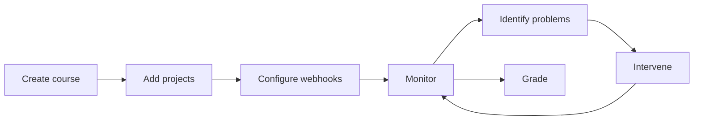


- For: Teacher
- Requires: A GitPulse account with the instructor role

Welcome to the GitPulse Teacher's Guide. This section will help you effectively use the tool for monitoring and evaluating student teamwork.

## Contents of the manual

  - [Here we go](./zaciname/) - First steps with GitPulse - creating a course, adding projects, basic configuration.
  - [Dashboard and metrics](./dashboard/) - Dashboard overview, available metrics and their meaning.
  - [Interpretation of results](./interpretacia/) - How to correctly interpret compliance scores and identify problems.
  - [Evaluation in teaching](./pilot/) - How GitPulse will be evaluated with teachers and students and what a teacher does.
  - [Classroom assistant](./asistent/) - A bot that works on the exercises like a colleague: push review, a merge conflict, issues and merge requests.
  - [FAQ](./faq/) - Frequently asked questions and answers.

## Quick overview

### What does GitPulse offer teachers?

| Function | Benefit |
|---------|--------|
| **Checks R01 to R13** | The routine part of checking is precomputed, and every result has an explanation and a link to GitLab |
| **Real-time monitoring** | Early identification of problem teams |
| **Data exports (CSV / JSON)** | Student roster and grading background |
| **Historical trends** | Monitoring the development during the semester |

### Typical workflow

### Time requirement

How much time GitPulse saves a teacher has not been measured yet. It is measured in
the task study with teachers described on
[Evaluation in teaching](./pilot/).

## Prerequisites

Before starting work with GitPulse you need:

- [x] School GitLab account (gitlab.example.com)
- [x] Students' GitLab projects (or access to create them)
- [x] GitLab Personal Access Token with rights `api`, `read_repository`
- [x] Basic understanding of GitLab workflow (commits, MR, issues)


**Gaining access.** A GitPulse account is created automatically on first login via the school GitLab (OAuth). If you need a role change (e.g. promoted to instructor), contact the administrator at [mykyta.olym.work@gmail.com](mailto:mykyta.olym.work@gmail.com).

## Additional resources

- [GitLab integration](../gitlab/index.md) - Technical details of the setup
- [Security](../bezpecnost/index.md) - How student data is protected
- [API documentation](../api/index.md) - For advanced use

