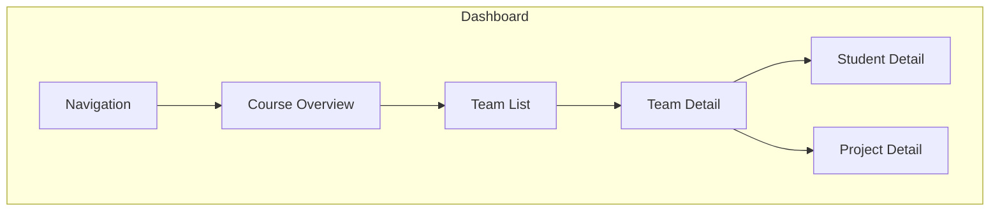
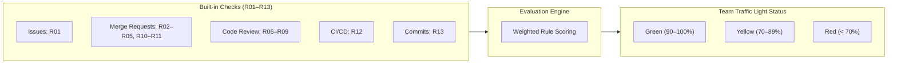


- For: Teacher
- Requires: A GitPulse account with the instructor role

This page explains the individual parts of the dashboard and the meaning of the displayed metrics.

## Dashboard Overview

## Navigation

### Main Sections

| Section | Description |
|--------|-------|
| **Courses** | List of your courses |
| **Teams** | Overview of all teams in the course |
| **Settings** | Course configuration, compliance controls, deadlines |

### Global Status Bar

A **global sync status bar** appears at the top of every page showing ongoing synchronizations:

- Number of queued, running, and completed jobs
- Auto-updates every 2 seconds
- Disappears after all jobs complete

### Filtering and Searching

- **Search**: Find a team or student by name
- **Filtering**: Display by status (OK, Warning, Critical)
- **Sorting**: By compliance score, name, activity

### Academic Period

The Dashboard, **Course Management** and **User Management** each carry an
**academic period** selector - one academic year and one semester, for example
*2026/2027 · Winter*. It decides which courses, and which students, the page is
about. The period travels in the address bar (`?period=2026-2027-winter`), so a
link to a cohort opens that cohort.

- **Which period a page opens on**: the newest one that holds courses *you can
  see* - not simply the calendar's. A course that runs only in summer would
  otherwise open on an empty winter for half the year. The period the TUKE
  calendar says is running is marked **Current** (or **Upcoming** between two
  semesters), so the two are never confused.
- **Which terms are listed**: both terms of the current academic year (an
  empty one is marked **No courses** rather than left out), the next term, and
  every older term that holds courses. A finished term with nothing in it is
  not listed - it would only be noise.
- **All periods** shows everything at once.
- **No period** (User Management only) lists students who are not in any group
  of any course yet - typically someone who signed in through GitLab before
  their group was synced. Without it they would be invisible in every period.
- **Your choice is remembered** - in the browser, like the interface
  language - and the pages open on it next time, until the next term starts;
  then they follow the calendar again. A link that names a period always wins.

Only **students** are narrowed by the period. Administrators, teachers and
service accounts appear in every period: they are not tied to a cohort, and
User Management would otherwise lose the very people who run it. The
**Period** column of User Management shows the terms each student is in.

On the Dashboard the period scopes everything on the page, and every refresh
of it: the course cards, the **Students**, **Groups** and **Compliance** cards
(each names its period, and opens the page that shows the same figure), the
items that need your attention and the activity feed. Only the housekeeping
items - a finished semester to archive, last year's course to transfer - look
at all your courses, because that course is by definition not in the term on
screen.

A group, a student and a project page each show the term their course belongs
to as a badge next to the title; it is highlighted when that term is the one
currently running. The course dialogs are described in
[Getting Started](zaciname.md#the-academic-period-and-its-dates): a new course
defaults to the term you picked in the selector, otherwise to the calendar's.

## Course Overview

### Summary Metrics

On the course page you will see:

- **Number of teams, students, and projects**
- **Average compliance score** with trend vs. last week
- **Team list** with traffic-light status
- **Alerts** for teams needing attention

### Team Statuses

| Status | Description | Compliance |
|--------|-------|------------|
| **Green** | Team is doing well | ≥ green threshold (default 80%) |
| **Yellow** | Needs attention | Between yellow and green threshold |
| **Red** | Serious problems | < yellow threshold (default 50%) |


**Dynamic Thresholds.** Green and yellow thresholds are configurable in course settings. Changes are reflected immediately on the dashboard.

## Team List

### Team Table

| Column | Description |
|--------|-------|
| **Team** | Team name (clickable) |
| **Compliance** | Overall compliance score with color indicator |
| **Last Activity** | Time of last commit/MR |
| **Members** | Number of students in the team |
| **Actions** | Buttons for sync, details |

## Team Detail

### Detail Sections

#### 1. Compliance Overview

Traffic-light status for each of the 13 Built-in Controls (R01-R13) plus custom controls (C01+).

#### 2. Activity Charts

Interactive charts showing team activity over time - commits, MRs, issues.

#### 3. Statistics

- Number of commits, MRs, issues, comments
- Review coverage (% of MRs with review)
- Pipeline success rate
- Test coverage

## Student Detail

### Individual Metrics

| Metric | Description |
|---------|-------|
| Commits | Total number of commits |
| MRs Created | Number of merge requests |
| Code Review | Number of review comments |
| Issues | Created and closed issues |

All metrics show comparison with team average.

### Section Pagination

Student detail contains 8 sections with client-side pagination:

1. Commits
2. Merge Requests
3. Issues
4. Comments
5. Pipeline results
6. Review activity
7. AI enrichment

## Compliance Metrics (R01-R13)

The weights in the tables are the defaults. R09, R11 and R13 are off by default. A
student's score is the sum of the partial scores of the enabled checks divided by
their total weight, so a switched-off check does not lower the score, is not counted
among the checks and does not show to the student as failed.

### Category: Issue

| Code | Metric | Weight | Description |
|------|--------|--------|-------------|
| R01 | Issue Assigned | 8 % | Student has at least 1 assigned issue |

### Category: MR

| Code | Metric | Weight | Description |
|------|--------|--------|-------------|
| R02 | Branch + MR Created | 6 % | The student has an MR from their own branch (a branch name convention is optional) |
| R03 | Tests Written | 10 % | At least 1 MR contains test file changes |
| R04 | MR Linked to Issue | 8 % | The MR references an issue by branch name or in the description (e.g. `Closes #12`) |
| R05 | MR Description | 5 % | The MR description has at least 10 words, optionally the required template sections |
| R10 | Merged by Author | 7 % | The author or another known team member merged the MR (a course can require the author or someone else) |
| R11 | MR + Issue Closed | 6 % | Both MR and linked issue are closed |

### Category: Review

Checks R06-R09 support **partial scoring** - score = weight × fulfillment ratio.

| Code | Metric | Weight | Description |
|------|--------|--------|-------------|
| R06 | Code Review Received | 12 % | Student's MR received reviews from ≥ N distinct reviewers |
| R07 | Code Review Given | 12 % | Student meaningfully reviewed ≥ N distinct peer MRs |
| R08 | Review Response | 10 % | Author responded to review threads and referenced commits |
| R09 | MR Approved | 9 % | Student's MR received ≥ N approvals |

### Category: CI

| Code | Metric | Weight | Description |
|------|--------|--------|-------------|
| R12 | Pipeline Green | 7 % | At least 1 pipeline succeeded with a test job |

### Category: Commit

| Code | Metric | Weight | Description |
|------|--------|--------|-------------|
| R13 | Commit Quality | 0 % | Commit quality (ratio of web-editor commits ≤ 30 %, default 0 % / opt-in) |

## Export and Configuration

### CSV Export

Export course data in CSV format (student roster, team activity).

### JSON Configuration Export/Import

Export the complete course configuration including:

- Course settings
- Compliance controls and thresholds
- Custom controls

Import configuration into a new or existing course. Useful for:

- Cloning settings between courses
- Sharing configuration between teachers
- Backup and restore

## LLM Enrichment

GitPulse has an optional LLM analysis of merge requests. It is disabled in production
(the deploy script sets `FEATURE_LLM_SUGGESTIONS=false`), does not feed checks
R01-R13 and creates no grade. Where an administrator enables it, it offers:

- **Merge request analysis** - AI summarization of changes, code quality and review comments
- **Team summaries** - aggregated overview of strengths and areas for improvement
- **Student summaries** - individual contribution analysis


**Privacy.** Before sending to the AI model, all personal data (names, emails, GitLab handles) is automatically redacted. Supported providers: any OpenAI-compatible provider, Gemini and Groq.

## GitLab Roles and Scoring

### Role Badges

On the team detail page, each member displays a colored badge reflecting their GitLab role:

| Role | Color | Access Level |
|------|-------|-------------|
| **Owner** | Warning (yellow) | 50 |
| **Maintainer** | Info (blue) | 40 |
| **Developer** | Secondary (grey) | 30 |
| **Reporter** | Grey | 20 |
| **Guest** | Grey | 10 |

Members with `inherited` membership (from parent group) have an additional "inherited" badge.

### Non-Contributing Members

Members excluded from the team score are labeled **(not in team score)**. Exclusion occurs when:

1. **Low role + zero activity** - Guest or Reporter with no commits, MRs, issues, or reviews
2. **Inherited access + zero activity** - inherited group member without any activity, regardless of role
3. **Teacher** - teachers marked as `is_teacher=true`


**Force Recheck.** The "Re-check" button on the team page triggers an immediate metric recomputation - including all checks regardless of weekly filtering.

## Further Reading

- [Result Interpretation](interpretacia.md) - How to read metrics correctly
- [FAQ](faq.md) - Frequently asked questions
