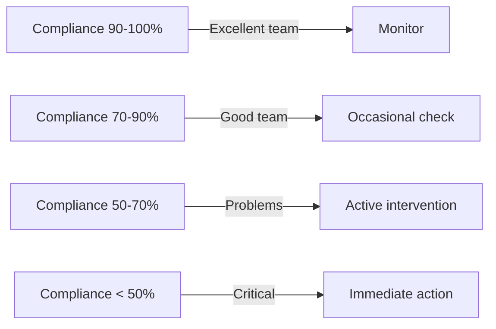
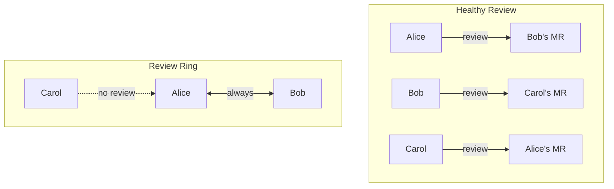
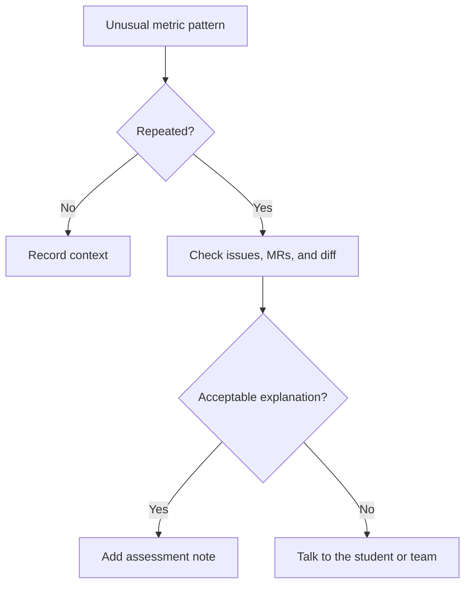


- For: Teacher
- Requires: A GitPulse account with the instructor role

This page will help you interpret metrics correctly and identify real problems in teams.

## Basic principles


**Important notice.** Metrics are **indicators**, not absolute truth. Always consider context and verify suspicions before jumping to conclusions.

### What the metrics say

| The metrics say | Metrics don't say |
|-----------------|-------------------|
| Quantity of activities | Code Quality |
| Distribution of work | Individual talent |
| Adherence to processes | Real Benefit |
| Patterns of behavior | Circumstances of the student |

## Compliance score

### Interpretation of the total score

### Context is key

| Score | Possible interpretations |
|-------|---------------------|
| High score (>80%) | + A well-functioning team OR ! Gamification of metrics |
| Average score (60-80%) | + Starting team OR ! Problems with cooperation |
| Low score (<60%) | ! Serious problems OR + Different work style |


**Best practice.** Compare teams within the course, not absolute values. Each course has a different baseline.

## Interpretation of individual metrics

### R01: Issue Assigned

**What we measure:** Student has at least 1 assigned issue in the project

**Healthy patterns:**

- Each student works on their own issue
- Issue is created before starting work

**Warning signs:**

- Student has no assigned issue -> score 0 %
- Issue assigned only formally, without actual work

### R02: Branch + MR Created

**What we measure:** MR source branch follows naming convention (default `issue-123-description`)

**Healthy patterns:**

- Branch named according to convention: `issue-5-add-search`
- MR created from feature branch

**Warning signs:**

- Branch named generically: `my-branch`, `fix`, `test`
- Direct push to main without MR

### R03: Tests Written

**What we measure:** At least 1 MR contains test file changes

**Configuration:** Test file patterns are set via `test_file_patterns`

### R04: MR Linked to Issue

**What we measure:** MR description references an issue (e.g. `Closes #5`, `Fixes #12`)

### R05: MR Description

**What we measure:** MR description includes required sections (default `## Description` and `## Testing`)

### R06: Code Review Received (partial scoring)

**What we measure:** Student's MR received reviews from ≥ N distinct reviewers

**Partial scoring:** If student needs 2 reviewers and has 1, they get 50 % of the weight.

**Healthy patterns:**

- Each member reviews and is reviewed
- Constructive comments (≥ 30 words)
- Different reviewers (not always the same person)

### R07: Code Review Given (partial scoring)

**What we measure:** Student meaningfully reviewed ≥ N distinct peer MRs

**Minimum review length:** 30 words (configurable via `min_review_word_count`)

### R08: Review Response (partial scoring)

**What we measure:** Author responded to review threads and referenced commits

Comments by bot accounts (the classroom assistant or a CI bot, for example) do not count as threads; nobody expects the author to answer them.

### R09: MR Approved (partial scoring)

**What we measure:** Student's MR received ≥ N approvals

### R10: Merged by Author

**What we measure:** Author merged their own MR (not another team member)

### R11: MR + Issue Closed

**What we measure:** Both MR and linked issue are closed

### R12: Pipeline Green

**What we measure:** At least 1 pipeline succeeded with a test job

## Non-Contributing Members

### When is a member excluded from the team score?

The compliance engine uses **three-tier member classification**:

1. **Teachers** (`is_teacher=true`) - get an individual snapshot but are never included in the team aggregate
2. **Non-contributing** - Guest/Reporter with no activity OR inherited members with no activity -> get an individual snapshot but are excluded from the team average
3. **Students** - Developer+ or any member with activity -> included in the team score

### What counts as "activity"?

Activity means the member has at least one of the following:

- Authored merge request
- Assigned issue
- Given code review
- Triggered pipeline

### Weekly Check Filtering

If a course uses `weekly_deadlines` with `expected_checks`, the engine evaluates only checks relevant to the current week. This prevents penalizing students for checks not yet introduced in the curriculum.


**Force-recheck.** The endpoint `POST /api/v1/teams/{team_id}/run-checks` triggers a recomputation with **all** checks (R01-R13 + custom), bypassing weekly filtering.

## Process Quality

Read the compliance score together with the real GitLab content. Low review diversity, many generic commit messages, or activity concentrated right before the deadline are signals for manual review, not automatic punishment.

### How to react to a suspicious pattern

## Contextual factors

### When metrics can lie

| Situation | Impact on metrics | How to verify |
|----------|------------------|------------|
| Pair programming | Low distribution | Ask about workflow |
| Refactoring | Big changes, few features | See diff |
| Documentation | Few commits | See contents |
| Final phase | Burst activity | Compare with plan |

### Verification questions

Before drawing conclusions, ask yourself:

1. **Is this pattern consistent?** (not a one time anomaly)
2. **Are external factors influencing it?** (exams, holidays)
3. **Does it match the workflow of the team?** (pair programming, mob programming)
4. **What does the code say?** (not just metrics)

## Practical examples

### Example 1: Low activity of one member

**Situation:** David has 5 commits per semester, the others 50+

**Possible causes:**
- David doesn't
- David does code reviews (not commits)
- David does documentation offline
- David has personal problems

**Action:** View review activity, compare with issues, or interview

### Example 2: High compliance, but poor result

**Situation:** The team has 90% compliance, but the project is not working

**Possible causes:**
- Rules satisfied formally without a good deliverable
- Good process, bad implementation
- Technical debts

**Action:** Code review, project demo, technical interview

### Example 3: Burst activity before the deadline

**Situation:** 80% commits in the last 2 days

**Possible causes:**
- Bad time management
- Underestimating the task
- External factors (other projects)
- Common for some types of tasks

**Action:** Planning discussion, mentoring

## Checklist for assessment

- [ ] I compared the team to the course average
- [ ] I looked at the trend, not just the current state
- [ ] I checked unusual patterns directly in GitLab
- [ ] I considered the context (project type, semester phase)
- [ ] I looked at the code, not just the metrics
- [ ] I have enough data for a conclusion

## Further reading

- [Evaluation in teaching](pilot.md) - How GitPulse will be evaluated in teaching
- [FAQ](faq.md) - Common situations and solutions

