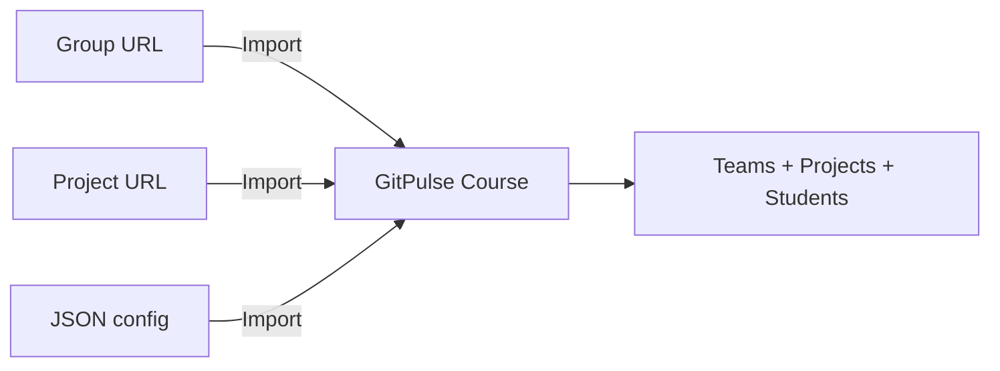


- For: Teacher
- Requires: A GitPulse account with the instructor role

This page guides you through the first steps of using the GitPulse.

## 1. Login

1. Open the GitPulse dashboard at the address provided by the administrator
2. Click **"Sign in with GitLab"** - you will be redirected to your GitLab server
3. Authorize the application, and after successful login you will see your courses overview


**Developer Mode.** In developer mode, login with name and role (admin / teacher / student) without GitLab OAuth is also available.

## 2. Creating a Course

### Option A - New Course

1. On the main dashboard, click **"Create Course"**
2. Fill in:

| Field | Description | Example |
|------|-------|---------|
| Course Code | Unique identifier | `ZSI` |
| Name | Full course name | `Fundamentals of Software Engineering` |
| Academic period | The term the course runs in | `2026/2027 · Winter (current)` |
| Semester Start / End Date | Filled in from the official TUKE calendar | `2026-09-21` - `2027-02-12` |

3. Click **"Create"**

### The academic period and its dates

Every dialog that creates or moves a course - **Create Course**, **Import from
GitLab**, **Edit Course**, **Transfer to New Semester** and the course
**Settings** - asks for the term the same way: one **Academic period** field,
followed by the two semester dates.

- The list offers the term the TUKE calendar is in (marked *current*, or
  *upcoming* between two semesters) and the terms after it - not a fixed span
  of years, so a finished year cannot be picked by accident. **Import from
  GitLab** also offers the last year's two terms, marked *ended*, to bring in
  a finished course for its history.
- Picking a term fills its **official TUKE dates**. Change the term and the
  dates move with it - as long as they are still the official ones. Dates you
  typed yourself stay; if the start date then falls in another term, the
  dialog says so.
- **Use the official TUKE dates** puts the calendar's dates back after a
  manual change.
- For a term the TUKE calendar does not publish yet, the dates stay empty and
  the dialog says why - enter them when the calendar is out.
- **Transfer to New Semester** proposes the same term one year on and never
  offers the term the course is already in. Left empty, its dates are this
  course's own, moved to the new term week for week - a deadline on the
  Friday of week 5 stays on the Friday of week 5.

The same rules are checked on the server for every way in, the REST API and
the JSON configuration import included: an academic year is two consecutive
years (`2026/2027`), a semester is `winter` or `summer`, and the end date is
after the start.

### Option B - Import from GitLab

1. Click **"Import from GitLab"**
2. Paste a GitLab URL:
      - **Group URL** - imports all subgroups and projects (e.g. `https://gitlab.example.com/zsi-labs/assignments-2026/a3`)
      - **Project URL** - imports only a single project (e.g. `https://gitlab.example.com/zsi-labs/assignments-2026/a3/mines-11679`)
3. Fill in code, name, and the academic period (its dates follow)
4. Check **"Auto-sync"** for immediate data download
5. Click **"Import"**


**Smart Structure Detection.** GitPulse automatically recognizes whether the URL points to a group or a project. When importing a group, subgroups become teams and projects are automatically linked. When importing a single project, one team is created with that project.

### Option C - JSON Configuration Import

1. Click **"Import JSON"**
2. Upload a JSON file with a complete course configuration
3. JSON includes settings, compliance checks, deadlines, and thresholds

## 3. Adding Projects

### Automatic Import from Group

If you have projects organized in a GitLab group:

1. On the course page, click **"Import from GitLab"**
2. Enter the group URL (e.g. `https://gitlab.example.com/zsi-labs/assignments-2026/a3`)
3. GitPulse automatically finds all projects and creates teams

### Single Project Import

1. Use **"Import from GitLab"** with a single project URL
2. The system creates one team with the assigned project
3. Students are automatically detected from project members

## 4. Data Synchronization

After import, you need to synchronize data from GitLab:

1. GitPulse automatically starts synchronization if you checked **"Auto-sync"**
2. Or click **"Sync All"** on the course page
3. Monitor progress in the global status bar (top of page)
4. After completion, metrics and compliance scores are updated


**What gets synchronized?.** - Issues - all open and closed - Merge Requests - with comments and review status - Pipelines - CI/CD results and coverage - Commits - history and statistics - Project members - automatic student detection

## 5. Student Import (Roster)

### Automatic Detection

Students are automatically imported from GitLab group/project members during import. No manual intervention is needed. The course **Roster** view lists every detected student and can be exported to CSV.

## 6. Compliance Controls Setup

### 13 Built-in Controls (R01-R13)

Controls are grouped into 4 categories: **Issue**, **MR**, **Review**, and **CI**.

| Control | Name | Category | Weight | Description |
|---------|------|----------|--------|-------------|
| R01 | Issue Assigned | Issue | 8 % | Student has at least 1 assigned issue |
| R02 | Branch + MR Created | MR | 6 % | MR source branch follows naming convention (e.g. `issue-123-description`) |
| R03 | Tests Written | MR | 10 % | At least 1 MR contains test file changes |
| R04 | MR Linked to Issue | MR | 8 % | MR description references an issue |
| R05 | MR Description | MR | 5 % | MR description includes required sections (e.g. Description, Testing) |
| R06 | Code Review Received | Review | 12 % | Student's MR received reviews from ≥ N distinct reviewers (partial scoring) |
| R07 | Code Review Given | Review | 12 % | Student meaningfully reviewed ≥ N distinct peer MRs (partial scoring) |
| R08 | Review Response | Review | 10 % | Author responded to review threads and referenced commits (partial scoring) |
| R09 | MR Approved | Review | 9 % | Student's MR received ≥ N approvals (partial scoring) |
| R10 | Merged by Author | MR | 7 % | Author merged their own MR |
| R11 | MR + Issue Closed | MR | 6 % | Both MR and linked issue are closed |
| R12 | Pipeline Green | CI | 7 % | At least 1 pipeline succeeded with a test job |
| R13 | Commit Quality | Commit | 0 % | Commit quality (ratio of web-editor commits ≤ 30 %, default 0 % / opt-in) |

### Threshold Configuration

In course settings -> **"Settings"** tab -> **"Compliance"** section:

- **Green threshold** (default 80%) - team meets requirements
- **Yellow threshold** (default 50%) - needs attention
- Below yellow threshold - **red** state

### Custom Controls

GitPulse also supports custom controls (C01+) for course-specific requirements.

## 7. First Review

After synchronization:

1. Open the course page - you'll see a team table with traffic-light status
2. Click a team for details (compliance, activity, analytics)
3. Click a student for individual metrics (commits, issues, MR, comments)


**Done!.** Your course is ready. GitPulse automatically processes new events and updates metrics.

## Checklist

- [x] Logged in via GitLab OAuth
- [x] Created / imported course
- [x] Imported projects and students
- [x] Data synchronization completed
- [x] Compliance controls and thresholds configured
- [x] Checked dashboard - metrics display correctly

## Next Steps

- [Dashboard and Metrics](dashboard.md) - Learn how to read metrics
- [Result Interpretation](interpretacia.md) - Understand the meaning of scores
- [FAQ](faq.md) - Solving common problems

