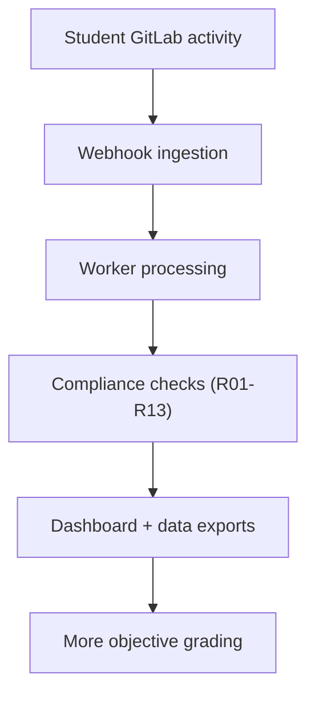


- For: Everyone
- Requires: Nothing

GitPulse is a platform for transparent and scalable evaluation of team work in GitLab projects.

## Primary Goal

Replace manual, subjective grading with a measurable data-driven process:

- automated event collection
- consistent compliance rules
- auditable outputs for teachers

## Target Audience

- teachers: metric interpretation and evaluation decisions
- developers: implementation, testing, release workflow
- operators: deployment, monitoring, incident response

## Next Steps

- [Project overview](prehlad.md)
- [Thesis goals](ciele.md)
- [System architecture](architektura.md)
