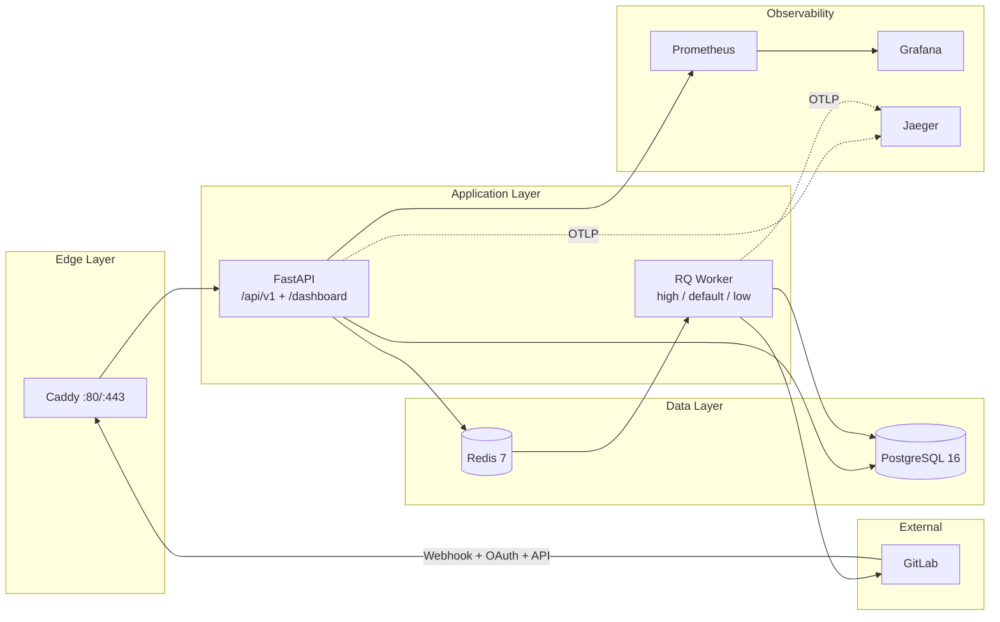
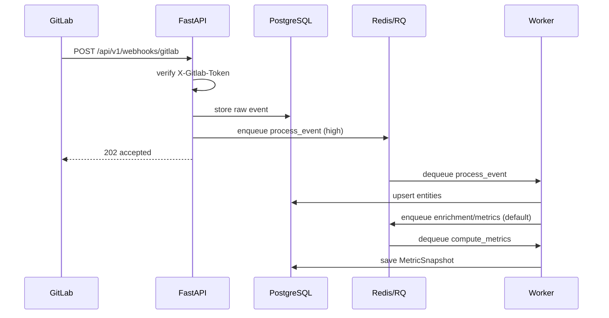
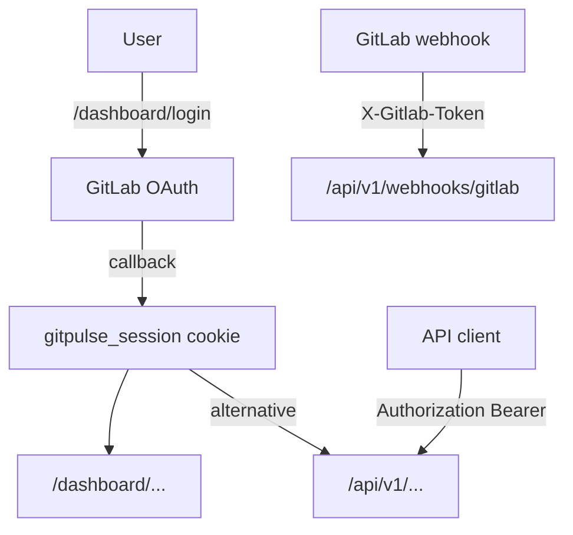


- For: Everyone
- Requires: Nothing

> Verified against implementation on **2026-09-09**.

## Runtime architecture

## Components and responsibilities

| Component | Responsibility |
|---|---|
| `Caddy` | TLS termination and reverse proxy |
| `FastAPI` | REST API, dashboard routes, health/metrics endpoints |
| `PostgreSQL` | persistent data (courses, teams, events, metrics, support tickets, audit logs) |
| `Redis` | queue backend, idempotency locks, short-lived cache |
| `RQ Worker` | webhook processing, MR/issue enrichment, metric computation, compliance snapshots, auto-archive, LLM analysis; delayed jobs (such as email-delivery retries) are scheduled via `Queue.enqueue_in` and executed by the worker's built-in RQ scheduler |

## Async pipeline (webhook -> metrics)

## Authentication architecture

Auth layers:

1. Dashboard: GitLab OAuth + signed session cookie.
2. API: Bearer token (`TEACHER_API_TOKEN`) or dashboard session.
3. Webhook endpoint: per-project secret (`X-Gitlab-Token`).

## Queues and scheduled jobs

| Queue | Purpose | Priority |
|---|---|---|
| `high` | webhook ingest processing | highest |
| `default` | enrichment, sync, metrics recompute | medium |
| `low` | compliance snapshots, auto-archive, LLM analysis | lowest |

The system runs **no periodic (cron) jobs**. Data refreshes come solely from
GitLab events (webhooks) and explicit actions in the UI. Maintenance
operations (pruning old events, archiving ended courses, re-analysis, etc.)
are exposed as manual actions under *System -> maintenance jobs* and an admin
runs them on demand. Delayed jobs (e.g. an email-delivery retry that backs off
and re-enqueues itself via `Queue.enqueue_in`) are executed by the worker's
built-in RQ scheduler.

## Deployment model

Production compose services:

- `postgres`
- `redis`
- `api`
- `worker`
- `caddy`

Optional `monitoring` profile adds:

- `prometheus`
- `grafana`
- `jaeger`

## Related pages

- [API reference](../api/index.md)
- [Monitoring](../operatori/monitoring.md)
- [Deployment](../operatori/nasadenie.md)
