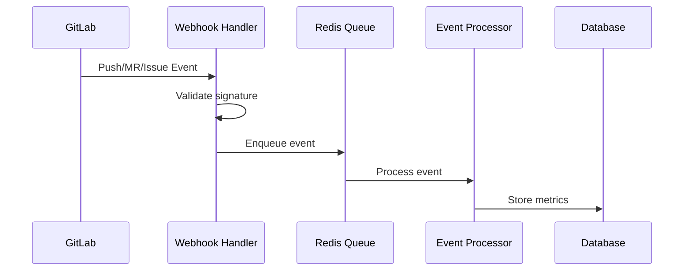
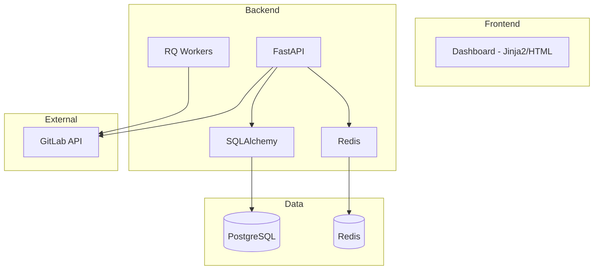


- For: Everyone
- Requires: Nothing

## What is a GitPulse?

**GitPulse** is a web application that automatically analyzes student activity on GitLab projects and provides teachers with objective metrics for evaluating teamwork and DevOps practices.

## Target group

### Primary users

| Role | Using |
|------|----------|
| **Teacher/Trainer** | Activity monitoring, evaluation, problem identification |
| **Course Admin** | Course configuration, user management |
| **Operator** | Deployment, maintenance, monitoring of the system |

### Secondary users

- **Students** - indirect access through transparent metrics
- **Administrators** - administration of the entire instance

## Key features

### 1. Data collection from GitLab



GitPulse receives webhooks from GitLab and processes:

- **Push events** - commits, file changes
- **Merge request events** - creation, review, merge
- **Note events** - comments, code review
- **Pipeline events** - CI/CD builds
- **Issue events** - task management

### 2. Compliance assessment

The system evaluates 13 DevOps practices (R01-R13):

| Code | Check | Category | Weight |
|------|-------|----------|--------|
| R01 | Issue Assigned | Issue | 8 % |
| R02 | Branch + MR Created | MR | 6 % |
| R03 | Tests Written | MR | 10 % |
| R04 | MR Linked to Issue | MR | 8 % |
| R05 | MR Description | MR | 5 % |
| R06 | Code Review Received | Review | 12 % |
| R07 | Code Review Given | Review | 12 % |
| R08 | Review Response | Review | 10 % |
| R09 | MR Approved | Review | 9 % |
| R10 | Merged by Author | MR | 7 % |
| R11 | MR + Issue Closed | MR | 6 % |
| R12 | Pipeline Green | CI | 7 % |
| R13 | Commit Quality | Commit | 0 % (opt-in) |

### 3. Dashboard and analysis

- **Real-time dashboard** - current status of all teams with SSE live updates
- **Team drill-down** - detailed analysis of a specific team
- **Student detail** - individual contributions with per-check breakdown
- **Export** - CSV data export, JSON course configuration export/import
- **LLM analysis** - optional AI analysis of merge requests with personal data redaction, disabled in production
- **Email notifications** - automated course and assessment notifications

## Technology stack



| Component | Technology | Purpose |
|-----------|-------------|------|
| API Server | FastAPI | REST API, webhook handling |
| Database | PostgreSQL | Persistent data |
| Cache/Queue | Redis | Caching, job queue |
| Workers | RQ (Redis Queue) | Background processing |
| Frontend | Jinja2 + htmx + Alpine.js | Server-side rendering with component macros |

## Deployment

GitPulse is designed to be deployed using Docker Compose:

```yaml
services:
  api:           # FastAPI application
  worker:        # RQ worker (high / default / low)
  postgres:      # Database
  redis:         # Cache and queue
  gitpulse-docs: # Documentation site (Hugo)
  caddy:         # Reverse proxy with HTTPS
```

GitPulse **does not use a scheduler or cron**. All jobs are triggered by webhooks
or explicit actions in the interface.

## Limits and restrictions


**Current restrictions.** - Only supports GitLab (not GitHub, Bitbucket) - Self-hosted GitLab must be accessible from the VM - Requires a GitLab API token with sufficient rights

## Further reading

- [System architecture](architektura.md) - technical details
- [Thesis goals](ciele.md) - academic context
- [Teacher's Guide](../ucitelia/index.md) - starting with GitPulse

