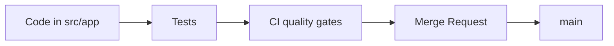


- For: Developer
- Requires: A local environment, per the developer guide

> Verified against the repository on **2026-09-09**.

## Quick orientation



## Where to find what

| Path | Purpose |
|---|---|
| `src/app/api` | route handlers (API + dashboard) |
| `src/app/services` | business logic and integrations |
| `src/app/workers` | background job processing |
| `src/app/models` | SQLAlchemy models |
| `src/app/schemas` | Pydantic request/response DTOs |
| `src/app/security` | auth, CSRF, token utilities |
| `src/app/observability` | logging, metrics, tracing |
| `tests/*` | unit, integration, load tests |

## Local setup

```bash
python -m venv .venv
# Linux/macOS: source .venv/bin/activate
# Windows: .venv\Scripts\Activate.ps1

pip install --constraint requirements.lock -e ".[dev,otel]"
docker compose up -d postgres redis
alembic upgrade head
uvicorn app.main:create_app --factory --reload
```

## Required quality gates

```bash
ruff check src/ tests/ scripts/
ruff format --check src/ tests/ scripts/
mypy src/app
pytest tests/unit -q
```

CI definition:

- `.gitlab-ci.yml`

## API and contracts

- route inventory: `docs/04-api-spec.md`
- dashboard routes: `src/app/api/dashboard.py`
- health/metrics: `src/app/api/health.py`

## Recommended workflow

1. Create a branch (`feature/*`, `fix/*`, `refactor/*`).
2. Implement change + tests.
3. Pass local quality gates.
4. Open MR with impact and test notes.
5. Merge after code review and green CI.

## Documentation

- internal docs: `docs/*`
- docs site (SK/EN): `docs-site/docs/*`
- system audit: `docs/00_system_audit_2026-02-15.md`
