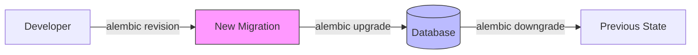


- For: Developer
- Requires: A local environment, per the developer guide

Guide to managing database migrations using Alembic.

## Overview



## Configuration

### alembic.ini

```ini
# alembic.ini
[alembic]
script_location = alembic
prepend_sys_path = src

# Database URL z environment variable
sqlalchemy.url = 

[post_write_hooks]
hooks = ruff
ruff.type = exec
ruff.executable = ruff
ruff.options = format REVISION_SCRIPT_FILENAME
```

### env.py

```python
# alembic/env.py
import asyncio
from logging.config import fileConfig

from sqlalchemy import pool
from sqlalchemy.ext.asyncio import async_engine_from_config
from alembic import context

from app.config import settings
from app.models.base import Base

# Importovať všetky modely
from app.models import *  # noqa

config = context.config
config.set_main_option("sqlalchemy.url", settings.DATABASE_URL)

if config.config_file_name is not None:
    fileConfig(config.config_file_name)

target_metadata = Base.metadata

def run_migrations_offline() -> None:
    """Run migrations in 'offline' mode."""
    url = config.get_main_option("sqlalchemy.url")
    context.configure(
        url=url,
        target_metadata=target_metadata,
        literal_binds=True,
        dialect_opts={"paramstyle": "named"},
    )

    with context.begin_transaction():
        context.run_migrations()

def do_run_migrations(connection):
    context.configure(connection=connection, target_metadata=target_metadata)
    with context.begin_transaction():
        context.run_migrations()

async def run_async_migrations():
    connectable = async_engine_from_config(
        config.get_section(config.config_ini_section, {}),
        prefix="sqlalchemy.",
        poolclass=pool.NullPool,
    )

    async with connectable.connect() as connection:
        await connection.run_sync(do_run_migrations)

    await connectable.dispose()

def run_migrations_online() -> None:
    """Run migrations in 'online' mode."""
    asyncio.run(run_async_migrations())

if context.is_offline_mode():
    run_migrations_offline()
else:
    run_migrations_online()
```

## Basic commands

### Creating a migration

```bash
# Automatická detekcia zmien v modeloch
alembic revision --autogenerate -m "add_team_description"

# Prázdna migrácia (manuálna)
alembic revision -m "custom_data_migration"
```

### Applying migrations

```bash
# Latest version
alembic upgrade head

# Specific version
alembic upgrade 003

# Relative (2 steps forward)
alembic upgrade +2
```

### Rollback

```bash
# One step back
alembic downgrade -1

# To specific version
alembic downgrade 002

# To beginning (caution!)
alembic downgrade base
```

### Information

```bash
# Current version
alembic current

# Migration history
alembic history --verbose

# Pending migrations
alembic heads
```

## Existing migrations

GitPulse uses a linear history of 27 Alembic migrations (`001` through `027`):

| Migration | Description |
|----------|-------|
| `001_core_schema` | Core platform schema (courses, teams, users, projects, events) |
| `002_teaching_tools` | Educational tools (rubrics, telemetry, LLM integration) |
| `003_scale_and_telemetry` | Scale optimizations and pilot telemetry |
| `004_release_v1_consolidated` | Release v1 consolidated schema |
| `005_drop_redundant_indexes_and_assignments` | Drop redundant indexes and assignment tables |
| `006_pipeline_coverage` | Add test coverage column to `pipelines` table |
| `007_mr_assignee_reviewers` | Explicit assignees, reviewers, and approvers in `merge_requests` |
| `008_project_gitlab_intel` | JSONB `gitlab_intel` column in `gitlab_projects` |
| `009_drop_sandbox_features` | Permanently drop unused sandbox features (conflict simulator, docker verify, ci failure) |
| `010_prune_metric_snapshot_backlog` | Cap growth of metrics history and indexes |
| `011_patterns_into_check_configs` | Move convention patterns into per-check configuration |
| `012_user_preferences` | Account-level user preferences (theme, layout width, shortcuts) |
| `013_diff_colors` | Custom diff row colors (Preferences > Diffs) |
| `014_notification_prefs` | Category-based notification preferences |
| `015_workspace_prefs` | GitPulse workspace preferences |
| `016_ticket_queue_pref` | Split staff-facing support ticket notifications |
| `017_syntax_theme_pref` | Syntax highlighting preference |
| `018_mr_commit_shas` | Merge request commit SHAs from GitLab |
| `019_mr_notes_author_index` | Index for merge request note authors |
| `020_remember_period` | Preference to remember the chosen academic period |
| `021_default_period` | Preference for the default period of pages with a period selector |
| `022_drop_remember_period` | Drops the column replaced by the default period |
| `023_classroom_assistant` | Classroom assistant: the course bot account and student tasks |
| `024_assistant_language_and_token_state` | Assistant comment language and rejected-token state |
| `025_analytics_snapshot_indexes` | Indexes for course analytics without reading snapshot history |
| `026_course_snapshot_freshness_index` | Index of the latest course snapshot |
| `027_drop_usage_telemetry` | Drops the pilot usage telemetry tables |

## Writing migrations

### Autogenerated migration

```python
# alembic/versions/028_example_feature.py
"""add example feature

Revision ID: 028_example_feature
Revises: 027
Create Date: 2026-09-10 10:00:00.000000

"""
from typing import Sequence

from alembic import op
import sqlalchemy as sa

# revision identifiers
revision: str = '028_example_feature'
down_revision: str | None = '019_mr_notes_author_index'
branch_labels: str | Sequence[str] | None = None
depends_on: str | Sequence[str] | None = None

def upgrade() -> None:
    # ### autogenerated ###
    op.create_table(
        'user_preferences',
        sa.Column('id', sa.Integer(), nullable=False),
        sa.Column('user_id', sa.Integer(), nullable=False),
        sa.Column('theme', sa.String(20), nullable=False, default='light'),
        sa.Column('notifications_enabled', sa.Boolean(), default=True),
        sa.Column('created_at', sa.DateTime(), nullable=False),
        sa.Column('updated_at', sa.DateTime(), nullable=False),
        sa.ForeignKeyConstraint(['user_id'], ['users.id'], ondelete='CASCADE'),
        sa.PrimaryKeyConstraint('id')
    )
    op.create_index('ix_user_preferences_user_id', 'user_preferences', ['user_id'])
    # ### end autogenerated ###

def downgrade() -> None:
    # ### autogenerated ###
    op.drop_index('ix_user_preferences_user_id', 'user_preferences')
    op.drop_table('user_preferences')
    # ### end autogenerated ###
```

### Data migration

```python
# alembic/versions/012_populate_default_checks.py
"""populate default checks

Revision ID: 012_populate_default_checks
Revises: 011_add_user_preferences
Create Date: 2026-11-15 11:00:00.000000

"""
from alembic import op
import sqlalchemy as sa
from sqlalchemy.sql import table, column

revision = '012_populate_default_checks'
down_revision = '011_add_user_preferences'

def upgrade() -> None:
    # Definícia tabuľky pre insert
    custom_checks = table(
        'custom_checks',
        column('id', sa.Integer),
        column('course_id', sa.Integer),
        column('check_code', sa.String),
        column('name', sa.String),
        column('description', sa.Text),
        column('is_active', sa.Boolean),
    )
    
    # Batch insert
    op.bulk_insert(custom_checks, [
        {
            'id': 1,
            'course_id': 1,
            'check_code': 'C01',
            'name': 'Repository README',
            'description': 'Project has an up-to-date README',
            'is_active': True,
        },
        {
            'id': 2,
            'course_id': 1,
            'check_code': 'C02',
            'name': 'Deployment notes',
            'description': 'Project documents deployment steps',
            'is_active': True,
        },
    ])

def downgrade() -> None:
    op.execute("DELETE FROM custom_checks WHERE id IN (1, 2)")
```

### Complex migration

```python
# alembic/versions/013_split_events_table.py
"""split events table for better performance

Revision ID: 013_split_events_table
Revises: 012_populate_default_checks
Create Date: 2026-11-15 12:00:00.000000

"""
from alembic import op
import sqlalchemy as sa

revision = '013_split_events_table'
down_revision = '012_populate_default_checks'

def upgrade() -> None:
    # 1. Vytvoriť novú tabuľku
    op.create_table(
        'commit_events',
        sa.Column('id', sa.Integer(), primary_key=True),
        sa.Column('project_id', sa.Integer(), sa.ForeignKey('projects.id')),
        sa.Column('sha', sa.String(40), nullable=False),
        sa.Column('message', sa.Text()),
        sa.Column('author_id', sa.Integer(), sa.ForeignKey('users.id')),
        sa.Column('committed_at', sa.DateTime(), nullable=False),
        sa.Column('lines_added', sa.Integer(), default=0),
        sa.Column('lines_removed', sa.Integer(), default=0),
    )
    
    # 2. Migrovať dáta
    op.execute("""
        INSERT INTO commit_events (id, project_id, sha, message, author_id, committed_at, lines_added, lines_removed)
        SELECT id, project_id, data->>'sha', data->>'message', author_id, created_at, 
               COALESCE((data->>'additions')::int, 0),
               COALESCE((data->>'deletions')::int, 0)
        FROM events
        WHERE event_type = 'commit'
    """)
    
    # 3. Vytvoriť index
    op.create_index('ix_commit_events_project_committed', 'commit_events', ['project_id', 'committed_at'])
    
    # 4. Odstrániť staré dáta (voliteľné)
    # op.execute("DELETE FROM events WHERE event_type = 'commit'")

def downgrade() -> None:
    # Migrovať dáta späť
    op.execute("""
        INSERT INTO events (project_id, event_type, data, author_id, created_at)
        SELECT project_id, 'commit', 
               jsonb_build_object('sha', sha, 'message', message, 'additions', lines_added, 'deletions', lines_removed),
               author_id, committed_at
        FROM commit_events
        WHERE NOT EXISTS (
            SELECT 1 FROM events e WHERE e.id = commit_events.id
        )
    """)
    
    op.drop_table('commit_events')
```

## Best practices

### Recommendations

1. **Always test up and down**
   ```bash
   alembic upgrade head
   alembic downgrade -1
   alembic upgrade head
   ```

2. **Atomic Changes**
   ```python
   # Jedna migrácia = jedna logická zmena
   # Nie: pridať tabuľku + zmeniť inú + migrovať dáta
   ```

3. **Backup before production migration**
   ```bash
   pg_dump -Fc gitpulse > backup_before_migration.dump
   alembic upgrade head
   ```

4. **Review autogenerated code**
   ```python
   # Alembic nedetekuje všetko správne
   # - Premenovanie stĺpca -> drop + add
   # - Zmena typu -> môže stratiť dáta
   ```

### Anti-patterns

```python
# 1. Hardcoded dáta v upgrade
def upgrade():
    op.execute("INSERT INTO users VALUES (1, 'admin', 'admin@example.com')")
    # Čo ak user už existuje?

# 2. DROP bez zálohy dát
def upgrade():
    op.drop_column('users', 'legacy_field')  # Dáta stratené navždy

# 3. Chýbajúci downgrade
def downgrade():
    pass  # Nemožné vrátiť späť!
```

## Production deployment

### Migration in CI/CD

```yaml
# .gitlab-ci.yml
migrate:
  stage: deploy
  script:
    - alembic upgrade head
  only:
    - main
  when: manual  # Manuálne spustenie pre bezpečnosť
```

### Docker entry point

```bash
#!/bin/bash
# docker-entrypoint.sh

# Čakať na databázu
while ! pg_isready -h $DB_HOST -p $DB_PORT; do
    echo "Waiting for database..."
    sleep 2
done

# Spustiť migrácie
alembic upgrade head

# Spustiť aplikáciu
exec uvicorn app.main:app --host 0.0.0.0 --port 8000
```

## Troubleshooting

### "Target database is not up to date"

```bash
# Mark current state as migrated
alembic stamp head

# Or a specific version
alembic stamp 018
```

### "Can't locate revision"

```bash
# Show history
alembic history

# Fix broken chain
alembic stamp --purge
alembic stamp head
```

### Conflict migrations

```bash
# Ak dva vývojári vytvorili migrácie súčasne:
# 1. Premenovať jednu (zmeniť revision ID)
# 2. Upraviť down_revision reťaz
```

## Further reading

- [Alembic documentation](https://alembic.sqlalchemy.org/)
- [Project structure](struktura.md)
- [Contributing](prispievanie.md)

