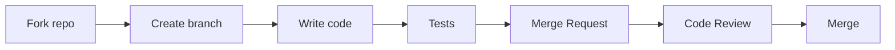
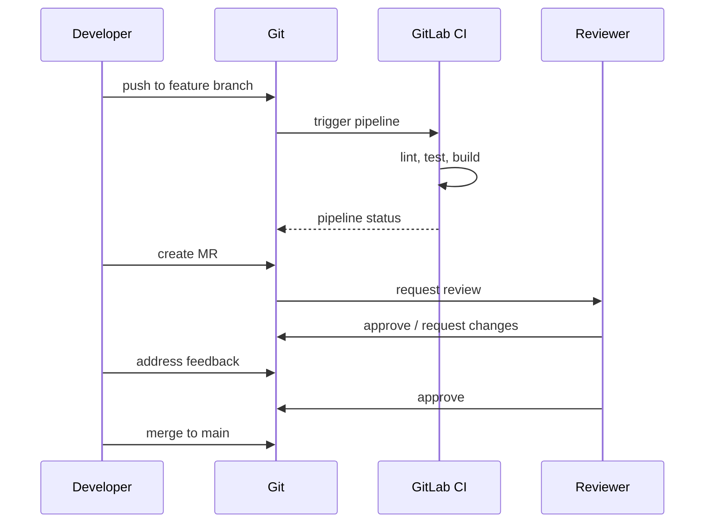
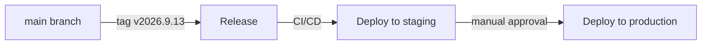


- For: Developer
- Requires: A local environment, per the developer guide

Thank you for your interest in contributing to the GitPulse! This page describes the process and conventions for contributing.

## Contribution process



## Quick start

### 1. Fork and cloning

```bash
git clone https://gitlab.example.com/kpi-zp/2027/dp.mykyta.olym/workspace/workspace.git gitpulse
cd gitpulse
```

### 2. Creation of a branch

```bash
# Synchronizácia s upstream
git fetch upstream
git checkout main
git merge upstream/main

# Nový feature branch
git checkout -b feature/moj-novy-feature
```

### 3. Development

```bash
# Nastavenie prostredia
python -m venv .venv
source .venv/bin/activate
pip install --constraint requirements.lock -e ".[dev,otel]"

# Spustenie testov
pytest

# Linting
ruff check .
ruff format .
```

### 4. Commit and push

```bash
git add .
git commit -m "feat: pridanie novej funkcionality"
git push origin feature/moj-novy-feature
```

### 5. Merge Request

Open the MR through the GitLab UI with a description of the changes.

## Conventions

### Branch naming

| Prefix | Purpose | Example |
|--------|------|---------|
| `feature/` | New functionality | `feature/live-sync-refresh` |
| `fix/` | Bug fix | `fix/timeline-sorting` |
| `docs/` | Documentation | `docs/api-examples` |
| `refactor/` | Refactoring | `refactor/service-layer` |
| `test/` | Tests | `test/compliance-engine` |

### Commit messages

We use [Conventional Commits](https://www.conventionalcommits.org/):

```
<type>(<scope>): <description>

[optional body]

[optional footer(s)]
```

#### Types

| Type | Description |
|-----|-------|
| `feat` | New functionality |
| `fix` | Bug fix |
| `docs` | Documentation |
| `style` | Formatting (without changing logic) |
| `refactor` | Refactoring |
| `test` | Tests |
| `chore` | Maintenance, build |

#### Examples

```bash
# Feature
feat(sync): add live activity refresh after course sync

# Fix
fix(api): oprava 500 error pri prázdnom team

# Docs
docs(readme): aktualizácia inštalačných inštrukcií

# Breaking change
feat(api)!: zmena formátu response pre /metrics

BREAKING CHANGE: response teraz obsahuje nested objekt metrics
```

### Code style

#### Python

We use [Ruff](https://docs.astral.sh/ruff/) for linting and formatting.

```toml
# pyproject.toml
[tool.ruff]
line-length = 100
target-version = "py312"

[tool.ruff.lint]
select = [
    "E",    # pycodestyle errors
    "W",    # pycodestyle warnings
    "F",    # Pyflakes
    "I",    # isort
    "B",    # flake8-bugbear
    "UP",   # pyupgrade
]

[tool.ruff.lint.isort]
known-first-party = ["app"]
```

#### An example of well-formatted code

```python
"""Team service module.

This module provides business logic for team management.
"""
from datetime import datetime
from typing import Sequence

from sqlalchemy import select
from sqlalchemy.ext.asyncio import AsyncSession

from app.models.team import Team
from app.schemas.team import TeamCreate, TeamUpdate

class TeamService:
    """Service for team-related operations."""
    
    def __init__(self, db: AsyncSession) -> None:
        """Initialize team service.
        
        Args:
            db: Async database session.
        """
        self.db = db
    
    async def get_all(self, course_id: int) -> Sequence[Team]:
        """Get all teams for a course.
        
        Args:
            course_id: The course ID to filter by.
            
        Returns:
            List of teams belonging to the course.
        """
        result = await self.db.execute(
            select(Team)
            .where(Team.course_id == course_id)
            .order_by(Team.name)
        )
        return result.scalars().all()
```

### Tests

Every new functionality must have tests.

```python
# tests/unit/test_team_service.py
import pytest
from app.services.team_service import TeamService

class TestTeamService:
    """Tests for TeamService."""
    
    @pytest.fixture
    def service(self, db_session):
        return TeamService(db_session)
    
    @pytest.mark.asyncio
    async def test_get_all_returns_teams_for_course(
        self, service, sample_course, sample_team
    ):
        """get_all should return only teams for specified course."""
        # Arrange
        course = await sample_course()
        team1 = await sample_team(course=course)
        team2 = await sample_team(course=course)
        
        # Act
        teams = await service.get_all(course.id)
        
        # Assert
        assert len(teams) == 2
        assert all(t.course_id == course.id for t in teams)
```

## Code Review

### What we are looking for

- [ ] The code is readable and well documented
- [ ] Tests cover new functionality
- [ ] No breaking changes without documentation
- [ ] Commit messages are descriptive
- [ ] CI pipeline passes

### Tips for the author MR

1. **Small MR** - They are easier to review
2. **Descriptive title** - Clearly explains what MR does
3. **Screenshots** - For UI changes
4. **Self-review** - Review the diff before submitting

### Tips for the reviewer

1. **Constructive Criticism** - Suggest solutions
2. **Prioritization** - Differentiate blocker vs nice-to-have
3. **Testing** - Checkout branch and try it
4. **Approve promptly** - Do not block progress

## Issues

### Creating an issue

```markdown
## Description
Short description of the problem or request.

## Steps to reproduce (for bugs)
1. Step 1
2. Step 2
3. ...

## Expected behavior
What should happen.

## Actual behavior
What happens instead.

## Environment
- OS: Ubuntu 22.04
- Python: 3.12.1
- GitPulse version: 2026.9.13
```

### Labels

| Label | Description |
|-------|-------|
| `bug` | Something is not working |
| `enhancement` | New functionality |
| `documentation` | Documentation |
| `good first issue` | Suitable for beginners |
| `help wanted` | We need help |
| `priority: high` | Urgent |

## Development workflow

### Feature development



### Release process



## Contact

- **Maintainer**: [Mykyta Olym](mailto:mykyta.olym.work@gmail.com)
- **GitLab Issues**: For bugs and feature requests
- **MS Teams**: For quick questions

---

See issues marked `good first issue` for easier tasks to get started.

## Further reading

- [Local Environment](prostredie.md)
- [Project structure](struktura.md)
- [Testing](testovanie.md)
