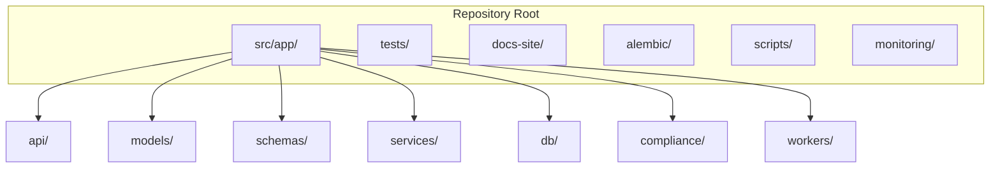
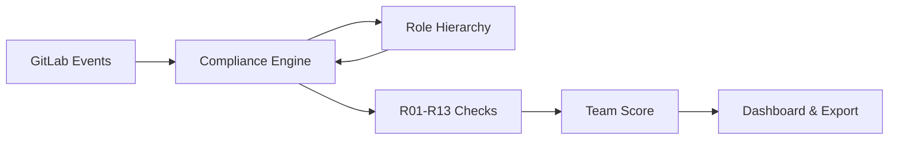


- For: Developer
- Requires: A local environment, per the developer guide

GitPulse source code organization overview.

## High level view



## Main structure

```plaintext
gitpulse/
+-- src/app/                    # Hlavný aplikačný kód
|   +-- __init__.py
|   +-- main.py                 # FastAPI aplikácia
|   +-- config.py               # Konfigurácia (pydantic-settings)
|   +-- dependencies.py         # Dependency injection
|   +-- api/                    # HTTP endpointy
|   +-- models/                 # SQLAlchemy ORM modely
|   +-- schemas/                # Pydantic schémy
|   +-- services/               # Business logika
|   +-- db/                     # Database utilities
|   +-- compliance/             # Hodnotenie (compliance checks R01-R13)
|   +-- workers/                # Background tasks (RQ)
|   +-- middleware/             # ASGI middleware (security, rate limit, locale, logging, errors)
|   +-- security/               # Sessions, OAuth, CSRF, roles, token encryption
|   +-- observability/          # Logging, metrics, tracing
|   +-- i18n/                   # Translation catalogues
|   +-- utils/                  # Pomocné funkcie
+-- tests/                      # Testy
|   +-- unit/                   # Unit testy
|   +-- integration/            # Integračné testy
+-- alembic/                    # Database migrations
|   +-- versions/               # Migration scripts
+-- docs-site/                  # Documentation (Hugo)
+-- scripts/                    # Admin and maintenance scripts
+-- monitoring/                 # Prometheus, Grafana config
+-- docker-compose.yml          # Production compose
+-- Dockerfile                  # API image
+-- pyproject.toml              # Python dependencies
```

## API layer

```plaintext
src/app/api/
+-- __init__.py
+-- router.py               # Main router (aggregates all endpoints)
+-- health.py               # /health, /ready, /live
+-- courses.py              # Course and setting management
+-- course_import.py        # GitLab group and project import
+-- teams.py                # Team management
+-- projects.py             # Project management
+-- students.py             # Student roster and details
+-- users.py                # Users and roles
+-- events.py               # GitLab events and audit log
+-- webhooks.py             # Incoming webhook processing
+-- webhook_configs.py      # Multi-scope webhook configuration
+-- sync.py                 # Synchronization trigger and status
+-- sse.py                  # Server-Sent Events for real-time notifications
+-- llm.py                  # Merge request LLM analysis
+-- compliance_history.py   # Weekly student compliance history
+-- observability.py        # Role-safe service notices
+-- support.py              # Support API
+-- helpers/                # Shared by the routers, registers no route
|   +-- sync.py             # Sync orchestration, GitLab readiness guard
|   +-- job_guards.py       # One running job per course / project
|   +-- support_deps.py     # Support FastAPI dependencies
|   +-- utils.py            # Small response utilities
+-- dashboard/              # Server-rendered dashboard package
```

### Dashboard package split

```plaintext
src/app/api/dashboard/
+-- __init__.py            # Aggregates one router per domain package
+-- auth.py                # Login, logout, language switch
+-- preferences.py         # Theme, accent, density
+-- _helpers.py            # Shared templates, CSRF, role context helpers
+-- _access.py             # Dashboard access-control helpers
+-- home/                  # Dashboard home
|   +-- routes.py          # Page composition, sidebar, search
|   +-- stats.py           # Role-specific stat-card SQL
|   +-- context.py         # Role-specific context and sidebar badges
|   +-- changelog.py       # Latest changes entries (changelog_entries.json)
|   +-- course_health.py   # Per-course RED-team health for course cards
|   +-- activity.py, attention.py, semester.py, sync_info.py
+-- courses/               # Course page, checks, settings
|   +-- routes.py, checks.py, settings.py, settings_config.py, settings_view.py
+-- teams/                 # Team page, LLM analysis, member exclusion
+-- projects/              # Project page, LLM analysis
+-- students/              # Student page: routes.py, diffs.py (diff views, highlight), notes.py (threads)
+-- admin/                 # Users, course teachers, system, analytics, events, enrichment
```

Each domain package is laid out the way GitLab keeps
`app/controllers/<domain>/`: `routes.py` composes the page, the sibling
modules hold the SQL and the view models, and the package `__init__` exposes
the router the dashboard aggregator includes.

### An example API endpoint

```python
# src/app/api/courses.py
from fastapi import APIRouter, Depends, HTTPException, status
from sqlalchemy.ext.asyncio import AsyncSession

from app.db.session import get_db
from app.schemas.courses import CourseCreate, CourseResponse
from app.services.courses import CourseService
from app.security.rbac import require_role

router = APIRouter(prefix="/courses", tags=["courses"])

@router.post("/", response_model=CourseResponse, status_code=status.HTTP_201_CREATED)
async def create_course(
    course_data: CourseCreate,
    db: AsyncSession = Depends(get_db),
    _: None = Depends(require_role("admin")),
):
    """Creates a new course."""
    service = CourseService(db)
    return await service.create(course_data)
```

## Models (ORM)

```plaintext
src/app/models/
+-- __init__.py
+-- base.py                       # Base class with timestamps
+-- course.py                     # Course model
+-- course_settings.py            # Course rule and threshold configuration
+-- team.py                       # Team model
+-- team_member.py                # Team membership and is_mentor flag
+-- user.py                       # User accounts and preferences
+-- project.py                    # GitLab project mapping
+-- webhook_event.py              # Stored raw webhook payloads
+-- commit.py                     # Commits
+-- merge_request.py              # Merge requests
+-- issue.py                      # Issues
+-- pipeline.py                   # CI/CD pipelines
+-- metric_snapshot.py            # Computed metric snapshots
+-- student_compliance_snapshot.py# Weekly student compliance snapshots
+-- custom_check.py               # Dynamic custom checks
+-- support_ticket.py             # Support tickets
+-- email_log.py                  # Sent email audit log
```

### An example of a model

```python
# src/app/models/team.py
from sqlalchemy import String, ForeignKey, Integer
from sqlalchemy.orm import Mapped, mapped_column, relationship

from app.models.base import BaseModel

class Team(BaseModel):
    __tablename__ = "teams"
    
    name: Mapped[str] = mapped_column(String(100))
    course_id: Mapped[int] = mapped_column(ForeignKey("courses.id"))
    gitlab_group_id: Mapped[int | None] = mapped_column(Integer)
    
    # Relationships
    course: Mapped["Course"] = relationship(back_populates="teams")
    members: Mapped[list["TeamMember"]] = relationship(back_populates="team")
    projects: Mapped[list["Project"]] = relationship(back_populates="team")
```

## Schemas (Pydantic)

```plaintext
src/app/schemas/
+-- __init__.py
+-- common.py           # Shared schemas (pagination, filters)
+-- courses.py          # CourseCreate, CourseResponse
+-- teams.py            # TeamCreate, TeamResponse
+-- users.py            # UserCreate, UserResponse
+-- projects.py         # ProjectResponse
+-- students.py         # StudentResponse, StudentDetail
+-- events.py           # Event schemas
+-- compliance.py       # Compliance history schemas
+-- observability.py    # Service status schemas
+-- support.py          # Support ticket and feedback schemas
+-- llm.py              # LLM prompt and response schemas
+-- custom_check.py     # Custom check schemas
+-- jobs.py             # Background job schemas
+-- webhooks.py         # Webhook payload schemas
```

### Example schemas

```python
# src/app/schemas/courses.py
from datetime import date
from pydantic import BaseModel, ConfigDict

class CourseBase(BaseModel):
    code: str
    name: str
    academic_year: str
    semester: str

class CourseCreate(CourseBase):
    start_date: date | None = None
    end_date: date | None = None

class CourseResponse(CourseBase):
    model_config = ConfigDict(from_attributes=True)
    
    id: int
    start_date: date | None
    end_date: date | None
    team_count: int = 0
```

## Services (Business logic)

```plaintext
src/app/services/
+-- __init__.py
+-- courses.py              # Course and settings management
+-- member_sync.py          # Member and team synchronization
+-- events.py               # GitLab event ingestion and queries
+-- audit.py                # Audit log writes
+-- gitlab/                 # Talking to GitLab
|   +-- client.py           # Async GitLab REST API client
|   +-- cache.py            # Cache layer for GitLab API calls
|   +-- token_health.py     # Token probe the sync preflight runs
+-- gitlab_import/          # Batch GitLab group and project import
|   +-- service.py          # The import operation
|   +-- persistence.py, email_enrichment.py, normalize.py, helpers.py
+-- llm/                    # Merge request LLM analysis (OpenAI, Gemini, Groq)
|   +-- service.py, redaction.py, course_context.py, types.py
+-- email_notifications.py  # Email notification subsystem
+-- compliance_history.py   # Weekly compliance snapshots
+-- support_forms.py        # Feedback forms and support
+-- job_control.py          # Background job lifecycle management
+-- page_cache.py           # Redis caching for pages and data
```

### Service pattern

```python
# src/app/services/teams.py
from sqlalchemy.ext.asyncio import AsyncSession
from sqlalchemy import select

from app.models.team import Team
from app.schemas.team import TeamCreate

class TeamService:
    def __init__(self, db: AsyncSession):
        self.db = db
    
    async def get_by_id(self, team_id: int) -> Team | None:
        result = await self.db.execute(
            select(Team).where(Team.id == team_id)
        )
        return result.scalar_one_or_none()
    
    async def create(self, data: TeamCreate, course_id: int) -> Team:
        team = Team(**data.model_dump(), course_id=course_id)
        self.db.add(team)
        await self.db.commit()
        await self.db.refresh(team)
        return team
```

## Compliance engine

```plaintext
src/app/compliance/
+-- __init__.py
+-- engine.py               # Main compliance engine
+-- engine_checks.py        # R01-R13 compliance check implementations
+-- dynamic_checks.py       # Teacher-defined custom check evaluation
+-- roles.py                # GitLab role hierarchy (access levels, scoring gate helpers)
+-- types.py                # Shared types
```

### Role Hierarchy (`roles.py`)

This module defines GitLab access levels (Guest=10, Reporter=20, Developer=30, Maintainer=40, Owner=50)
and helper functions `access_role_name()`, `is_contributing_role()`, `role_priority()`.

**Scoring gate:** Members with a role below Developer (Guest/Reporter) and zero
activity are excluded from the team aggregate. Inherited group members with no
activity are also excluded, regardless of their access level.



## Workers (Background tasks)

```plaintext
src/app/workers/
+-- __init__.py
+-- sync_job.py             # Full team GitLab synchronization
+-- sync_project_job.py     # Single project synchronization
+-- metrics_job.py          # Compliance metrics computation (R01-R13)
+-- event_processor.py      # Async processing of incoming webhooks
+-- enrich_mr.py            # REST API enrichment of merge requests
+-- enrich_issue.py         # REST API enrichment of issues
+-- llm_job.py              # Async merge request LLM analysis
+-- sweep.py                # Periodic maintenance sweeps and cleanup
```

### Worker example

```python
# src/app/workers/sync_job.py
import redis
from rq import Queue

redis_conn = redis.from_url("redis://localhost:6379/0")
queue = Queue("default", connection=redis_conn)

# Enqueue background sync task
job = queue.enqueue("app.workers.sync_job.sync_team", team_id=123)
```

## Tests

```plaintext
tests/
+-- __init__.py
+-- conftest.py             # Pytest fixtures
+-- unit/                   # Unit tests (no external deps)
|   +-- test_compliance_engine.py
|   +-- test_roles.py               # 36 tests for role hierarchy
+-- integration/            # Integračné testy
    +-- test_api_courses.py
    +-- test_api_teams.py
    +-- test_gitlab_sync.py
```

## Frontend architecture

Dashboard uses server-side rendering (Jinja2) enriched with htmx for partial
updates and Alpine.js for client reactivity. All frontend code is
organized according to the component architecture.

### Templates

```plaintext
src/app/templates/
+-- base.html                    # Minimal shell (~80 lines)
+-- components/                  # 23 reusable Jinja2 macro files
|   +-- icons.html               #   SVG icons
|   +-- buttons.html             #   Buttons (primary, danger, icon)
|   +-- badges.html              #   Status badges, traffic light
|   +-- modals.html              #   Modal & drawer dialogs
|   +-- forms.html               #   Form fields
|   +-- alerts.html              #   Alert banners
|   +-- cards.html               #   Cards and metrics
|   +-- layout.html              #   Page header, breadcrumbs
|   +-- loaders.html             #   Spinner, block loading
|   +-- tables.html              #   Sortable tables
|   +-- toasts.html              #   Toast notifications
|   +-- header.html              #   Navigation bar
|   +-- import_helpers.html      #   GitLab import modal markup
|   +-- _config_import_body.html #   Config import modal body
|   +-- feature_flags.html       #   Feature flag macros
+-- errors/                      # Error pages (403, 404, 500)
+-- static/
|   +-- styles.css               # Entry point - @import 18 CSS súborov
|   +-- css/                     # Component CSS files
|   |   +-- tokens.css           #   Design tokens (colors, spacing)
|   |   +-- buttons.css          #   Button styles
|   |   +-- badges.css           #   Badge styles
|   |   +-- cards.css            #   Card styles
|   |   +-- modals.css           #   Modal & drawer styles
|   |   +-- responsive.css       #   Mobile (≤768px) + phone (≤480px)
|   |   +-- ...                  #   (toasts, alerts, forms, tables, ...)
|   +-- js/                      # JS sources (the build goes to dist/)
|       +-- _parts/core/         #   core.bundle.js: CSRF, apiCall, toast, modal, job bar, guards
|       +-- components.js        #   Paginator, TableFilter, forms
|       +-- sse-stream.js        #   SSE streaming s fallback
|       +-- import-stream.js     #   GitLab import SSE lifecycle
|       +-- gitlab-helpers.js    #   GitLab URL parsing
|       +-- pages/               #   Page-specific controllers
+-- *.html                       # 20 stránkových šablón
```

### Using macros

Templates use Jinja2 `` imports to compose pages:

```jinja2




{{ btn("Uložiť", variant="primary") }}
{{ modal("editModal", "Upraviť tím") }}
```

### CDN libraries

| Library | Version | Purpose |
|----------|--------|------|
| htmx | 1.9.12 | Partial updates |
| Alpine.js | 3. x | Client reactivity |
| Flatpicker | latest | Date selection |
| Tom Select | 2.3.1 | Combo box |
| Tippy.js | 6. x | Tooltips |

## Conventions

### Import ordering

```python
# 1. Standard library
from datetime import datetime
from typing import Any

# 2. Third-party
from fastapi import APIRouter
from sqlalchemy.ext.asyncio import AsyncSession

# 3. Local imports
from app.models.team import Team
from app.services.teams import TeamService
```

### Naming conventions

| Type | Convention | Example |
|-----|-----------|---------|
| Modules | `snake_case` | `member_sync.py` |
| Classes | `PascalCase` | `TeamService` |
| Features | `snake_case` | `get_team_metrics` |
| Constants | `UPPER_SNAKE` | `MAX_TEAM_SIZE` |
| Endpoints | `kebab-case` | `/api/v1/courses/{course_id}/sync-all` |

## Further reading

- [Testing](testovanie.md)
- [Database Migrations](migracie.md)
- [Contributing](prispievanie.md)
