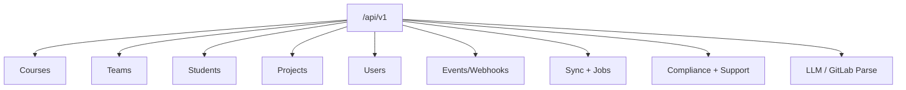


- Pre: Vývojár
- Vyžaduje: API token

> Overené podľa implementácie dňa **2026-09-09**.

## Zdroj pravdy pre kontrakt

1. `src/app/api/*`
2. `src/app/schemas/*`
3. runtime `GET /openapi.json` (v development/debug režime)
4. error kontrakty v `src/app/api/contracts.py`

## Dôležité upresnenie

GitPulse nepoužíva JWT login endpoint typu `/api/v1/auth/login`.

Autentifikácia je riešená troma režimami:

1. Dashboard: GitLab OAuth + session cookie.
2. API: statický bearer token (`TEACHER_API_TOKEN`) alebo dashboard session.
3. Webhook endpoint: `X-Gitlab-Token`.

## Základné prefixy

| Oblasť | Prefix | Poznámka |
|---|---|---|
| REST API | `/api/v1` | CRUD, sync, compliance history, support, jobs |
| Dashboard | `/dashboard` | server-rendered UI + JSON endpointy |
| Ops | `/health`, `/metrics` | healthcheck a Prometheus scrape |

## Health, ops a verejné metadata endpointy

- `GET /health`
- `GET /health/live`
- `GET /health/ready`
- `GET /metrics`
- `GET /robots.txt` - Dynamické pravidlá indexácie pre vyhľadávače
- `GET /sitemap.xml` - XML sitemap pre verejné stránky s hreflang alternatívami
- `GET /llms.txt` - Prompt konfiguračný súbor s deklaráciou súkromných rozhraní pre AI crawlerov
- `GET /google32f411f09f436ae2.html` - Overovací token Google Search Console
- `GET /privacy` - Presmerovanie na ochranu osobných údajov na docs webe
- `GET /terms` - Presmerovanie na podmienky používania na docs webe

Príklad:

```bash
curl http://localhost:8000/health
curl http://localhost:8000/robots.txt
curl http://localhost:8000/sitemap.xml
curl http://localhost:8000/llms.txt
curl http://localhost:8000/metrics
```

## API autentifikácia - príklady

### Bearer token

```bash
curl http://localhost:8000/api/v1/courses/ \
  -H "Authorization: Bearer ${TEACHER_API_TOKEN}"
```

### Webhook endpoint

```bash
curl -X POST http://localhost:8000/api/v1/webhooks/gitlab \
  -H "X-Gitlab-Token: ${WEBHOOK_SECRET}" \
  -H "Content-Type: application/json" \
  -d '{"object_kind":"push"}'
```

## Endpoint inventory (zgrupované)

Celkový scan: **206 route handlerov** (189 pod `/api/v1` a `/dashboard`, plus 17 prevádzkových a verejných handlerov).

### Core API

- Kurzy: `/api/v1/courses/*`
- Tímy: `/api/v1/teams/*`
- Študenti: `/api/v1/students/*`
- Projekty: `/api/v1/projects/*`
- Používatelia: `/api/v1/users/*`

### Event pipeline

- Webhook ingest: `POST /api/v1/webhooks/gitlab`
- DLQ/replay: `/api/v1/events/*`

### Synchronizácia a joby

- Sync: `/api/v1/teams/{team_id}/sync`, `/api/v1/courses/{course_id}/sync-all`
- Recheck: `/api/v1/teams/{team_id}/run-checks` - okamžité prepočítanie metrik (force all checks)
- Job status/SSE: `/api/v1/jobs/{job_id}`, `/api/v1/jobs/{job_id}/stream`

### Rozšírenia

- LLM: `/api/v1/llm/mr/{project_id}/{mr_iid}`
- GitLab parse: `/api/v1/gitlab/parse-url`

### Súlad, podpora a stav služby

- `/api/v1/compliance/*`, `/api/v1/support/*`, `/api/v1/observability/status`

## Dashboard routy

`/dashboard/*` obsahuje:

- login/logout/OAuth callback
- dashboard pre kurzy, tímy, študentov, projekty
- admin sekcie (users, courses, system, events)

## Mermaid mapa API domén



## OpenAPI export

```bash
curl http://localhost:8000/openapi.json > openapi.json
```

Poznámka: `openapi.json`, `/docs`, `/redoc` sú dostupné v development/debug režime.

## Súvisiace dokumenty

- [Architektúra](../uvod/architektura.md)
- [GitLab webhooky](../gitlab/webhooky.md)
- [Monitoring](../operatori/monitoring.md)
- Detailný route inventory: `docs/04-api-spec.md`
