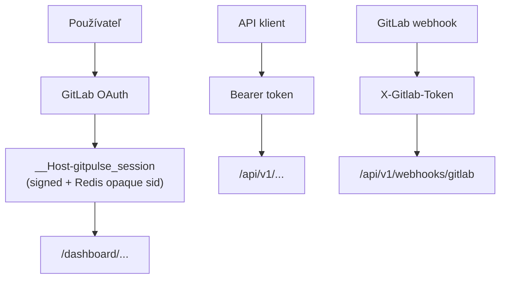


- Pre: Operátor
- Vyžaduje: Prístup k nastaveniam nasadenia

> Overené podľa `src/app/security/*`, `src/app/dependencies.py` a middleware vrstvy k **2026-09-09**.

## Bezpečnostné piliere

1. Viacvrstvová autentifikácia (OAuth, Bearer, webhook secret)
2. RBAC autorizácia (admin, teacher, student)
3. Ochrana web vrstvy (CSRF, security headers, `__Host-` cookie prefix)
4. Auditovateľnosť (request logging, correlation ID, telemetry)

## Autentifikácia a autorizácia

| Vrstva | Mechanizmus | Použitie |
|---|---|---|
| Dashboard | GitLab OAuth + signed session cookie (`__Host-` prefix) + Redis opaque session ID | UI routy `/dashboard/*` |
| API | `Authorization: Bearer <TEACHER_API_TOKEN>` alebo session | `/api/v1/*` |
| Webhooks | `X-Gitlab-Token` (per-project secret) | `/api/v1/webhooks/gitlab` |
| RBAC | `admin`, `teacher`, `student` | role-based access |

## Kľúčové ochranné prvky

- `__Host-` cookie prefix (browser-enforced: Secure + Path=/ + no Domain)
- Opaque session ID v cookie + serverový session blob v Redise (server-side revocation)
- 30-dňový sliding TTL + **absolútny 90-dňový ceiling** (AUTH-06) - ohraničuje blast-radius ukradnutého cookie nezávisle od refresh-ov sliding TTL
- Service Worker obchádza `/dashboard` navigácie a odpovede s `no-store` / `private`
- User-Agent fingerprint binding ako _opt-in_ defence-in-depth (`SESSION_STRICT_UA_FINGERPRINT`, default `false` - UA hash nie je stabilný cez mobil<->desktop a auto-update prehliadačov)
- CSRF tokeny pre form POST operácie (HMAC-SHA256)
- `FEATURE_RBAC=false` v produkcii hard-faily pri štarte (AUTH-04 - žiadne fail-open RBAC)
- Rate-limit fail-closed v produkcii (AUTH-05 - keď Redis nedostupný, vraciame `HTTP 503` namiesto povolenia request-u)
- Redis vyžaduje heslo v produkcii (SEC-03/04 - validator odmietne naštartovať ak `REDIS_URL` nemá password segment)
- Security headers middleware
- constant-time porovnávanie citlivých tokenov
- trusted-host ochrana (voliteľne cez `ALLOWED_HOSTS`)
- rate limiting pre webhooky a API operácie

## Dokumenty v sekcii

- [Bezpečnostný model](model.md)
- [Model hrozieb](hrozby.md)
- [Hardening](hardening.md)
