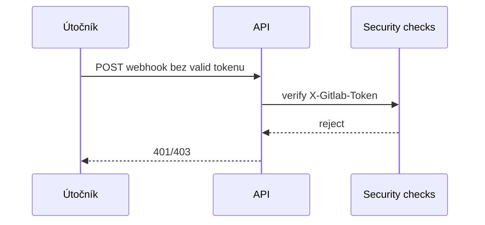


- Pre: Operátor
- Vyžaduje: Prístup k nastaveniam nasadenia

## STRIDE prehľad

| Kategória | Riziko | Mitigácia |
|---|---|---|
| Spoofing | podvrhnutý webhook | `X-Gitlab-Token` + bcrypt verifikácia |
| Tampering | manipulácia session/tokenov | signed cookies, constant-time comparisons |
| Repudiation | nedostatočný audit | štruktúrované logy + correlation ID |
| Information disclosure | únik citlivých údajov | bezpečnostné hlavičky, minimálne endpoint exposure |
| DoS | zahltenie webhook/API | rate limiting + queue backpressure mechanizmy |
| Elevation of privilege | neoprávnený admin prístup | RBAC dependency checks |

## Kritické toky

## Riziká, ktoré treba monitorovať

1. opakované 401/403 pokusy na citlivé endpointy
2. prudký rast `rq_queue_depth`
3. zvýšený podiel `5xx` a chýb pri spracovaní webhookov
4. dlhodobo otvorené worker failure alerty

## Incident response minimum

1. identifikovať impacted endpointy a časové okno
2. korelovať metriky + logy + trace podľa `correlation_id`
3. ak ide o credentials leak, okamžite rotovať tokeny
4. obnoviť službu a zdokumentovať postmortem
