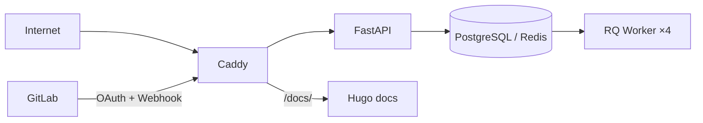


- Pre: Operátor
- Vyžaduje: Prístup k nastaveniam nasadenia

## Trust boundaries

Boundary úrovne:

1. Verejná zóna: internet + externý GitLab.
2. Edge zóna: reverse proxy a TLS terminácia.
3. App zóna: API, dashboard, workers, docs.
4. Data zóna: DB a queue backend.

## Aktíva

| Aktívum | Príklad |
|---|---|
| Prihlasovacie údaje | OAuth tokeny, session cookie, API token |
| Prevádzkové dáta | webhook payloady, metriky, reporty |
| Konfigurácia | `.env`, feature flags, role mapovanie |
| Audit stopa | logy, correlation ID, telemetry eventy |

## Mechanizmy ochrany

- Signed session cookie (`itsdangerous`) + 30-dňový sliding TTL + **90-dňový absolútny strop životnosti** (AUTH-06: ohraničuje blast-radius ukradnutého cookie nezávisle od refresh-ov sliding TTL)
- Opaque session ID v cookie + serverový session blob v Redise (umožňuje server-side revocation a sweep)
- `__Host-` cookie prefix pri HTTPS (browser-enforced: Secure + Path=/ + žiadny Domain)
- User-Agent fingerprint binding (`ua` claim) ako **opt-in** defence-in-depth - default `false`, lebo UA hash nie je stabilný cez mobil<->desktop a auto-update prehliadačov
- `BUILD_HASH` binding (`av` claim) - sessions sú invalidované po redeployi
- Boot nonce (`bn` claim) - sessions sú invalidované po reštarte servera
- Constant-time bearer token check (`hmac.compare_digest`)
- Bcrypt webhook secret verifikácia
- CSRF ochrana pre formuláre (HMAC-SHA256)
- Security headers middleware (CSP, HSTS, X-App-Version, X-Frame-Options)
- Fernet šifrovanie GitLab OAuth tokenov v databáze (AES-128-CBC + HMAC-SHA256)
- RBAC enforcement cez dependency vrstvu
- `Clear-Site-Data` header pri odhlásení (vymazanie cache + storage v prehliadači)
- Service Worker obchádza `/dashboard` navigácie a nekešuje odpovede s
  `no-store` / `private`, takže prihlásené HTML neostáva v browser Cache API

## Role model

| Rola | Prístup |
|---|---|
| `admin` | plný prístup vrátane admin rout |
| `teacher` | hodnotenie, dashboard, väčšina API operácií |
| `student` | obmedzený prístup na čítanie podľa policy |

## Session model

Session cookie obsahuje identitu a rolu používateľa; je podpísaná a časovo obmedzená.
Pri `PERSISTENT_SESSIONS=false` sa uplatňuje boot nonce invalidácia po reštarte.

### Cookie atribúty

| Atribút | Hodnota |
|---|---|
| Názov | `__Host-gitpulse_session` (HTTPS) / `gitpulse_session` (HTTP) |
| HttpOnly | `true` |
| Secure | `true` (HTTPS) |
| SameSite | `Lax` |
| Max-Age | sliding 2 592 000 s (30 dní) + absolútny strop 7 776 000 s (90 dní) |

### Payload claims

| Claim | Popis |
|---|---|
| `user` | GitLab username |
| `role` | `admin` / `teacher` / `student` |
| `bn` | Boot nonce - invaliduje sessions po reštarte servera |
| `av` | `BUILD_HASH` - invaliduje sessions po redeployi |
| `ua` | SHA-256(User-Agent)[:16] - detekcia krádeže cookies |
| `ts` | ISO 8601 timestamp vytvorenia |

### Vrstvy invalidácie

1. **Sliding TTL** - `itsdangerous` odmietne cookies, na ktorých nebola aktivita posledných 30 dní (refresh sa pri každej request-e bumpne)
2. **Absolútny strop** (AUTH-06) - cookie staršie než 90 dní od `created_at` je zamietnuté nezávisle od refresh-ov sliding TTL
3. **Boot nonce** - nový nonce pri každom reštarte servera (ak `PERSISTENT_SESSIONS=false`)
4. **Build hash** - nový hash pri každom deployi
5. **UA fingerprint** - ak je `SESSION_STRICT_UA_FINGERPRINT=true` (opt-in), cookie z iného prehliadača je odmietnutá
6. **HMAC podpis** - zmanipulované cookies sú odmietnuté
