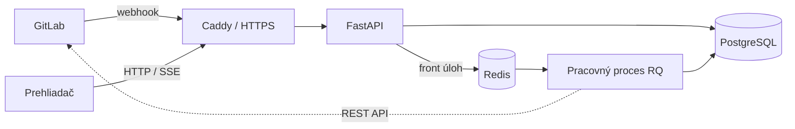


- Pre: Čitateľ práce
- Vyžaduje: Nič

Hlavným používateľom je cvičiaci. Na začiatku semestra importuje kurz zo skupiny
v GitLabe, počas semestra hľadá skupinu, ktorá potrebuje pozornosť, a odtiaľ
prechádza ku konkrétnemu študentovi a k pôvodnému objektu v GitLabe. Študent sa
prihlási účtom GitLab a vidí iba údaje o vlastnej práci, bez možnosti niečo meniť.

## 5.1 Architektúra

Prijímacia časť webhooku overí projekt a tajný token, uloží telo, vypočíta kľúč
udalosti a zaradí jej identifikátor do frontu s vysokou prioritou. Duplicitné
doručenie nevytvorí druhý záznam. Pracovný proces udalosť spracuje, doplní
podrobnosti cez REST, prepočíta kontroly skupiny a upozorní otvorené stránky cez
SSE. Fronty sú tri (vysoká, stredná a nízka priorita) a periodický plánovač
platforma nemá.

## 5.2 Dátový model

Kurz obsahuje nastavenia kontrol, prahy a členstvá. Skupina patrí jednému kurzu
a môže mať viac projektov. Import zjednocuje členov podľa identifikátora v GitLabe
a zdedené členstvo označí, aby nevstupovalo do výpočtu. Objekty si pamätajú
identifikátor z GitLabu, takže opakované doplnenie nevytvára duplicity.

## 5.3 Výpočet kontrol

Každá kontrola vracia identifikátor, stav, zdôvodnenie, váhu a čiastkové skóre.
Skóre študenta je súčet čiastkových skóre zapnutých kontrol vydelený súčtom ich
váh, takže vypnutá kontrola skóre neskresľuje a študentovi sa neukáže ako
nesplnená. Predvolene sú vypnuté R09, R11 a R13. Semafor má predvolené prahy
80 a 50 percent a usporadúva pozornosť cvičiaceho, nie je to známka. Kurz môže
určiť, od ktorého týždňa sa kontrola vyžaduje, a pridať vlastné kontroly.
Voliteľná analýza jazykovým modelom je v produkcii vypnutá a do R01 až R13
nevstupuje.

## 5.4 Asistent cvičení

Asistent pracuje v GitLabe pod vlastným účtom bota kurzu a má tri nástroje:
kontrolu odoslaných zmien, prípravu konfliktu pri zlučovaní a cvičenie s tiketmi
a žiadosťami o zlúčenie. Cvičenie je konečný automat nad udalosťami, ktoré
GitPulse dostáva. Pravidlá sú pevné, bez jazykového modelu. Asistent nepoužíva
token na synchronizáciu, predvolene žiadosť iba schváli a zlúčenie nechá na
študenta, pretože R10 zlúčenie botom nepočíta. Komentáre botov R08 medzi vlákna
nezaratúva. Podrobnosti sú v [príručke asistenta](../../ucitelia/asistent/).

## 5.5 Bezpečnosť

Prihlásenie prebieha cez GitLab OAuth a oprávnenie sa overuje na serveri voči
konkrétnemu kurzu. Tajomstvo webhooku má rozsah (kurz, skupina alebo zoznam
projektov), v databáze je iba jeho odtlačok a po výmene platí predchádzajúca
hodnota ešte 24 hodín. Token na doplnenie údajov stačí na čítanie, token asistenta
patrí jednému kurzu a je uložený šifrovane.
