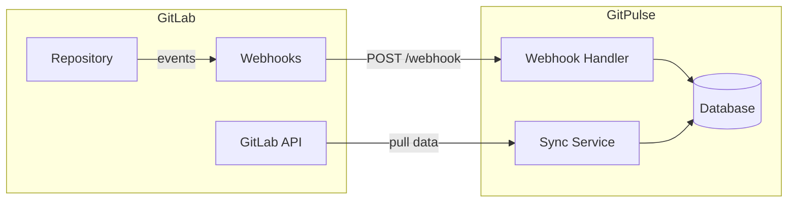
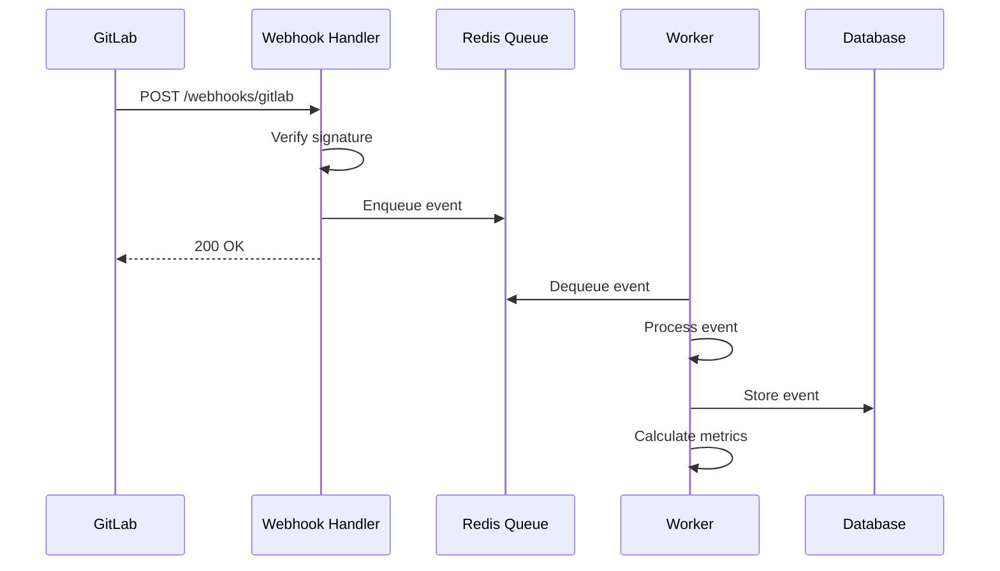


- Pre: Učiteľ, Operátor
- Vyžaduje: GitLab Personal Access Token

Táto sekcia popisuje integráciu GitPulse s GitLab.

## Prehľad integrácie



## Podporované funkcie

| Funkcia | Popis | Stav |
|---------|-------|------|
| **Commits** | Sledovanie commit history | Yes |
| **Merge Requests** | MR vytvorenie, review, merge | Yes |
| **Issues** | Vytvorenie a zatvorenie issues | Yes |
| **Pipelines** | CI/CD pipeline status | Yes |
| **Comments** | Diskusie na MR a issues | Yes |
| **Branches** | Branch creation/deletion | Yes |
| **Tags** | Release tags | Yes |

## Čo nájdete v tejto sekcii

  - [Tokeny](./tokeny/) - Konfigurácia GitLab prístupových tokenov
  - [Webhooky](./webhooky/) - Nastavenie real-time notifikácií
  - [CI/CD Pipeline](./cicd/) - Integrácia s GitLab CI

## Rýchly štart

### 1. Vytvorenie tokenu

1. Prejdite na GitLab -> Settings -> Access Tokens
2. Vytvorte token s oprávneniami:
   - `api` - Full API access
   - `read_repository` - Read repository
3. Uložte token do `.env`:

```bash
GITLAB_URL=https://gitlab.example.com
GITLAB_TOKEN=glpat_placeholder_token
```

### 2. Konfigurácia webhook

1. V GitLab projekte: Settings -> Webhooks
2. URL: `https://gitpulse.kpi.fei.tuke.sk/api/v1/webhooks/gitlab`
3. Secret Token: Vygenerujte a uložte do `.env`
4. Trigger events: Push, Issues, Merge requests, Comments (Notes), Pipeline

### 3. Test pripojenia

```bash
# Test API pripojenia
curl -H "Private-Token: ${GITLAB_TOKEN}" \
  "${GITLAB_URL}/api/v4/user"

# Doručovací endpoint webhooku (vyzaduje hlavicku X-Gitlab-Token)
# Testovacie dorucenie spustite tlacidlom Test v GitLabe:
#   Settings -> Webhooks -> Test -> Push events
curl -sS -o /dev/null -w '%{http_code}
' http://localhost:8000/health
```

## Architektúra



## Podporované event typy

### Push Events

```json
{
  "object_kind": "push",
  "event_name": "push",
  "ref": "refs/heads/main",
  "commits": [
    {
      "id": "abc123...",
      "message": "feat: add new feature",
      "author": {
        "name": "John Doe",
        "email": "john@example.com"
      },
      "added": ["file1.py"],
      "modified": ["file2.py"],
      "removed": []
    }
  ]
}
```

### Merge Request Events

```json
{
  "object_kind": "merge_request",
  "event_type": "merge_request",
  "object_attributes": {
    "iid": 1,
    "title": "Feature: Add login",
    "state": "merged",
    "source_branch": "feature/login",
    "target_branch": "main",
    "author_id": 123
  }
}
```

### Pipeline Events

```json
{
  "object_kind": "pipeline",
  "object_attributes": {
    "id": 456,
    "status": "success",
    "duration": 120,
    "stages": ["build", "test", "deploy"]
  }
}
```

## Limity a rate limiting

| Resource | Limit | Poznámka |
|----------|-------|----------|
| API requests | 600/min | Per token |
| Webhook payload | 25 MB | Max payload size |
| Concurrent webhooks | 10 | Per project |

## Bezpečnosť

- Všetky tokeny sú uložené šifrované
- Webhook signature verification
- IP whitelist pre webhook endpoints (odporúčané)
- Audit log všetkých API volaní

## Ďalšie kroky

1. [Konfigurácia tokenov](tokeny.md)
2. [Nastavenie webhookov](webhooky.md)
3. [GitLab CI integrácia](cicd.md)

