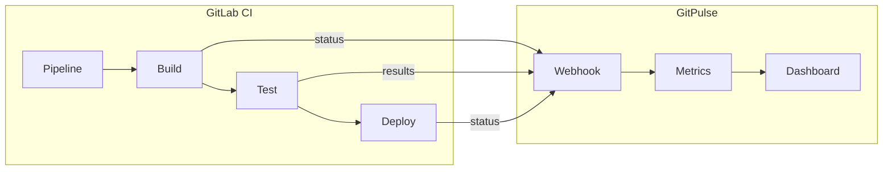
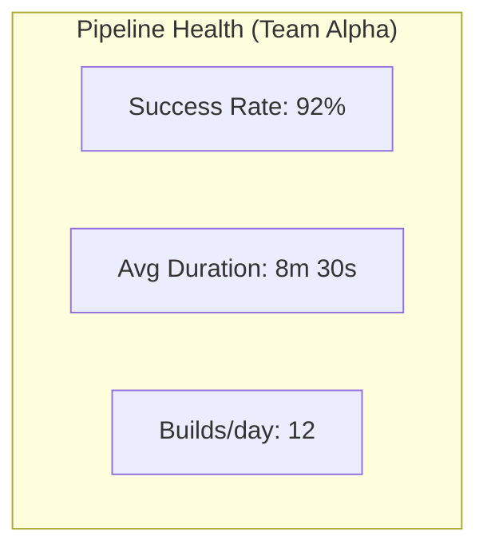


- Pre: Učiteľ, Operátor
- Vyžaduje: GitLab Personal Access Token

Sprievodca integráciou GitPulse s GitLab CI/CD pipelines.

## Prehľad



## Pipeline metriky

GitPulse sleduje tieto CI/CD metriky:

| Metrika | Popis | Výpočet |
|---------|-------|---------|
| Pipeline Success Rate | % úspešných pipelines | `success / total` |
| Mean Time to Recovery | Čas na opravu zlyhania | Priemer času medzi failure a success |
| Pipeline Duration | Trvanie pipeline | Čas od štart do koniec |
| Build Frequency | Počet buildov za deň | Count per day |
| Test Coverage Trend | Vývoj test coverage | Coverage z JUnit reports |

## Konfigurácia GitLab CI

### Základný .gitlab-ci.yml

```yaml
# .gitlab-ci.yml
stages:
  - build
  - test
  - analyze
  - deploy

variables:
  DOCKER_DRIVER: overlay2

# === BUILD ===
build:
  stage: build
  image: docker:24
  services:
    - docker:24-dind
  script:
    - docker build -t $CI_REGISTRY_IMAGE:$CI_COMMIT_SHA .
    - docker push $CI_REGISTRY_IMAGE:$CI_COMMIT_SHA
  only:
    - main
    - merge_requests

# === TEST ===
test:
  stage: test
  image: python:3.12-slim
  script:
    - pip install --constraint requirements.lock -e ".[dev,otel]"
    - pytest --junitxml=report.xml --cov=app --cov-report=xml
  coverage: '/TOTAL.*\s+(\d+%)$/'
  artifacts:
    reports:
      junit: report.xml
      coverage_report:
        coverage_format: cobertura
        path: coverage.xml

# === ANALYZE ===
lint:
  stage: analyze
  image: python:3.12-slim
  script:
    - pip install ruff
    - ruff check . --output-format=gitlab > ruff-report.json
  artifacts:
    reports:
      codequality: ruff-report.json

security-scan:
  stage: analyze
  image: python:3.12-slim
  script:
    - pip install bandit pip-audit
    - bandit -r src -f json -o bandit-report.json || true
    - pip-audit --format json --output pip-audit-report.json || true
  artifacts:
    paths:
      - bandit-report.json
      - pip-audit-report.json

# === DEPLOY ===
deploy:staging:
  stage: deploy
  environment:
    name: staging
    url: https://staging.gitpulse.kpi.fei.tuke.sk
  script:
    - echo "Deploying to staging..."
  only:
    - main
```

### Ako sa pipeline dostane do GitPulse

**Do `.gitlab-ci.yml` kvôli GitPulse nepridávate nič.** GitPulse nemá endpoint,
ktorým by mu pipeline hlásila svoj stav - stav, trvanie aj coverage prichádzajú
z **Pipeline webhooku** GitLabu (a pri synchronizácii z GitLab API). Stačí mať
webhook nastavený podľa [Webhooky](webhooky.md).

Aby bolo coverage vyplnené, nechajte v jobe `coverage:` regex - GitPulse číta
hodnotu, ktorú vypočíta GitLab.

## Pipeline Events

### Webhook payload

GitLab posiela pipeline events automaticky:

```json
{
  "object_kind": "pipeline",
  "object_attributes": {
    "id": 12345,
    "iid": 42,
    "ref": "main",
    "sha": "abc123def456...",
    "status": "success",
    "detailed_status": "passed",
    "stages": ["build", "test", "deploy"],
    "created_at": "2026-01-15T10:00:00Z",
    "finished_at": "2026-01-15T10:15:30Z",
    "duration": 930,
    "queued_duration": 10
  },
  "builds": [
    {
      "id": 100,
      "stage": "build",
      "name": "build",
      "status": "success",
      "duration": 120,
      "runner": {
        "description": "shared-runner-1"
      }
    },
    {
      "id": 101,
      "stage": "test",
      "name": "test",
      "status": "success",
      "duration": 300,
      "coverage": 85.5
    }
  ],
  "project": {
    "id": 123,
    "path_with_namespace": "kpi/tp-2026/team-alpha"
  }
}
```

### Ako GitPulse spracováva pipeline eventy

Pipeline udalosti prichádzajú cez webhook a sú spracované v `src/app/workers/event_processor.py`.
Worker extrahuje stav pipeline, trvanie a coverage z webhookoveho payloadu
a uloží ich k príslušnému projektu. Kontrola R12 (Pipeline Green) sa následne
vyhodnotí pri prepočítaní compliance metrík tímu.

## Dashboard zobrazenie

### Pipeline health widget



Pipeline dáta sú zobrazené na stránke projektu a vstu pujú do compliance
kontrolky R12 (Pipeline Green).

## CI/CD Best Practices pre študentov

### Hodnotené aspekty

GitPulse hodnotí tieto CI/CD praktiky:

| Aspekt | Bodové hodnotenie |
|--------|-------------------|
| Pipeline existuje | Yes Základné |
| Automated tests | Yes Základné |
| Code quality checks | Yes Odporúčané |
| Security scanning | Bonus |
| Coverage > 60% | Bonus |
| Multi-stage pipeline | Bonus |

### Príklad ukážkovej pipeline

```yaml
# Ideálna študentská pipeline
stages:
  - validate
  - build
  - test
  - quality
  - deploy

# Rýchla validácia
validate:
  stage: validate
  script:
    - python -m py_compile src/**/*.py

# Build Docker image
build:
  stage: build
  script:
    - docker build -t $CI_REGISTRY_IMAGE .

# Unit testy s coverage
test:
  stage: test
  script:
    - pytest --cov=src --cov-report=term --cov-fail-under=60
  coverage: '/TOTAL.*\s+(\d+%)$/'

# Linting
lint:
  stage: quality
  script:
    - ruff check src/
    - ruff format --check src/

# Deploy na staging (len main branch)
deploy:
  stage: deploy
  script:
    - echo "Deploying..."
  environment:
    name: production
  only:
    - main
```

## Troubleshooting

### Pipeline status nie je v GitPulse

```bash
# 1. Overte webhook konfiguráciu
# GitLab -> Settings -> Webhooks
# Trigger: Pipeline events

# 2. Skontrolujte webhook logy
# GitLab -> Settings -> Webhooks -> Recent deliveries

# 3. GitPulse logy
docker compose logs api | grep pipeline
```

### Coverage nie je reportovaný

```yaml
# Uistite sa, že máte správny coverage regex
test:
  script:
    - pytest --cov=app --cov-report=term
  coverage: '/TOTAL.*\s+(\d+%)$/'  # <- Tento regex musí matchovať output
  
# Pytest output musí obsahovať:
# TOTAL    100    10    90%
```

### Pipeline vyzerá v GitPulse inak ako v GitLabe

GitPulse nič nebuilduje ani nevaliduje `.gitlab-ci.yml` - iba zobrazuje stav,
ktorý nahlásil GitLab. Rozdiel je takmer vždy oneskorenie alebo stratený webhook:

```bash
# 1. Porovnajte so zdrojom pravdy v GitLabe
curl -H "Private-Token: ${GITLAB_TOKEN}" \
  "${GITLAB_URL}/api/v4/projects/${CI_PROJECT_ID}/pipelines"

# 2. Dotiahnite chýbajúce udalosti (nahradí zmeškaný webhook)
curl -X POST "${GITPULSE_URL}/api/v1/projects/<project_id>/sync" \
  -H "Authorization: Bearer ${GITPULSE_TOKEN}"
```

## Integrácia s compliance kontrolami

GitPulse používa výsledky pipeline priamo v kontrolách R12 a vo vlastných kontrolách kurzu. Pre CI/CD kurz typicky sledujte:

- existenciu `.gitlab-ci.yml`,
- úspešný test job,
- lint alebo statickú analýzu,
- bezpečnostný scan, ak je súčasťou zadania.

## Ďalšie čítanie

- [Tokeny](tokeny.md)
- [Webhooky](webhooky.md)
- [API referencia](../api/index.md)
