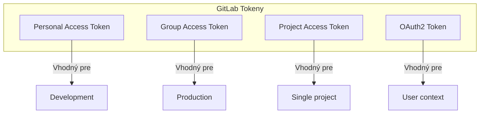


- Pre: Učiteľ, Operátor
- Vyžaduje: GitLab Personal Access Token

Sprievodca konfiguráciou GitLab prístupových tokenov pre GitPulse.

## Typy tokenov



| Typ | Použitie | Scope | Životnosť |
|-----|----------|-------|-----------|
| Personal Access Token | Development | User-level | Konfigurovateľná |
| Group Access Token | Production | Group-level | Max 1 rok |
| Project Access Token | Single project | Project-level | Max 1 rok |
| OAuth2 Token | User auth | User-level | Short-lived |

## Personal Access Token

### Vytvorenie

1. Prihláste sa do GitLab
2. Kliknite na avatar -> **Preferences**
3. V ľavom menu: **Access Tokens**
4. Vyplňte:
   - **Token name**: `GitPulse Production` alebo `GitPulse Development`
   - **Expiration date**: Max 1 rok (365 dní)
   - **Scopes**: Pozri nižšie

### Požadované scopes

```
Yes api           - Full API access
Yes read_api      - Read-only API access
Yes read_user     - Read user info
Yes read_repository - Clone/fetch repositories
- [ ] write_repository - Push (nepotrebné)
```


**Minimum privilege.** Pre produkciu používajte len minimálne potrebné oprávnenia. Pre read-only prístup stačí: `read_api`, `read_repository`.

### Príklad

```bash
# Token vyzerá takto:
GITLAB_TOKEN=glpat_placeholder_token

# Test tokenu
curl -H "Private-Token: ${GITLAB_TOKEN}" \
  "https://gitlab.example.com/api/v4/user"
```

## Group Access Token

Pre produkčné nasadenie odporúčame Group Access Token.

### Vytvorenie

1. Prejdite do GitLab Group (napr. `/kpi/tp-2026`)
2. **Settings** -> **Access Tokens**
3. Vyplňte:
   - **Token name**: `GitPulse Sync Token`
   - **Expiration date**: Koniec semestra
   - **Role**: `Reporter` alebo `Developer`
   - **Scopes**: `api`, `read_repository`

### Výhody

- Nie je viazaný na konkrétneho používateľa
- Funguje aj keď používateľ odíde
- Granulárnejšia kontrola scope
- Audit log na group úrovni

## Project Access Token

Pre single-project integráciu:

```bash
# Na úrovni projektu: Settings -> Access Tokens
# Vytvorte token s rolou Reporter a scope read_api
```

## Token asistenta cvičení

[Asistent cvičení](../../ucitelia/asistent/) je jediná časť GitPulse, ktorá v GitLabe zapisuje (komentuje, commituje, otvára tikety, schvaľuje a zlučuje). Preto nepoužíva `GITLAB_TOKEN` z `.env`, ale vlastný token pre každý kurz:

- **Typ:** Group Access Token v skupine kurzu (GitLab k nemu vytvorí bot používateľa)
- **Rola:** Maintainer - asistent commituje do chránenej predvolenej vetvy a zlučuje merge requesty
- **Scope:** `api`
- **Uloženie:** učiteľ ho vloží na karte **Asistent** kurzu; GitPulse ho overí v GitLabe a uloží zašifrovaný. Token na čítanie odmietne.

Synchronizačný token tak zostáva iba na čítanie a jeho expirácia ani odvolanie bot tokenu sa navzájom neovplyvňujú.

## Konfigurácia v GitPulse

### Environment variables

```bash
# .env
GITLAB_URL=https://gitlab.example.com
GITLAB_TOKEN=glpat_placeholder_token
```

### Docker secrets (produkcia)

```yaml
# docker-compose.yml
services:
  api:
    secrets:
      - gitlab_token
    environment:
      GITLAB_TOKEN_FILE: /run/secrets/gitlab_token

secrets:
  gitlab_token:
    file: ./secrets/gitlab_token.txt
```

```bash
# Vytvorenie secret súboru
mkdir -p secrets
echo "glpat_placeholder_token" > secrets/gitlab_token.txt
chmod 600 secrets/gitlab_token.txt
```

## Rotácia tokenov

### Automatická notifikácia

```python
# Monitoring expirácie tokenu
from datetime import datetime, timedelta

def check_token_expiry(token_info: dict) -> bool:
    expiry = datetime.fromisoformat(token_info['expires_at'])
    warning_threshold = datetime.now() + timedelta(days=30)
    
    if expiry < warning_threshold:
        send_alert(f"Token expires in {(expiry - datetime.now()).days} days")
        return True
    return False
```

### Manuálna rotácia

```bash
# 1. Vytvorte nový token (pozri vyššie)

# 2. Aktualizujte .env
nano .env
# Zmeňte GITLAB_TOKEN na nový

# 3. Reštartujte služby
docker compose restart api worker

# 4. Overte funkčnosť
curl http://localhost:8000/health/gitlab

# 5. Revokujte starý token v GitLab UI
```

### Zero-downtime rotácia

```bash
# 1. Pridajte nový token ako sekundárny
GITLAB_TOKEN_NEW=glpat_placeholder_token

# 2. Update konfigurácie na používanie oboch
# (aplikácia skúsi primary, potom fallback)

# 3. Prepnite na nový ako primary
GITLAB_TOKEN=${GITLAB_TOKEN_NEW}

# 4. Odstráňte starý
```

## Troubleshooting

### Token nefunguje

```bash
# Test základného prístupu
curl -I -H "Private-Token: ${GITLAB_TOKEN}" \
  "https://gitlab.example.com/api/v4/user"

# Očakávaná odpoveď: HTTP 200
# Ak 401: Token je neplatný alebo expirovaný
# Ak 403: Nedostatočné oprávnenia
```

### Rate limiting

```bash
# Kontrola rate limit headers
curl -i -H "Private-Token: ${GITLAB_TOKEN}" \
  "https://gitlab.example.com/api/v4/projects" | head -20

# RateLimit-Limit: 600
# RateLimit-Remaining: 599
# RateLimit-Reset: 1699999999
```

### Scope problémy

```bash
# Test read-only scope
curl -H "Private-Token: ${GITLAB_TOKEN}" \
  "https://gitlab.example.com/api/v4/projects/123/repository/commits"

# Test API scope
curl -H "Private-Token: ${GITLAB_TOKEN}" \
  "https://gitlab.example.com/api/v4/projects/123/issues"
```

## Bezpečnostné odporúčania

### Best practices

1. **Používajte Group/Project tokeny** namiesto Personal tokenov
2. **Minimálne oprávnenia** - len potrebné scopes
3. **Krátka expirácia** - max 6 mesiacov pre produkciu
4. **Rotácia** - pravidelná výmena tokenov
5. **Audit** - monitorujte použitie tokenov

### Čomu sa vyhnúť

1. ~~Zdieľanie tokenov medzi prostrediami~~
2. ~~Tokeny v Git repozitári~~
3. ~~Personal tokeny v produkcii~~
4. ~~Tokeny bez expirácie~~

## Audit log

Všetky administratívne akcie a zmeny sú zaznamenávané do nemenného audit logu platformy (`audit_log`):

```sql
-- Posledné auditné záznamy v databáze
SELECT 
    timestamp,
    action,
    actor,
    actor_ip,
    entity_type,
    detail
FROM audit_log
ORDER BY timestamp DESC
LIMIT 100;
```

## Ďalšie čítanie

- [Webhooky](webhooky.md)
- [CI/CD integrácia](cicd.md)
- [Bezpečnosť](../bezpecnost/model.md)

