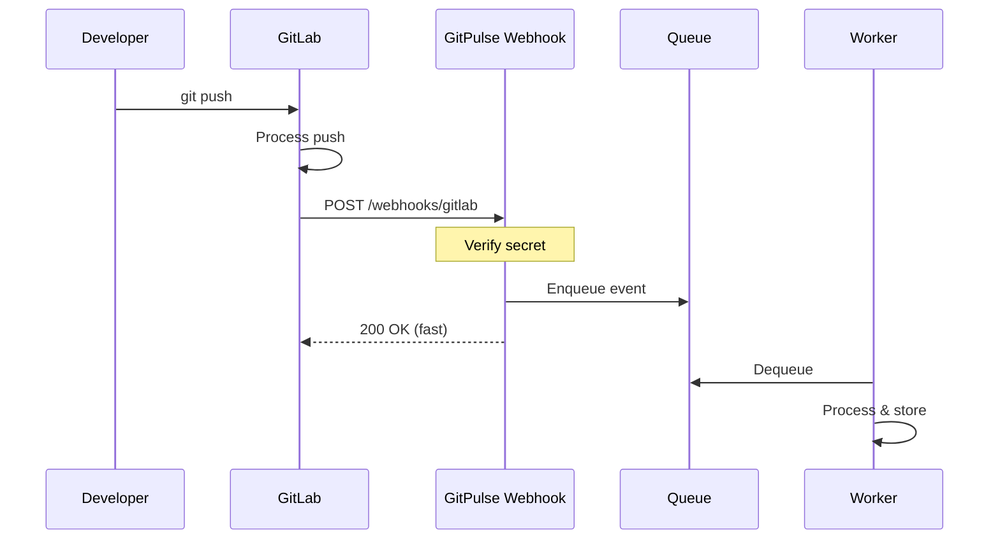


- Pre: Učiteľ, Operátor
- Vyžaduje: GitLab Personal Access Token

Sprievodca konfiguráciou GitLab webhookov pre real-time notifikácie.

## Prehľad



## Konfigurácia v GitLab

### Na úrovni projektu

1. Prejdite do projektu v GitLab
2. **Settings** -> **Webhooks**
3. Vyplňte konfiguráciu:

| Pole | Hodnota |
|------|---------|
| URL | `https://gitpulse.kpi.fei.tuke.sk/api/v1/webhooks/gitlab` |
| Secret token | Vygenerovaný secret (pozri nižšie) |
| Trigger | Push, **Comments**, Issues, Merge request, Pipeline |
| SSL verification | zapnuté |


**Bez "Comments" nefungujú tri pravidlá.** Táto tabuľka roky uvádzala len
Push, MR, Issues a Pipelines. Komentáre v GitLabe chodia ako udalosť `note`,
a práve z nej sa počítajú R06 (prijaté review), R07 (poskytnuté review) a
R08 (reakcia na pripomienky) - spolu **0,32 z celkovej váhy skóre**. Webhook
nastavený podľa starej tabuľky doručoval všetko ostatné, takže vyzeral
funkčne, ale tieto tri pravidlá zostali navždy nesplnené. Rovnaký zoznam
uvádza aj samotná aplikácia v *Nastavenia kurzu -> Webhooky*.


### Na úrovni skupiny

Pre hromadnú konfiguráciu všetkých projektov:

1. Prejdite do skupiny
2. **Settings** -> **Webhooks**
3. Rovnaká konfigurácia ako vyššie


**Group webhooks.** Group webhooky automaticky platia pre všetky projekty v skupine.

## Odkiaľ vziať webhook secret

**Secret negenerujete ručne a nedávate ho do `.env`.** Vytvorí ho GitPulse:

- **Pri projekte** - keď projekt pripojíte (Link Project), GitPulse vygeneruje
  secret práve pre tento projekt a zobrazí ho spolu s návodom na nastavenie.
  Uloží si iba jeho bcrypt hash, takže secret uvidíte len raz.
- **Pri skupine / kurze** - vytvorte webhook konfiguráciu
  (`POST /api/v1/courses/{course_id}/webhook-configs`) a použite secret, ktorý
  vráti. Jedna konfigurácia pokryje všetky projekty vo svojom rozsahu.

Skopírujte tento secret do poľa **Secret token** vo webhooku v GitLabe.
Rotácia: `POST /api/v1/webhook-configs/{config_id}/rotate` - starý secret
ešte chvíľu platí, aby ste ho stihli vymeniť bez výpadku.

## Trigger events

### Push Events

```json
{
  "object_kind": "push",
  "event_name": "push",
  "before": "abc123...",
  "after": "def456...",
  "ref": "refs/heads/main",
  "checkout_sha": "def456...",
  "user_name": "John Doe",
  "user_email": "john@example.com",
  "project": {
    "id": 123,
    "name": "my-project",
    "path_with_namespace": "group/my-project"
  },
  "commits": [
    {
      "id": "def456...",
      "message": "feat: add feature X",
      "timestamp": "2026-01-15T10:30:00Z",
      "author": {
        "name": "John Doe",
        "email": "john@example.com"
      },
      "added": ["new_file.py"],
      "modified": ["existing.py"],
      "removed": []
    }
  ],
  "total_commits_count": 1
}
```

**Spracované metriky:**
- Počet commitov
- Autor (mapovanie na člena tímu)
- Pridané/modifikované/odstránené súbory
- Časové rozloženie

### Merge Request Events

```json
{
  "object_kind": "merge_request",
  "event_type": "merge_request",
  "user": {
    "id": 1,
    "username": "johndoe"
  },
  "object_attributes": {
    "iid": 42,
    "title": "Feature: User authentication",
    "description": "Implements OAuth2 login",
    "state": "merged",
    "source_branch": "feature/auth",
    "target_branch": "main",
    "author_id": 1,
    "assignee_id": 2,
    "created_at": "2026-01-10T10:00:00Z",
    "updated_at": "2026-01-15T14:30:00Z",
    "action": "merge"
  },
  "changes": {
    "state": {
      "previous": "opened",
      "current": "merged"
    }
  }
}
```

**Spracované metriky:**
- MR creation/merge rate
- Time to merge
- Review participation
- Branch activity

### Issue Events

```json
{
  "object_kind": "issue",
  "event_type": "issue",
  "user": {
    "id": 1,
    "username": "johndoe"
  },
  "object_attributes": {
    "iid": 15,
    "title": "Bug: Login fails on mobile",
    "state": "closed",
    "action": "close",
    "labels": [
      {"title": "bug"},
      {"title": "priority:high"}
    ]
  }
}
```

### Pipeline Events

```json
{
  "object_kind": "pipeline",
  "object_attributes": {
    "id": 789,
    "status": "success",
    "duration": 245,
    "created_at": "2026-01-15T10:00:00Z",
    "finished_at": "2026-01-15T10:04:05Z"
  },
  "builds": [
    {
      "id": 1001,
      "stage": "build",
      "name": "compile",
      "status": "success",
      "duration": 60
    },
    {
      "id": 1002,
      "stage": "test",
      "name": "unit-tests",
      "status": "success",
      "duration": 120
    }
  ]
}
```

## Ako GitPulse webhook overí

GitLab neposiela HMAC podpis - posiela priamo secret v hlavičke:

```
X-Gitlab-Token: <secret>
```

GitPulse ho porovná s uloženým **bcrypt hashom** (konštantný čas,
`app/security/webhook_auth.py`). Skúša v tomto poradí:

1. **webhook konfiguráciu** zodpovedajúcu projektu / ceste (multi-scope systém),
2. **legacy secret na úrovni kurzu** (`CourseSettings.webhook_secret_hash`),
3. **secret projektu** (`GitLabProject.webhook_secret_hash`).

Pri rotácii ešte krátko platí aj predchádzajúci secret, kým neuplynie jeho
odkladná lehota.

## Čo handler robí

`POST /api/v1/webhooks/gitlab` (`src/app/api/webhooks.py`) spracuje doručenie
takto - odpoveď je vždy rýchla, samotná práca beží na pozadí:

1. Odmietne príliš veľký payload a uplatní rate limit.
2. Nájde projekt podľa GitLab project ID a overí secret (vyššie).
3. Zahodí doručenie pre **odpojený projekt** aj pre **archivovaný kurz** -
   archivovaný kurz je read-only, jeho dáta sa už nemenia.
4. Trojitá deduplikácia: `X-Gitlab-Delivery`, `X-Gitlab-Event-UUID` a hash
   payloadu.
5. Uloží `WebhookEvent` a zaradí ho do fronty na spracovanie.

Neúspešné udalosti končia v dead-letter queue a dajú sa prehrať zo stránky
**Admin -> System -> Events**.

## Testovanie webhookov

### Manuálny test

```bash
# Simulácia push event
curl -X POST http://localhost:8000/api/v1/webhooks/gitlab \
  -H "Content-Type: application/json" \
  -H "X-Gitlab-Token: ${WEBHOOK_SECRET}" \
  -H "X-Gitlab-Event: Push Hook" \
  -d '{
    "object_kind": "push",
    "ref": "refs/heads/main",
    "commits": [{
      "id": "test123",
      "message": "Test commit",
      "author": {"name": "Test", "email": "test@example.com"}
    }]
  }'
```

### GitLab test webhook

1. V GitLab webhooks settings
2. Kliknite **Test** pri uloženom webhook
3. Vyberte event type
4. Skontrolujte response a GitPulse logy

### Ngrok pre lokálny vývoj

```bash
# Spustenie ngrok tunela
ngrok http 8000

# Použite vygenerovanú URL v GitLab
# https://abc123.ngrok.io/api/v1/webhooks/gitlab
```

## Troubleshooting

### Webhook nedoručený

```bash
# 1. Skontrolujte GitLab webhook logy
# Project -> Settings -> Webhooks -> Recent deliveries

# 2. Overte dostupnosť GitPulse
curl -I https://gitpulse.kpi.fei.tuke.sk/health

# 3. Skontrolujte firewall
sudo ufw status
```

### 401 Unauthorized

```text
Secret nesedí s uloženým hashom.
1. Skontrolujte pole Secret token vo webhooku v GitLabe (bez medzier navyše).
2. Ak ste secret stratili, zrotujte ho:
   POST /api/v1/webhook-configs/{config_id}/rotate
   a nový vložte do GitLabu. Reštart GitPulse netreba - secret je v databáze,
   nie v .env.
```

### 500 Server Error

```bash
# Pozrite GitPulse logy
docker compose logs api | grep webhook

# Bežné príčiny:
# - Malformed JSON payload
# - Database connection error
# - Redis unavailable
```

### Duplicitné eventy

```python
# GitPulse používa idempotency key
# Event s rovnakým ID je spracovaný len raz

# Ak vidíte duplicity, skontrolujte:
# 1. Či nie sú nakonfigurované webhooky na project aj group úrovni
# 2. Retry logic v GitLab
```

## Monitoring webhookov

### Prometheus metriky

```promql
# Webhook request rate
rate(gitlab_webhook_requests_total[5m])

# Error rate
sum(rate(gitlab_webhook_requests_total{status="error"}[5m])) /
sum(rate(gitlab_webhook_requests_total[5m]))

# Processing latency
histogram_quantile(0.99, 
  rate(gitlab_webhook_duration_seconds_bucket[5m])
)
```

### Alerting

```yaml
# monitoring/prometheus/alerts/webhooks.yml
groups:
  - name: webhooks
    rules:
      - alert: WebhookHighErrorRate
        expr: |
          sum(rate(gitlab_webhook_requests_total{status="error"}[5m])) /
          sum(rate(gitlab_webhook_requests_total[5m])) > 0.1
        for: 5m
        labels:
          severity: warning
        annotations:
          summary: "High webhook error rate"
```

## Bezpečnosť

### IP Whitelist

```nginx
# Caddy/Nginx - povoliť len GitLab IP
location /api/v1/webhooks/ {
    allow 10.0.0.0/8;      # GitLab server IP range
    deny all;
    
    proxy_pass http://api:8000;
}
```

### Rate limiting

```python
# src/app/api/webhooks.py
from slowapi import Limiter
from slowapi.util import get_remote_address

limiter = Limiter(key_func=get_remote_address)

@router.post("/webhooks/gitlab")
@limiter.limit("100/minute")
async def gitlab_webhook(...):
    ...
```

## Ďalšie čítanie

- [Tokeny](tokeny.md)
- [CI/CD integrácia](cicd.md)
- [Monitoring](../operatori/monitoring.md)

