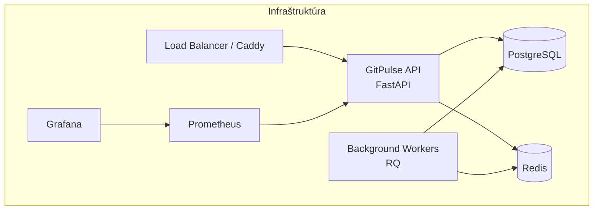
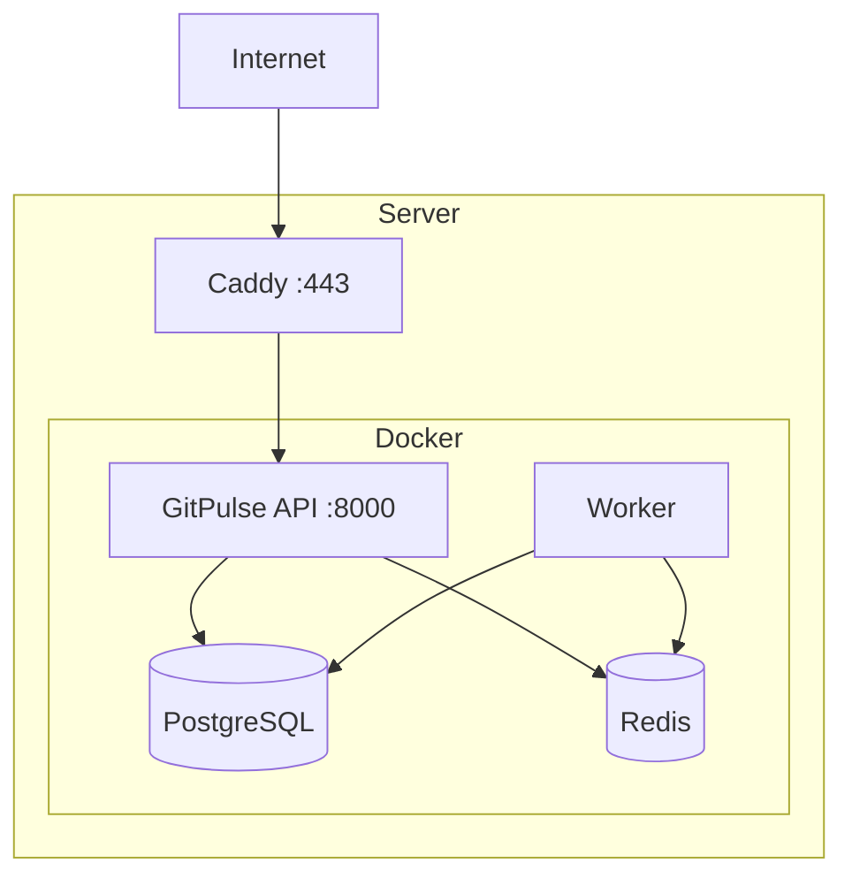
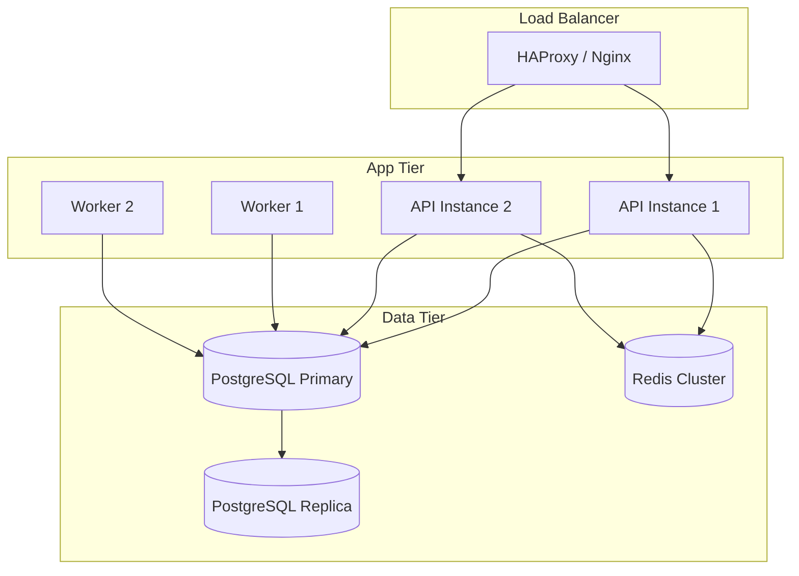


- Pre: Operátor
- Vyžaduje: Prístup na server a k nasadeniu

Táto sekcia je určená pre administrátorov a DevOps inžinierov zodpovedných za nasadenie a prevádzku GitPulse.

## Prehľad



## Čo nájdete v tejto sekcii

  - [Nasadenie](./nasadenie/) - Inštalácia a konfigurácia na produkčnom serveri
  - [Aktualizácie](./aktualizacie/) - Proces aktualizácie na novú verziu
  - [Zálohovanie](./zalohovanie/) - Stratégia zálohovania a obnovy
  - [Monitoring](./monitoring/) - Prometheus, Grafana, alerting
  - [Troubleshooting](./troubleshooting/) - Riešenie bežných problémov

## Minimálne požiadavky

### Hardware

| Komponent | Minimum | Odporúčané |
|-----------|---------|------------|
| CPU | 2 cores | 4 cores |
| RAM | 4 GB | 8 GB |
| Disk | 20 GB SSD | 50 GB SSD |
| Sieť | 100 Mbps | 1 Gbps |

### Software

| Komponent | Verzia |
|-----------|--------|
| Docker | 24.0+ |
| Docker Compose | 2.20+ |
| PostgreSQL | 16+ |
| Redis | 7+ |

### Sieťové požiadavky

| Port | Služba | Prístup |
|------|--------|---------|
| 443 | HTTPS (Caddy) | Verejný |
| 80 | HTTP redirect | Verejný |
| 5432 | PostgreSQL | Interný |
| 6379 | Redis | Interný |
| 8000 | API (interný) | Interný |
| 9090 | Prometheus | Interný |
| 3000 | Grafana | Interný/VPN |

## Architektúra nasadenia

### Jednoduchý deployment (1 server)



### Škálovateľný deployment



## Rýchly štart

### 1. Príprava servera

```bash
# Aktualizácia systému
sudo apt update && sudo apt upgrade -y

# Inštalácia Docker
curl -fsSL https://get.docker.com | sh
sudo usermod -aG docker $USER

# Inštalácia Docker Compose
sudo apt install docker-compose-plugin
```

### 2. Klonovanie repozitára

```bash
git clone https://gitlab.example.com/kpi-zp/2027/dp.mykyta.olym/workspace/workspace.git gitpulse
cd gitpulse
```

### 3. Konfigurácia

```bash
# Kopírovanie šablóny
cp .env.example .env

# Úprava konfigurácie
nano .env
```

### 4. Spustenie

```bash
docker compose up -d
```

### 5. Overenie

```bash
# Health check
curl http://localhost:8000/health

# Logy
docker compose logs -f
```

## Ďalšie kroky

1. [Detailné nasadenie](nasadenie.md) - Kompletný sprievodca
2. [Konfigurácia TLS](nasadenie.md) - HTTPS setup
3. [GitLab integrácia](../gitlab/tokeny.md) - Napojenie na GitLab
4. [Monitoring](monitoring.md) - Nastavenie alertov

