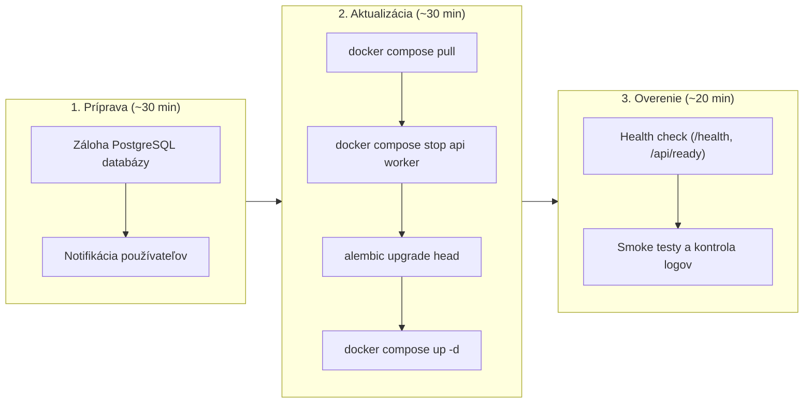


- Pre: Operátor
- Vyžaduje: Prístup na server a k nasadeniu

Sprievodca bezpečnou aktualizáciou GitPulse na novú verziu.

## Stratégia vydávania verzií

### Calendar Versioning

```
YYYY.M.D[.postN]
  |     |     |
  |     |     +- Voliteľný same-day follow-up
  |     +------- Mesiac releasu
  +------------- Rok releasu
```

| Verzia | Príklad | Vyžaduje |
|--------|---------|----------|
| Dátumový release | 2026.6.2.post24 -> 2026.6.3 | Reštart kontajnerov; možné migrácie |
| Same-day follow-up | 2026.6.3 -> 2026.6.3.post1 | Reštart kontajnerov |
| Breaking release | Ľubovoľná verzia | Explicitné release notes a operátorská akcia |

### Aktuálny baseline

GitPulse aktuálne beží na `2026.9.13`; CalVer baseline začína z
`2026.5.15`.

- Repozitár začal ako full-codebase initial commit, nie ako tagovaný `0.1.0`
  release.
- Pred zápisom tohto baseline audit našiel 1 875 commitov, 19 Alembic migračných
  súborov a žiadne predchádzajúce release tagy.
- Počty commitov a migrácií sú prevádzkový kontext, nie stabilné verejné
  komponenty verzie. Aktuálne releasy preto používajú Calendar Versioning
  (`YYYY.M.D`).
- Same-day follow-up releasy používajú `.postN`; breaking changes musia byť
  jasne popísané v release notes a rollout docs.

## Pred aktualizáciou

### 1. Kontrola release notes

```bash
# Pozrieť release notes
open https://gitlab.example.com/kpi-zp/2027/dp.mykyta.olym/workspace/workspace/-/releases
```

### 2. Záloha databázy

```bash
# Vytvorenie zálohy pred aktualizáciou
./scripts/backup.sh

# Overenie zálohy
ls -la backups/
```

### 3. Kontrola dostupného miesta

```bash
# Disk space
df -h

# Docker images
docker system df
```

### 4. Plánovanie maintenance window



## Proces aktualizácie

### Štandardná aktualizácia (Patch/Minor)

```bash
# 1. Prepnúť na správnu verziu
cd /home/gitpulse/gitpulse
git fetch --tags
git checkout 2026.9.1

# 2. Pull nových Docker images
docker compose pull

# 3. Zastaviť služby gracefully
docker compose stop api worker

# 4. Spustiť migrácie (ak treba)
docker compose run --rm api alembic upgrade head

# 5. Spustiť nové verzie
docker compose up -d

# 6. Overenie
docker compose ps
curl https://gitpulse.kpi.fei.tuke.sk/health
```

### Zero-downtime aktualizácia

Pre produkciu s požiadavkou na dostupnosť:

```bash
# 1. Pull nových images
docker compose pull

# 2. Scale up nové inštancie
docker compose up -d --scale api=2 --no-recreate

# 3. Počkať na health check nových inštancií
sleep 30

# 4. Rolling restart
docker compose up -d --force-recreate

# 5. Overiť
curl https://gitpulse.kpi.fei.tuke.sk/health
```

### Major version upgrade

Major verzie môžu obsahovať breaking changes:

```bash
# 1. Prečítať migration guide
cat docs/UPGRADING.md

# 2. Záloha všetkého
./scripts/backup.sh --full

# 3. Maintenance mode
docker compose exec api \
  python -c "from app.config import settings; settings.MAINTENANCE_MODE = True"

# 4. Stop všetkých služieb
docker compose down

# 5. Aktualizácia kódu
git fetch --tags
git checkout 2026.8.1

# 6. Aktualizácia konfigurácie (ak treba)
# Pozrieť .env.example pre nové premenné
diff .env .env.example

# 7. Build/pull nových images
docker compose pull

# 8. Migrácie
docker compose run --rm api alembic upgrade head

# 9. Spustenie
docker compose up -d

# 10. Disable maintenance mode
docker compose exec api \
  python -c "from app.config import settings; settings.MAINTENANCE_MODE = False"
```

## Rollback

### Rýchly rollback

```bash
# Ak niečo zlyhalo, rollback na predchádzajúcu verziu

# 1. Stop problematickej verzie
docker compose down

# 2. Checkout predchádzajúcej verzie
git checkout 2026.8.15

# 3. Obnova databázy (ak boli migrácie)
./scripts/restore.sh backups/backup_20261115_080000.sql

# 4. Spustenie
docker compose up -d
```

### Databázový rollback

```bash
# Ak migrácia spôsobila problémy
docker compose exec api \
  alembic downgrade -1

# Alebo na konkrétnu revíziu
docker compose exec api \
  alembic downgrade 018
```

## Automatizácia

### GitLab CI deployment

```yaml
# .gitlab-ci.yml
deploy:production:
  stage: deploy
  environment:
    name: production
    url: https://gitpulse.kpi.fei.tuke.sk
  only:
    - tags
  when: manual
  script:
    - ssh gitpulse@server "cd gitpulse && git pull && docker compose pull && docker compose up -d"
```

### Ansible playbook

```yaml
# deploy.yml
---
- hosts: production
  become: yes
  become_user: gitpulse
  vars:
    app_dir: /home/gitpulse/gitpulse
    version: "{{ lookup('env', 'VERSION') | default('latest') }}"
  
  tasks:
    - name: Pull latest code
      git:
        repo: https://gitlab.example.com/kpi-zp/2027/dp.mykyta.olym/workspace/workspace.git
        dest: "{{ app_dir }}"
        version: "{{ version }}"
    
    - name: Pull Docker images
      community.docker.docker_compose:
        project_src: "{{ app_dir }}"
        files:
          - docker-compose.yml
        pull: yes
        state: present
    
    - name: Run migrations
      community.docker.docker_container_exec:
        container: gitpulse-api-1
        command: alembic upgrade head
    
    - name: Restart services
      community.docker.docker_compose:
        project_src: "{{ app_dir }}"
        files:
          - docker-compose.yml
        restarted: yes
```

## Checklist

### Pred aktualizáciou

- [ ] Release notes prečítané
- [ ] Záloha databázy vytvorená
- [ ] Disk space overený
- [ ] Maintenance window naplánovaný
- [ ] Notifikácia používateľom odoslaná

### Počas aktualizácie

- [ ] Staré služby zastavené
- [ ] Migrácie spustené
- [ ] Nové služby naštartované
- [ ] Health checks prechádzajú

### Po aktualizácii

- [ ] Smoke testy
- [ ] Log monitoring
- [ ] Výkonnostné metriky
- [ ] Rollback plán pripravený (24h)

## Troubleshooting

### Migrácia zlyhala

```bash
# Pozrieť error
docker compose logs api | grep -i error

# Manuálne spustiť migráciu pre debug
docker compose exec api alembic upgrade head --sql

# Rollback ak treba
docker compose exec api alembic downgrade -1
```

### Kontajner nenaštartuje

```bash
# Kontrola logov
docker compose logs api

# Kontrola konfigurácie
docker compose config

# Spustiť interaktívne pre debug
docker compose run --rm api /bin/bash
```

### Health check zlyháva

```bash
# Manuálny health check
curl -v http://localhost:8000/health

# Kontrola databázového pripojenia
docker compose exec api \
  python -c "from app.db.session import engine; print(engine.url)"
```

## Ďalšie čítanie

- [Zálohovanie](zalohovanie.md)
- [Monitoring](monitoring.md)
- [Troubleshooting](troubleshooting.md)
