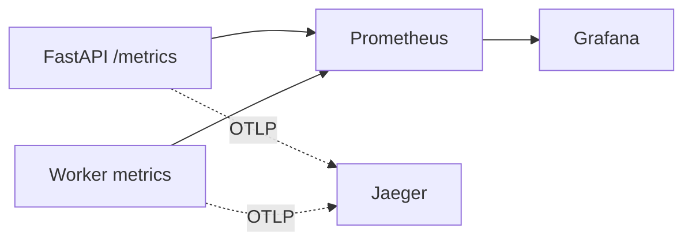


- Pre: Operátor
- Vyžaduje: Prístup na server a k nasadeniu

> Overené podľa `monitoring/*` a `src/app/observability/*` dňa **2026-09-09**.

## Stack

Aktuálny monitoring profil (`docker compose --profile monitoring`) spúšťa:

- Prometheus
- Grafana
- Jaeger



## Prístupy a Spustenie

### Lokálny vývoj (Local Development)
Pre spustenie monitoringu lokálne:
```bash
docker compose --profile monitoring up -d
```
Lokálne prístupy (bez nutnosti autentifikácie):
- **Grafana**: `http://localhost:3000` (alebo `http://localhost:3000/grafana/`)
- **Prometheus**: `http://localhost:9090`
- **Jaeger**: `http://localhost:16686` (alebo `http://localhost:16686/jaeger/`)

### Produkčné prostredie (Production)
V produkcii sú služby monitoringu za reverse proxy (Caddy) a otvoria sa prihlásenému administrátorovi GitPulse.
- **Grafana**: [https://gitpulse.kpi.fei.tuke.sk/grafana/](https://gitpulse.kpi.fei.tuke.sk/grafana/)
- **Prometheus**: [https://gitpulse.kpi.fei.tuke.sk/prometheus/](https://gitpulse.kpi.fei.tuke.sk/prometheus/)
- **Jaeger**: [https://gitpulse.kpi.fei.tuke.sk/jaeger/](https://gitpulse.kpi.fei.tuke.sk/jaeger/)
- **Alertmanager**: [https://gitpulse.kpi.fei.tuke.sk/alertmanager/](https://gitpulse.kpi.fei.tuke.sk/alertmanager/)

**Prístup:** prihláste sa do GitPulse ako administrátor a otvorte odkazy vyššie -
žiadne samostatné heslo nie je. Caddy sa pred každou požiadavkou opýta GitPulse
(`/internal/monitoring-authz`); bez prihlásenia vás pošle prihlásiť sa a späť,
s inou rolou dostanete 403. Grafana vás prihlási pod vaším menom z GitPulse.
Kým GitPulse nebeží, sú zatvorené aj nástroje; na serveri ostávajú na 127.0.0.1
(pozri DEPLOY.md, "Monitoring access").

## Kľúčové metriky (implementované)

| Metrika | Typ | Labely | Význam |
|---|---|---|---|
| `webhook_events_received_total` | Counter | `event_type` | prijaté webhooky |
| `webhook_events_processed_total` | Counter | `event_type`, `status` | výsledok spracovania |
| `webhook_processing_duration_seconds` | Histogram | `event_type` | latencia spracovania |
| `gitlab_api_requests_total` | Counter | `endpoint`, `status` | volania na GitLab API |
| `gitlab_api_duration_seconds` | Histogram | `endpoint` | latencia GitLab API |
| `http_requests_total` | Counter | `method`, `path`, `status` | HTTP request objem |
| `http_request_duration_seconds` | Histogram | `method`, `path` | HTTP latencia |
| `rq_queue_depth` | Gauge | `queue_name` | hĺbka queue |
| `rq_failed_jobs` | Gauge | - | uchované záznamy zlyhaní RQ vrátane historických |
| `rq_job_failures_total` | Counter | `queue_name` | chyby vykonávania vrátane opakovaných pokusov |
| `rq_workers_active` | Gauge | - | aktívni workeri |
| `metrics_compute_total` | Counter | `status` | výpočty metrík |
| `metrics_compute_duration_seconds` | Histogram | - | čas výpočtu metrík |
| `db_pool_size` | Gauge | - | veľkosť DB poolu |
| `db_pool_checked_out` | Gauge | - | využité DB connections |

## Grafana dashboard

Provisioned dashboard:

- `monitoring/grafana/dashboards/gitpulse.json`

Hlavné panely:

1. Webhook rate (received/processed)
2. Processing latency (p50/p95/p99)
3. Queue depth
4. Success/failure rate
5. DB pool utilization
6. HTTP request rate
7. GitLab API latency
8. Active workers
9. Metrics compute duration

## Alerty

Alert pravidlá: `monitoring/prometheus/alerts.yml`

| Alert | Podmienka |
|---|---|
| `QueueStuck` | `rq_queue_depth > 50` počas 5 min |
| `HighFailureRate` | `rate(webhook_events_processed_total{status="error"}[5m]) > 0.1` |
| `ApiDown` | `up{job="gitpulse-api"} == 0` |
| `HighProcessingLatency` | p95 webhook latencia > 10 s |
| `WorkerDown` | `rq_workers_active == 0` |
| `DBPoolExhausted` | `db_pool_checked_out / db_pool_size > 0.9` |
| `HighHTTPErrorRate` | podiel 5xx > 5% |

Spustený aj vyriešený alert príde e-mailom na `ALERT_EMAIL_TO` (v `.env.production`), odoslaný cez SMTP účet aplikácie a upravený ako ostatné e-maily GitPulse (`monitoring/alertmanager-templates/gitpulse.tmpl`). Odkaz **Silence** otvorí Alertmanager na `/alertmanager/`, prístupný administrátorom GitPulse ako ostatné nástroje.

## Operačný checklist

1. `/health` a `/metrics` vracajú 200.
2. `http://localhost:9090/targets` má `gitpulse-api` v stave UP.
3. Grafana datasource smeruje na `http://prometheus:9090`.
4. Pri incidentoch korelujte `correlation_id` medzi logmi, metrikami a trace.

### Diagnostika zlyhaní

Administrátor nájde na stránke **Systém → Úlohy na pozadí** posledných 100 uchovaných zlyhaní RQ, ich poslednú aktivitu, príčiny a odporúčané kroky. **Podrobnosti** zobrazia ID úlohy, typ výnimky a miesta v kóde; podľa ID možno vyhľadať úplný záznam v denníku workera. Stránka neobsahuje argumenty, správy výnimiek ani prihlasovacie údaje. Obnovenie používa spoločné stavy načítavania a opakovania. Učitelia a študenti vidia iba oznámenia určené svojej roli.

Uchované zlyhania sú história, nie počet aktuálnych incidentov. Hodinový panel a upozornenie používajú počítadlo `rq_job_failures_total` v Redise; vymazanie ani expirácia histórie toto počítadlo nezmení. Počítadlo začína týmto vydaním, historické záznamy sa doň spätne nezapočítavajú.

Systém spája zdravie služieb a metriky monitoringu. Jeden denník úloh obsahuje sledované úlohy aj posledných 100 zlyhaní RQ, bez duplikátov podľa RQ ID. Záznamy iba z RQ nemožno vybrať jednotlivo; Vymazať staré odstraňuje ukončené sledované úlohy aj uchované zlyhania RQ podľa poslednej aktivity. Aktívne a nedávno dokončené úlohy zostanú zachované. Učitelia a študenti vidia oznámenia o vplyve na službu na existujúcich stránkach.
