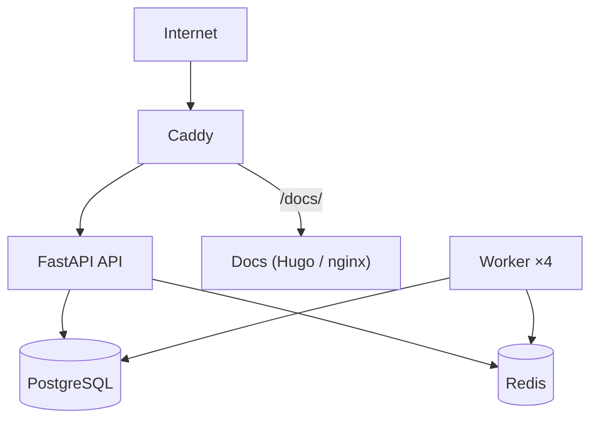


- Pre: Operátor
- Vyžaduje: Prístup na server a k nasadeniu

> Overené podľa `docker-compose.yml`, `.env.production.example` a `deploy-production.ps1` dňa **2026-09-09**.

## Model nasadenia

GitPulse používa Docker Compose stack:

- `postgres`
- `redis`
- `api`
- `worker`
- `gitpulse-docs`
- `caddy`

Voliteľne (`--profile monitoring`):

- `prometheus`
- `grafana`
- `jaeger`



## Prerekvizity

- Docker 24+
- Docker Compose 2.20+
- `.env.production` podľa `.env.production.example`
- GitLab OAuth aplikácia (pre dashboard login)

## Povinné konfigurácie

Minimálne nastavte:

- `DATABASE_URL`
- `POSTGRES_PASSWORD`
- `REDIS_PASSWORD` (validator v `APP_ENV=production` odmietne naštartovať ak `REDIS_URL` nemá password segment)
- `SECRET_KEY`
- `TEACHER_API_TOKEN`
- `GITLAB_OAUTH_CLIENT_ID`
- `GITLAB_OAUTH_CLIENT_SECRET`
- `GITLAB_API_TOKEN` (alebo legacy alias `GITLAB_TOKEN`)
- `DOMAIN`

## Rýchly produkčný deploy (PowerShell)

```powershell
cp .env.production.example .env.production
# vyplňte hodnoty

.\deploy-production.ps1 -Build -Migrate
```

S monitoring profilom:

```powershell
.\deploy-production.ps1 -Monitoring
```

## Manuálny deploy (cross-platform)

### 1. Migrácie

```bash
docker compose --env-file .env.production --profile migrate run --rm migrate
```

### 2. Spustenie stacku

```bash
docker compose --env-file .env.production up -d
```

### 3. Monitoring (voliteľne)

```bash
docker compose --env-file .env.production --profile monitoring up -d
```

## Overenie po deployi

```bash
curl http://localhost:8000/health
curl http://localhost:8000/health/ready
curl http://localhost:8000/metrics
```

UI endpointy:

- dashboard: `http://localhost/dashboard/`
- docs (produkcia, cez Caddy): `http://localhost/docs/`
- docs (fallback, cez FastAPI): `http://localhost:8000/project-docs/`

## Prevádzkové porty

| Služba | Port |
|---|---|
| Caddy HTTP/HTTPS | `80`, `443` |
| API (lokálne bind) | `127.0.0.1:8000` |
| PostgreSQL | `127.0.0.1:5433` |
| Redis | `127.0.0.1:6379` |
| Grafana (profil monitoring) | `127.0.0.1:3000` |
| Prometheus (profil monitoring) | `127.0.0.1:9090` |
| Jaeger (profil monitoring) | `127.0.0.1:16686` |

## Rollback

```bash
docker compose --env-file .env.production down
# alebo s monitoring profilom
# docker compose --env-file .env.production --profile monitoring down
```

## Súvisiace dokumenty

- [Monitoring](monitoring.md)
- [Aktualizácie](aktualizacie.md)
- [Zálohovanie](zalohovanie.md)
