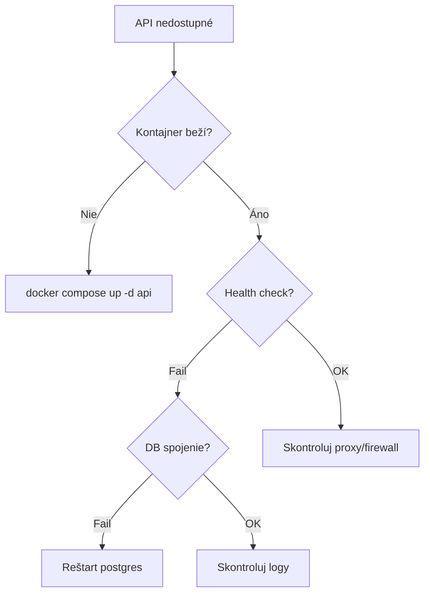


- Pre: Operátor
- Vyžaduje: Prístup na server a k nasadeniu

Sprievodca riešením bežných problémov s GitPulse.

## Diagnostické nástroje

### Rýchla kontrola stavu

```bash
# Stav kontajnerov
docker compose ps

# Health check API
curl -s http://localhost:8000/health | jq

# Databázové spojenie
docker compose exec postgres pg_isready

# Redis ping
docker compose exec redis redis-cli ping
```

### Logy

```bash
# Všetky logy
docker compose logs -f

# Len API logy
docker compose logs -f api

# Posledných 100 riadkov
docker compose logs --tail=100 api

# Filtrovanie chýb
docker compose logs api 2>&1 | grep -i error
```

## Bežné problémy

### API nedostupné



#### Riešenie

```bash
# 1. Overiť stav kontajnera
docker compose ps api

# 2. Ak nebeží, pozrieť dôvod
docker compose logs api | tail -50

# 3. Overiť závislosti
docker compose exec api \
  python -c "from app.db.session import engine; print('DB OK')"

# 4. Reštart
docker compose restart api
```

### Databáza nedostupná

#### Symptómy
- API vracia 500 error
- Logy obsahujú "connection refused" alebo "timeout"

#### Riešenie

```bash
# 1. Stav PostgreSQL
docker compose ps postgres
docker compose logs postgres | tail -20

# 2. Disk space
df -h
docker system df

# 3. Pripojenie do DB
docker compose exec postgres \
  psql -U gitpulse -c "SELECT 1;"

# 4. Ak corrupted, restore
./scripts/restore.sh backups/latest.dump

# 5. Reštart
docker compose restart postgres
```

### GitLab sync nefunguje

#### Symptómy
- Events nie sú aktualizované
- Dashboard zobrazuje staré dáta

#### Diagnostika

```bash
# 1. Test GitLab API
curl -H "Private-Token: ${GITLAB_TOKEN}" \
  "https://gitlab.example.com/api/v4/user"

# 2. Kontrola worker queue
docker compose exec redis \
  redis-cli LLEN rq:queue:default

# 3. Worker logy
docker compose logs worker | tail -50

# 4. Manuálny sync tímu
curl -X POST http://localhost:8000/api/v1/teams/<team_id>/sync \
  -H "Authorization: Bearer ${TEACHER_API_TOKEN}"
```

#### Riešenie

```bash
# Token expired/invalid
# 1. Vygenerovať nový token v GitLab
# 2. Aktualizovať .env
# 3. Reštart
docker compose restart api worker
```

### Vysoká latencia

#### Diagnostika

```bash
# 1. API metriky
curl http://localhost:8000/metrics | grep http_request_duration

# 2. Slow queries
docker compose exec postgres \
  psql -U gitpulse -c "
    SELECT query, mean_exec_time, calls
    FROM pg_stat_statements
    ORDER BY mean_exec_time DESC
    LIMIT 10;
  "

# 3. CPU/Memory
docker stats --no-stream
```

#### Riešenie

```bash
# 1. Scale API
docker compose up -d --scale api=2

# 2. Vacuum databázy
docker compose exec postgres \
  psql -U gitpulse -c "VACUUM ANALYZE;"

# 3. Redis cache clear (ak potrebné)
docker compose exec redis \
  redis-cli FLUSHDB
```

### Worker stuck/crashed

#### Symptómy
- Jobs zostávajú v queue
- No worker logs

#### Riešenie

```bash
# 1. Stav workerov
docker compose ps worker

# 2. Stuck jobs
docker compose exec redis \
  redis-cli LRANGE rq:queue:failed 0 10

# 3. Clear failed queue
docker compose exec redis \
  redis-cli DEL rq:queue:failed

# 4. Reštart workerov
docker compose restart worker
```

### Out of memory

#### Symptómy
- Container killed (OOMKilled)
- System becomes unresponsive

#### Diagnostika

```bash
# 1. Memory usage
free -h
docker stats --no-stream

# 2. OOM events
dmesg | grep -i oom

# 3. Container limits
docker compose config | grep -A5 resources
```

#### Riešenie

```yaml
# Zvýšiť memory limity v docker-compose.yml
services:
  api:
    deploy:
      resources:
        limits:
          memory: 4G
        reservations:
          memory: 2G
```

### Disk full

#### Symptómy
- Database errors
- No new logs

#### Riešenie

```bash
# 1. Identifikácia problému
df -h
du -sh /var/lib/docker/*

# 2. Docker cleanup
docker system prune -a --volumes

# 3. Log rotation
docker compose logs --tail=0

# 4. Old backups
find /home/gitpulse/backups -mtime +30 -delete
```

### SSL/TLS problémy

#### Symptómy
- Certificate errors v prehliadači
- curl: SSL certificate problem

#### Diagnostika

```bash
# 1. Certificate info
echo | openssl s_client -connect gitpulse.kpi.fei.tuke.sk:443 2>/dev/null | openssl x509 -text

# 2. Caddy logy
docker compose logs caddy | grep -i cert

# 3. Let's Encrypt rate limits
curl "https://crt.sh/?q=gitpulse.kpi.fei.tuke.sk&output=json" | jq length
```

#### Riešenie

```bash
# Force certificate renewal
docker compose exec caddy \
  caddy reload --config /etc/caddy/Caddyfile

# Alebo reštart Caddy
docker compose restart caddy
```

## Escalation matrix

| Severity | Čas odpovede | Kto |
|----------|--------------|-----|
| Critical (P1) | 15 min | On-call + Team Lead |
| High (P2) | 1 hodina | DevOps team |
| Medium (P3) | 4 hodiny | DevOps team |
| Low (P4) | Next business day | DevOps team |

### P1 - Critical

- API kompletne nedostupné
- Data loss
- Security incident

### P2 - High

- Významná degradácia výkonu
- GitLab sync nefunkčný
- Backup failures

### P3 - Medium

- Čiastočné problémy
- Single component issues
- Performance warnings

### P4 - Low

- Kozmetické problémy
- Non-critical features

## Checklist pre incident response

- [ ] Identifikácia problému
- [ ] Notifikácia stakeholderov
- [ ] Záloha pred zmenami
- [ ] Implementácia fix
- [ ] Verifikácia
- [ ] Dokumentácia (post-mortem)

## Užitočné príkazy

```bash
# === Docker ===
# Interaktívny shell v kontajneri
docker compose exec api /bin/bash

# Kopírovanie súborov z kontajnera
docker cp gitpulse-api-1:/app/logs ./local-logs

# Resource usage
docker stats

# === Database ===
# Interaktívny psql
docker compose exec postgres psql -U gitpulse

# Dump schémy
docker compose exec postgres \
  pg_dump -U gitpulse --schema-only gitpulse

# === Network ===
# DNS test
docker compose exec api \
  nslookup gitlab.example.com

# Port test
docker compose exec api \
  nc -zv postgres 5432
```

## Ďalšie čítanie

- [Monitoring](monitoring.md)
- [Zálohovanie](zalohovanie.md)
- [Nasadenie](nasadenie.md)

