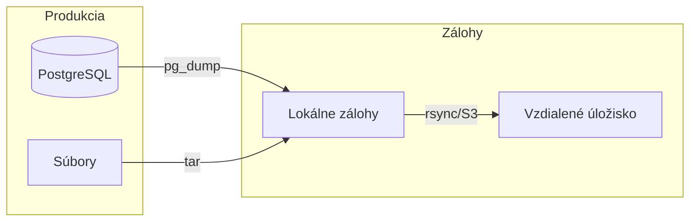
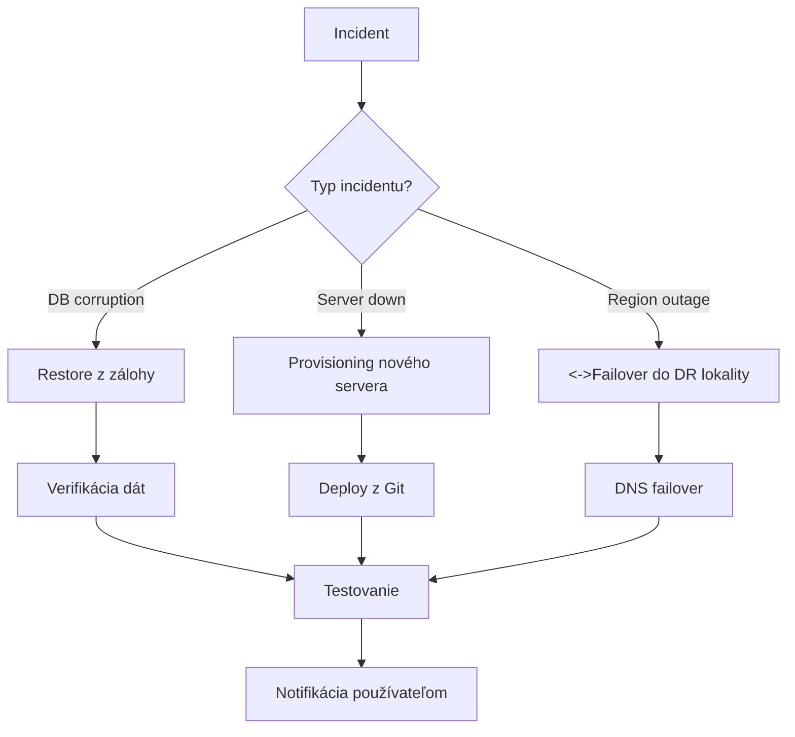


- Pre: Operátor
- Vyžaduje: Prístup na server a k nasadeniu

Kompletná stratégia zálohovania a disaster recovery pre GitPulse.

## Prehľad



## Čo zálohovať

| Komponenta | Priorita | Frekvencia | Retencia |
|------------|----------|------------|----------|
| PostgreSQL databáza | Critical Kritická | Denne | 30 dní |
| Konfiguračné súbory | High Vysoká | Pri zmene | 90 dní |
| Docker volumes | Medium Stredná | Týždenne | 14 dní |
| Logy | Low Nízka | Denne | 7 dní |

## Automatické zálohovanie

### Zálohovací skript

```bash
#!/bin/bash
# scripts/backup.sh

set -euo pipefail

# === Konfigurácia ===
BACKUP_DIR="/home/gitpulse/backups"
RETENTION_DAYS=30
TIMESTAMP=$(date +%Y%m%d_%H%M%S)
BACKUP_NAME="gitpulse_backup_${TIMESTAMP}"

# Farby pre output
RED='\033[0;31m'
GREEN='\033[0;32m'
NC='\033[0m'

log() {
    echo -e "${GREEN}[$(date +'%Y-%m-%d %H:%M:%S')]${NC} $1"
}

error() {
    echo -e "${RED}[ERROR]${NC} $1" >&2
    exit 1
}

# === Vytvorenie adresára ===
mkdir -p "${BACKUP_DIR}"

# === 1. Záloha PostgreSQL ===
log "Zálohujem PostgreSQL databázu..."
docker compose exec -T postgres \
    pg_dump -U gitpulse -Fc gitpulse \
    > "${BACKUP_DIR}/${BACKUP_NAME}.dump" \
    || error "Záloha databázy zlyhala"

log "Databáza zálohovaná: ${BACKUP_NAME}.dump ($(du -h ${BACKUP_DIR}/${BACKUP_NAME}.dump | cut -f1))"

# === 2. Záloha konfigurácie ===
log "Zálohujem konfiguračné súbory..."
tar -czf "${BACKUP_DIR}/${BACKUP_NAME}_config.tar.gz" \
    --exclude='.git' \
    --exclude='__pycache__' \
    --exclude='.venv' \
    .env Caddyfile docker-compose.yml \
    || error "Záloha konfigurácie zlyhala"

# === 3. Záloha Redis (voliteľné) ===
log "Zálohujem Redis..."
docker compose exec -T redis \
    redis-cli BGSAVE
sleep 5
docker cp "$(docker compose ps -q redis):/data/dump.rdb" \
    "${BACKUP_DIR}/${BACKUP_NAME}_redis.rdb" 2>/dev/null || true

# === 4. Čistenie starých záloh ===
log "Čistím zálohy staršie ako ${RETENTION_DAYS} dní..."
find "${BACKUP_DIR}" -name "gitpulse_backup_*" -mtime +${RETENTION_DAYS} -delete

# === 5. Verifikácia ===
log "Verifikujem zálohu..."
pg_restore --list "${BACKUP_DIR}/${BACKUP_NAME}.dump" > /dev/null \
    || error "Verifikácia zálohy zlyhala"

# === Súhrn ===
log "Záloha dokončená úspešne!"
echo "========================================"
echo "Súbory zálohy:"
ls -lh "${BACKUP_DIR}/${BACKUP_NAME}"*
echo "========================================"
```

### Cron job

```bash
# Denná záloha o 2:00
0 2 * * * /home/gitpulse/gitpulse/scripts/backup.sh >> /var/log/gitpulse-backup.log 2>&1

# Týždenná plná záloha v nedeľu o 3:00
0 3 * * 0 /home/gitpulse/gitpulse/scripts/backup.sh --full >> /var/log/gitpulse-backup.log 2>&1
```

## Vzdialené zálohy

### S3 kompatibilné úložisko

```bash
#!/bin/bash
# scripts/backup-to-s3.sh

# Konfigurácia
S3_BUCKET="s3://gitpulse-backups"
S3_ENDPOINT="https://s3.example.com"

# Upload
aws s3 cp "${BACKUP_DIR}/${BACKUP_NAME}.dump" \
    "${S3_BUCKET}/database/" \
    --endpoint-url "${S3_ENDPOINT}"

# Retenciu rieši S3 lifecycle policy
```

### Rsync na vzdialený server

```bash
#!/bin/bash
# scripts/sync-backups.sh

REMOTE_HOST="backup.example.com"
REMOTE_DIR="/backups/gitpulse"

rsync -avz --delete \
    "${BACKUP_DIR}/" \
    "${REMOTE_HOST}:${REMOTE_DIR}/"
```

## Obnova (Restore)

### Obnova databázy

```bash
#!/bin/bash
# scripts/restore.sh

set -euo pipefail

BACKUP_FILE="${1:-}"

if [ -z "${BACKUP_FILE}" ]; then
    echo "Usage: $0 <backup_file>"
    echo "Available backups:"
    ls -la /home/gitpulse/backups/*.dump
    exit 1
fi

echo "WARNING: POZOR: Toto zmaže existujúcu databázu!"
read -p "Pokračovať? (yes/no): " confirm

if [ "${confirm}" != "yes" ]; then
    echo "Zrušené."
    exit 0
fi

# 1. Stop aplikácie
echo "Zastavujem aplikáciu..."
docker compose stop api worker

# 2. Drop a recreate databázy
echo "Pripravujem databázu..."
docker compose exec -T postgres \
    psql -U gitpulse -c "DROP DATABASE IF EXISTS gitpulse_restore;"
docker compose exec -T postgres \
    psql -U gitpulse -c "CREATE DATABASE gitpulse_restore;"

# 3. Restore
echo "Obnovovujem z ${BACKUP_FILE}..."
docker compose exec -T postgres \
    pg_restore -U gitpulse -d gitpulse_restore < "${BACKUP_FILE}"

# 4. Swap databázy
echo "Prepínam databázy..."
docker compose exec -T postgres \
    psql -U gitpulse -c "
        SELECT pg_terminate_backend(pid) FROM pg_stat_activity 
        WHERE datname = 'gitpulse';
        DROP DATABASE gitpulse;
        ALTER DATABASE gitpulse_restore RENAME TO gitpulse;
    "

# 5. Start aplikácie
echo "Spúšťam aplikáciu..."
docker compose start api worker

echo "[OK] Obnova dokončená!"
```

### Point-in-time recovery (PITR)

Pre kritické nasadenia s WAL archivovaním:

```yaml
# docker-compose.yml
services:
  postgres:
    environment:
      POSTGRES_INITDB_ARGS: "--data-checksums"
    command: >
      postgres
      -c archive_mode=on
      -c archive_command='cp %p /var/lib/postgresql/wal_archive/%f'
      -c wal_level=replica
    volumes:
      - wal_archive:/var/lib/postgresql/wal_archive
```

```bash
# PITR obnova
pg_restore --target-time="2026-11-15 10:30:00" \
    -d gitpulse /backups/base_backup.dump
```

## Testovanie záloh

### Automatický test

```bash
#!/bin/bash
# scripts/test-backup.sh

# 1. Vytvor zálohu
./scripts/backup.sh

# 2. Vytvor test databázu
docker compose exec -T postgres \
    psql -U gitpulse -c "CREATE DATABASE backup_test;"

# 3. Restore do test databázy
LATEST_BACKUP=$(ls -t /home/gitpulse/backups/*.dump | head -1)
docker compose exec -T postgres \
    pg_restore -U gitpulse -d backup_test < "${LATEST_BACKUP}"

# 4. Verifikácia
PROD_COUNT=$(docker compose exec -T postgres psql -U gitpulse -t -c "SELECT COUNT(*) FROM teams;")
TEST_COUNT=$(docker compose exec -T postgres psql -U gitpulse -t -d backup_test -c "SELECT COUNT(*) FROM teams;")

if [ "${PROD_COUNT}" = "${TEST_COUNT}" ]; then
    echo "[OK] Backup test PASSED"
else
    echo "[FAIL] Backup test FAILED: counts don't match"
    exit 1
fi

# 5. Cleanup
docker compose exec -T postgres \
    psql -U gitpulse -c "DROP DATABASE backup_test;"
```

### Mesačný restore test

```bash
# Pridať do crontab (prvú nedeľu v mesiaci)
0 4 1-7 * 0 /home/gitpulse/gitpulse/scripts/test-backup.sh
```

## Disaster Recovery

### RTO a RPO

| Scenár | RPO | RTO |
|--------|-----|-----|
| Zlyhanie databázy | 24h | 1h |
| Zlyhanie servera | 24h | 4h |
| Regionálny výpadok | 24h | 8h |

### DR Playbook



### Kroky obnovy

1. **Assess** - Zistenie rozsahu problému
2. **Communicate** - Notifikácia stakeholderov
3. **Recover** - Obnova služieb
4. **Validate** - Testovanie funkčnosti
5. **Document** - Post-mortem

## Monitoring záloh

### Alerting

```yaml
# monitoring/prometheus/alerts.yml
groups:
  - name: backups
    rules:
      - alert: BackupTooOld
        expr: time() - backup_last_success_timestamp > 86400 * 2
        for: 1h
        labels:
          severity: critical
        annotations:
          summary: "Záloha je staršia ako 2 dni"
      
      - alert: BackupFailed
        expr: backup_last_status != 1
        for: 5m
        labels:
          severity: critical
        annotations:
          summary: "Posledná záloha zlyhala"
```

### Metriky

```bash
# scripts/backup-metrics.sh
# Exportuje metriky pre Prometheus

BACKUP_SIZE=$(du -b /home/gitpulse/backups/*.dump | tail -1 | cut -f1)
BACKUP_COUNT=$(ls /home/gitpulse/backups/*.dump 2>/dev/null | wc -l)
BACKUP_AGE=$(( $(date +%s) - $(stat -c %Y /home/gitpulse/backups/*.dump | sort -rn | head -1) ))

cat << EOF > /var/lib/prometheus/backups.prom
# HELP backup_size_bytes Size of latest backup
# TYPE backup_size_bytes gauge
backup_size_bytes ${BACKUP_SIZE}

# HELP backup_count Number of backup files
# TYPE backup_count gauge
backup_count ${BACKUP_COUNT}

# HELP backup_age_seconds Age of latest backup
# TYPE backup_age_seconds gauge
backup_age_seconds ${BACKUP_AGE}
EOF
```

## Checklist

### Týždenný

- [ ] Overenie, že automatické zálohy bežia
- [ ] Kontrola logu zálohovania
- [ ] Overenie voľného miesta

### Mesačný

- [ ] Test obnovy zo zálohy
- [ ] Overenie vzdialených záloh
- [ ] Review retenčnej politiky

### Ročný

- [ ] DR test (full restore na novom serveri)
- [ ] Aktualizácia DR dokumentácie
- [ ] Review RTO/RPO cieľov

## Ďalšie čítanie

- [Nasadenie](nasadenie.md)
- [Monitoring](monitoring.md)
- [Troubleshooting](troubleshooting.md)

