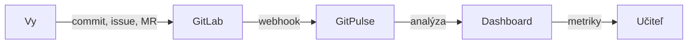


- Pre: Študent
- Vyžaduje: Školský GitLab účet

Vitajte v príručke pre študentov GitPulse. Táto sekcia vám pomôže pochopiť, ako GitPulse funguje, čo systém sleduje a ako efektívne využívať informácie z dashboardu.

## Obsah príručky

  - [Začíname](./zaciname/) - Prvé prihlásenie, navigácia v dashboarde a základné funkcie.
  - [Pochopenie metrík](./metriky/) - Čo znamenajú compliance pravidlá R01-R13 a ako ovplyvňujú vaše hodnotenie.
  - [FAQ](./faq/) - Často kladené otázky a odpovede pre študentov.

---

## Čo je GitPulse?

GitPulse je nástroj na podporu výučby DevOps praktík, ktorý automaticky analyzuje vašu prácu v GitLab projektoch. Systém sleduje:

- **Aktivitu commitov** - pravidelnosť a rozloženie práce v čase
- **Prácu s issues** - vytváranie, priraďovanie a uzatváranie úloh
- **Merge requesty** - code review a integrácia kódu
- **CI/CD pipeline** - automatizované testovanie a nasadenie
- **Tímovú spoluprácu** - rozdelenie práce medzi členov tímu


**GitPulse nie je nástroj na sledovanie.** GitPulse analyzuje iba verejne dostupné dáta z vašich GitLab projektov. Nesleduje vašu osobnú aktivitu, nenahráva obrazovku ani nemonitoruje čas strávený pri počítači. Systém hodnotí **výstupy tímovej práce**, nie individuálnu produktivitu.

## Ako to funguje?

1. **Pracujete v GitLab** - vytvárate commity, issues, merge requesty
2. **GitPulse automaticky synchronizuje** dáta z vašich projektov
3. **Dashboard zobrazuje** compliance metriky a prehľad aktivity
4. **Učiteľ využíva** tieto dáta ako podklad pre hodnotenie

---

## Dôležité upozornenia


**Akademická integrita.** GitPulse dáva učiteľovi podklady na kontrolu procesu, nie náhradu za odborné posúdenie práce. Umelé nafukovanie aktivity, prázdne commity, formálne review bez obsahu alebo obchádzanie pravidiel kurzu môže učiteľ preveriť priamo v GitLabe.


**Najlepšie praktiky.** - Pracujte pravidelne, nie len pred deadline - Používajte zmysluplné commit správy - Rozdeľte prácu na menšie úlohy cez issues - Robte code review cez merge requesty - Nastavte a udržiavajte CI/CD pipeline
