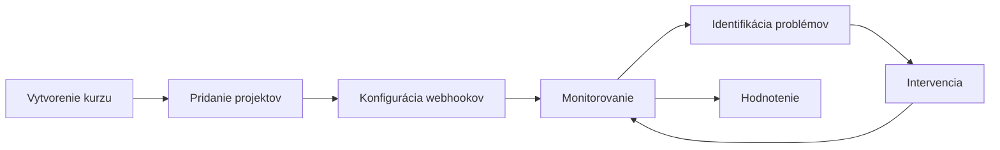


- Pre: Učiteľ
- Vyžaduje: Účet v GitPulse s rolou inštruktora

Vitajte v príručke pre učiteľov GitPulse. Táto sekcia vám pomôže efektívne využívať nástroj pre monitorovanie a hodnotenie tímovej práce študentov.

## Obsah príručky

  - [Začíname](./zaciname/) - Prvé kroky s GitPulse - vytvorenie kurzu, pridanie projektov, základná konfigurácia.
  - [Dashboard a metriky](./dashboard/) - Prehľad dashboardu, dostupné metriky a ich význam.
  - [Interpretácia výsledkov](./interpretacia/) - Ako správne interpretovať compliance skóre a identifikovať problémy.
  - [Vyhodnotenie vo výučbe](./pilot/) - Ako sa GitPulse overí s cvičiacimi a študentmi a čo pri tom robí cvičiaci.
  - [Asistent cvičení](./asistent/) - Bot, ktorý na cvičeniach pracuje ako kolega: kontrola pushu, konflikt pri zlučovaní, tikety a merge requesty.
  - [FAQ](./faq/) - Často kladené otázky a odpovede.

## Rýchly prehľad

### Čo GitPulse ponúka učiteľom?

| Funkcia | Prínos |
|---------|--------|
| **Kontroly R01 až R13** | Rutinná časť kontroly je predspracovaná, každý výsledok má zdôvodnenie a odkaz do GitLabu |
| **Real-time monitoring** | Včasná identifikácia problémových tímov |
| **Exporty dát (CSV / JSON)** | Súpiska študentov a podklady pre hodnotenie |
| **Historické trendy** | Sledovanie vývoja počas semestra |

### Typický workflow

### Časová náročnosť

Koľko času GitPulse cvičiacemu ušetrí, zatiaľ nikto nezmeral. Meria sa to
v úlohovej skúške s cvičiacimi, ktorú opisuje stránka
[Vyhodnotenie vo výučbe](./pilot/).

## Prerekvizity

Pred začatím práce s GitPulse potrebujete:

- [x] Školský GitLab účet (gitlab.example.com)
- [x] GitLab projekty študentov (alebo prístup na ich vytvorenie)
- [x] GitLab Personal Access Token s právami `api`, `read_repository`
- [x] Základné pochopenie GitLab workflow (commits, MR, issues)


**Získanie prístupu.** Účet v GitPulse sa vytvára automaticky pri prvom prihlásení cez školský GitLab (OAuth). Ak potrebujete zmeniť rolu (napr. povýšiť na inštruktora), kontaktujte administrátora na [mykyta.olym.work@gmail.com](mailto:mykyta.olym.work@gmail.com).

## Ďalšie zdroje

- [GitLab integrácia](../gitlab/index.md) - Technické detaily nastavenia
- [Bezpečnosť](../bezpecnost/index.md) - Ako sú chránené dáta študentov
- [API dokumentácia](../api/index.md) - Pre pokročilé použitie

