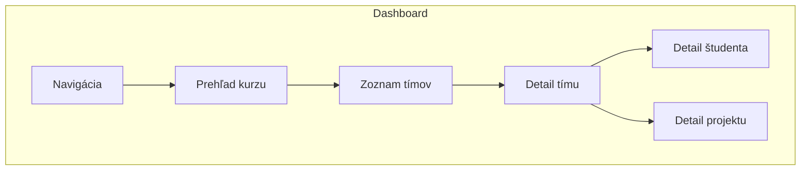
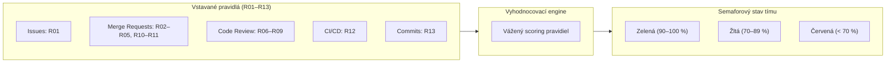


- Pre: Učiteľ
- Vyžaduje: Účet v GitPulse s rolou inštruktora

Táto stránka vysvetľuje jednotlivé časti dashboardu a význam zobrazovaných metrík.

## Prehľad dashboardu

## Navigácia

### Hlavné sekcie

| Sekcia | Popis |
|--------|-------|
| **Kurzy** | Zoznam vašich kurzov |
| **Tímy** | Prehľad všetkých tímov v kurze |
| **Nastavenia** | Konfigurácia kurzu, compliance kontroly, termíny |

### Globálny status bar

Na vrchu každej stránky sa zobrazuje **globálny sync status bar**, ktorý informuje o prebiehajúcich synchronizáciách:

- Počet čakajúcich, bežiacich a dokončených úloh
- Automaticky sa aktualizuje každé 2 sekundy
- Zmizne po dokončení všetkých úloh

### Filtrovanie a vyhľadávanie

- **Vyhľadávanie**: Nájdite tím alebo študenta podľa mena
- **Filtrovanie**: Zobrazenie podľa stavu (OK, Warning, Critical)
- **Triedenie**: Podľa compliance skóre, názvu, aktivity

### Akademické obdobie

Nástenka, **Správa kurzov** a **Správa používateľov** majú výber
**akademického obdobia** - jeden akademický rok a jeden semester, napríklad
*2026/2027 · Zima*. Určuje, o ktorých predmetoch a ktorých študentoch stránka
je. Obdobie sa nesie v adrese (`?period=2026-2027-winter`), takže odkaz na
ročník otvorí práve ten ročník.

- **Na akom období sa stránka otvorí**: na najnovšom, v ktorom sú predmety,
  *ktoré vidíte vy* - nie jednoducho na tom z kalendára. Predmet, ktorý beží
  iba v lete, by sa inak polroka otváral na prázdnej zime. Obdobie, ktoré podľa
  kalendára TUKE práve beží, je označené **Aktuálne** (alebo **Nadchádzajúce**
  medzi dvoma semestrami), aby sa nikdy nezamenili.
- **Ktoré obdobia sú uvedené**: obe obdobia aktuálneho akademického roka
  (prázdne je označené **Žiadne predmety** namiesto toho, aby chýbalo),
  nasledujúce obdobie a každé staršie obdobie, v ktorom sú predmety. Skončené
  obdobie bez predmetov uvedené nie je - bol by to len šum.
- **Všetky obdobia** ukáže všetko naraz.
- **Bez obdobia** (iba v Správe používateľov) zobrazí študentov, ktorí zatiaľ
  nie sú v žiadnej skupine žiadneho predmetu - typicky niekoho, kto sa prihlásil
  cez GitLab skôr, než sa jeho skupina synchronizovala. Bez tejto voľby by
  nebol viditeľný v žiadnom období.
- **Váš výber sa pamätá** - v prehliadači, rovnako ako jazyk rozhrania - a
  stránky sa naň nabudúce otvoria, kým sa nezačne ďalšie obdobie; potom opäť
  nasledujú kalendár. Odkaz, ktorý obdobie uvádza, má vždy prednosť.

Obdobie zužuje iba **študentov**. Administrátori, učitelia a servisné účty sa
zobrazia v každom období: nie sú viazaní na ročník a Správa používateľov by
inak stratila práve tých, ktorí ju spravujú. Stĺpec **Obdobie** v Správe
používateľov ukazuje obdobia, v ktorých je každý študent.

Na nástenke obdobie zužuje všetko na stránke aj každé jej obnovenie: karty
predmetov, karty **Študenti**, **Skupiny** a **Súlad** (každá uvádza svoje
obdobie a otvorí stránku s tým istým číslom), položky, ktoré potrebujú vašu
pozornosť, aj prehľad aktivity. Iba položky údržby - skončený semester na
archiváciu, minuloročný predmet na presun - sa pozerajú na všetky vaše
predmety, pretože taký predmet v zobrazenom období z definície nie je.

Stránka skupiny, študenta a projektu ukazuje pri názve odznak so semestrom,
do ktorého patrí jej predmet; je zvýraznený, keď práve ten semester beží.
Dialógy predmetu opisuje [Začíname](zaciname.md#akademické-obdobie-a-jeho-dátumy):
nový predmet sa predvolí na obdobie, ktoré ste zvolili vo výbere, inak na
obdobie z kalendára.

## Prehľad kurzu

### Súhrnné metriky

Na stránke kurzu uvidíte:

- **Počet tímov, študentov a projektov**
- **Priemerné compliance skóre** s trendom oproti minulému týždňu
- **Zoznam tímov** so semaforovým stavom
- **Upozornenia** na tímy vyžadujúce pozornosť

### Statusy tímov

| Status | Popis | Compliance |
|--------|-------|------------|
| **Zelený** | Tím pracuje dobre | ≥ zelený prah (predvolene 80 %) |
| **Žltý** | Potrebuje pozornosť | medzi žltým a zeleným prahom |
| **Červený** | Vážne problémy | < žltý prah (predvolene 50 %) |


**Dynamické prahy.** Zelený a žltý prah sú konfigurovateľné v nastaveniach kurzu. Zmeny sa ihneď prejavia na dashboarde.

## Zoznam tímov

### Tabuľka tímov

| Stĺpec | Popis |
|--------|-------|
| **Tím** | Názov tímu (kliknuteľný) |
| **Compliance** | Celkové compliance skóre s farebným indikátorom |
| **Posledná aktivita** | Čas posledného commitu/MR |
| **Členovia** | Počet študentov v tíme |
| **Akcie** | Tlačidlá pre synchronizáciu, detail |

## Detail tímu

### Sekcie detailu

#### 1. Compliance prehľad

Semaforový stav pre každú z 13 vstavaných kontrol (R01-R13) plus vlastné kontroly (C01+).

#### 2. Časová os aktivity

Interaktívny graf zobrazujúci aktivitu tímu v čase - commity, MR, issues.

#### 3. Štatistiky

- Počet commitov, MR, issues, komentárov
- Review coverage (% MR s review)
- Pipeline úspešnosť
- Test coverage

## Detail študenta

### Individuálne metriky

| Metrika | Popis |
|---------|-------|
| Commity | Celkový počet commitov |
| MR vytvorené | Počet merge requestov |
| Code review | Počet review komentárov |
| Issues | Vytvorené a zatvorené issues |

Všetky metriky zobrazujú porovnanie s priemerom tímu.

### Stránkovanie sekcií

Detail študenta obsahuje 8 sekcií s klientským stránkovaním:

1. Commity
2. Merge Requests
3. Issues
4. Komentáre
5. Pipeline výsledky
6. Review aktivita
7. Časová os
8. AI obohatenie

## Compliance metriky (R01-R13)

Váhy v tabuľkách sú predvolené. Predvolene sú vypnuté R09, R11 a R13. Skóre študenta
je súčet čiastkových skóre zapnutých kontrol vydelený súčtom ich váh, takže vypnutá
kontrola skóre nezníži, nezapočíta sa do počtu kontrol a študentovi sa neukáže ako
nesplnená.

### Kategória: Issue

| Kód | Metrika | Váha | Popis |
|-----|---------|------|-------|
| R01 | Issue Assigned | 8 % | Študent má priradenú aspoň 1 issue |

### Kategória: MR

| Kód | Metrika | Váha | Popis |
|-----|---------|------|-------|
| R02 | Branch + MR Created | 6 % | Študent má MR z vlastnej vetvy (konvencia názvu vetvy je voliteľná) |
| R03 | Tests Written | 10 % | Aspoň 1 MR obsahuje zmeny v testových súboroch |
| R04 | MR Linked to Issue | 8 % | MR odkazuje na issue názvom vetvy alebo v popise (napr. `Closes #12`) |
| R05 | MR Description | 5 % | Popis MR má aspoň 10 slov, voliteľne aj povinné sekcie šablóny |
| R10 | Merged by Author | 7 % | MR zlúčil autor alebo iný známy člen tímu (kurz môže vyžadovať autora alebo naopak iného člena) |
| R11 | MR + Issue Closed | 6 % | MR aj issue sú uzavreté |

### Kategória: Review

Kontroly R06-R09 podporujú **čiastočné skóre** - skóre = váha × pomer splnenia.

| Kód | Metrika | Váha | Popis |
|-----|---------|------|-------|
| R06 | Code Review Received | 12 % | MR študenta dostala review od ≥ N rôznych recenzentov |
| R07 | Code Review Given | 12 % | Študent zmysluplne recenzoval ≥ N rôznych MR kolegov |
| R08 | Review Response | 10 % | Autor odpovedal na review vlákna a odkazuje na commity |
| R09 | MR Approved | 9 % | MR študenta získala ≥ N schválení |

### Kategória: CI

| Kód | Metrika | Váha | Popis |
|-----|---------|------|-------|
| R12 | Pipeline Green | 7 % | Aspoň 1 pipeline prebehla úspešne s testovým jobom |

### Kategória: Commit

| Kód | Metrika | Váha | Popis |
|-----|---------|------|-------|
| R13 | Commit Quality | 0 % | Kvalita commitov (pomer web-editor commitov ≤ 30 %, predvolene 0 % / opt-in) |

## Export a konfigurácia

### CSV export

Exportujte dáta kurzu vo formáte CSV (súpiska študentov, aktivita tímov).

### JSON export/import konfigurácie

Exportujte kompletnú konfiguráciu kurzu vrátane:

- Nastavenia kurzu
- Compliance kontroly a prahy
- Vlastné kontroly

Importujte konfiguráciu do nového alebo existujúceho kurzu. Užitočné pre:

- Klonovanie nastavení medzi kurzami
- Zdieľanie konfigurácie medzi učiteľmi
- Zálohovanie a obnovu

## LLM obohatenie

GitPulse má voliteľnú LLM analýzu merge requestov. V produkčnom nasadení je vypnutá
(nasadzovací skript nastaví `FEATURE_LLM_SUGGESTIONS=false`), do kontrol R01-R13
nevstupuje a nevytvára známku. Ak ju správca na inej inštancii zapne, ponúka:

- **Merge request analýza** - AI sumarizácia zmien, kvality kódu a review komentárov
- **Tímové zhrnutia** - agregovaný prehľad silných stránok a oblastí na zlepšenie
- **Študentské zhrnutia** - individuálna analýza príspevkov


**Súkromie.** Pred odoslaním do AI modelu sú všetky osobné údaje (mená, emaily, GitLab handles) automaticky redakované. Podporovaní poskytovatelia: ľubovoľný OpenAI-kompatibilný provájder, Gemini a Groq.

## GitLab role a scoring

### Role badges

Na stránke detailu tímu sa pri každom členovi zobrazuje farebný odznak podľa jeho GitLab roly:

| Rola | Farba | Access Level |
|------|-------|-------------|
| **Owner** | Warning (žltá) | 50 |
| **Maintainer** | Info (modrá) | 40 |
| **Developer** | Secondary (šedá) | 30 |
| **Reporter** | Grey | 20 |
| **Guest** | Grey | 10 |

Členovia s `inherited` membershipom (z nadskupiny) majú dodatočný odznak "inherited".

### Neprispievajúci členovia

Členovia, ktorí sú vylúčení z tímového skóre, majú štítok **(not in team score)**. Vylúčenie nastáva keď:

1. **Nízka rola + nulová aktivita** - Guest alebo Reporter bez commitov, MR, issues alebo reviews
2. **Dedený prístup + nulová aktivita** - inherited group member bez akejkoľvek aktivity, bez ohľadu na rolu
3. **Inštruktor** - učitelia označení ako `is_teacher=true`


**Force Recheck.** Tlačidlo "Re-check" na stránke tímu spustí okamžité prepočítanie metrik - vrátane všetkých kontrol bez ohľadu na týždenné filtrovanie.

## Ďalšie čítanie

- [Interpretácia výsledkov](interpretacia.md) - Ako správne čítať metriky
- [FAQ](faq.md) - Často kladené otázky

