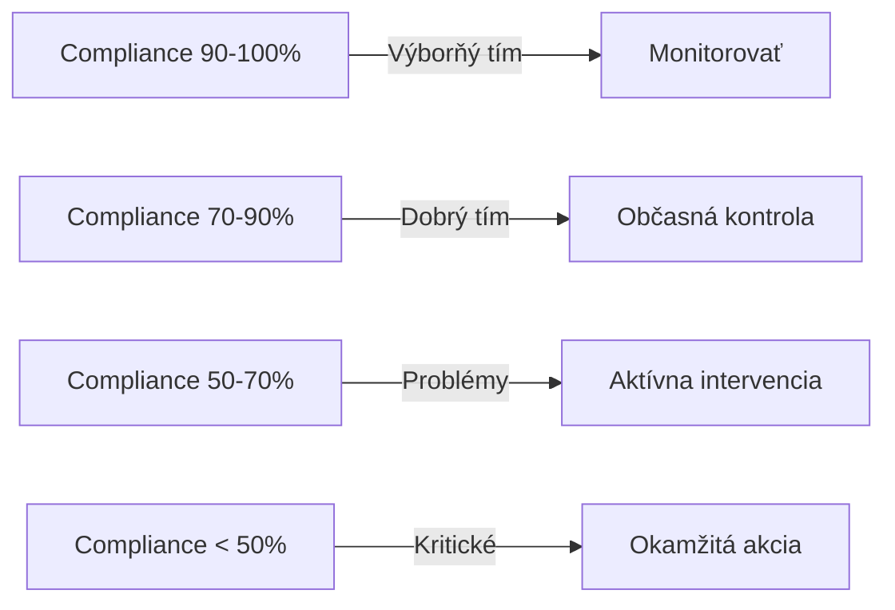
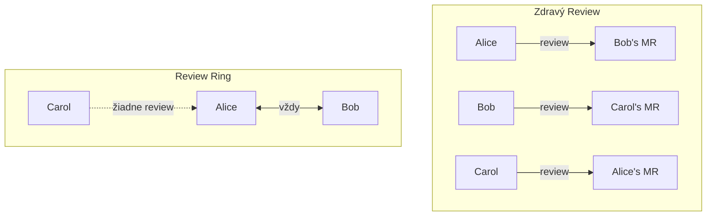
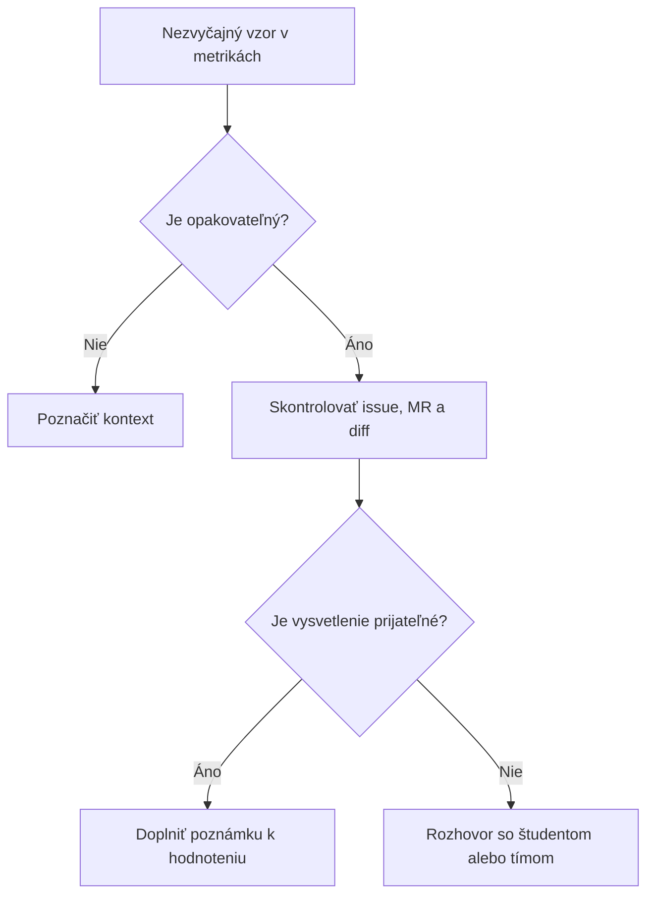


- Pre: Učiteľ
- Vyžaduje: Účet v GitPulse s rolou inštruktora

Táto stránka vám pomôže správne interpretovať metriky a identifikovať skutočné problémy v tímoch.

## Základné princípy


**Dôležité upozornenie.** Metriky sú **indikátory**, nie absolútna pravda. Vždy zvážte kontext a overte si podozrenia pred vyvodením záverov.

### Čo metriky hovoria

| Metriky hovoria | Metriky nehovoria |
|-----------------|-------------------|
| Kvantita aktivít | Kvalita kódu |
| Distribúcia práce | Individuálny talent |
| Dodržiavanie procesov | Skutočný prínos |
| Vzory správania | Okolnosti študenta |

## Compliance skóre

### Interpretácia celkového skóre

### Kontext je kľúčový

| Skóre | Možné interpretácie |
|-------|---------------------|
| Vysoké skóre (>80%) | + Dobre fungujúci tím ALEBO ! Gamovanie metrík |
| Stredné skóre (60-80%) | + Začínajúci tím ALEBO ! Problémy s tímovou prácou |
| Nízke skóre (<60%) | ! Vážne problémy ALEBO + Odlišný štýl práce |


**Best Practice.** Porovnávajte tímy v rámci kurzu, nie absolútne hodnoty. Každý kurz má iný baseline.

## Interpretácia jednotlivých metrík

### R01: Issue Assigned

**Čo meriame:** Študent má priradenú aspoň 1 issue v projekte

**Zdravé vzory:**

- Každý študent pracuje na vlastnej issue
- Issue je vytvorená pred začatím práce

**Varovné signály:**

- Študent nemá priradenú žiadnu issue -> skóre 0 %
- Issue priradená iba formálne, bez skutočnej práce

### R02: Branch + MR Created

**Čo meriame:** Vetva MR dodržiava konvenciu pomenovania (predvolene `issue-123-popis`)

**Zdravé vzory:**

- Vetva pomenovaná podľa konvencie: `issue-5-add-search`
- MR vytvorený z feature vetvy

**Varovné signály:**

- Vetva pomenovaná genericky: `my-branch`, `fix`, `test`
- Priame pushovanie do main bez MR

### R03: Tests Written

**Čo meriame:** Aspoň 1 MR obsahuje zmeny v testových súboroch

**Konfigurácia:** Vzory testových súborov sa nastavujú v `test_file_patterns`

### R04: MR Linked to Issue

**Čo meriame:** Popis MR odkazuje na issue (napr. `Closes #5`, `Fixes #12`)

### R05: MR Description

**Čo meriame:** Popis MR obsahuje povinné sekcie (predvolene `## Description` a `## Testing`)

### R06: Code Review Received (čiastočné skóre)

**Čo meriame:** MR študenta dostala review od ≥ N rôznych recenzentov

**Čiastočné skóre:** Ak študent potrebuje 2 recenzentov a má 1, dostane 50 % váhy.

**Zdravé vzory:**

- Každý člen reviewuje aj je reviewovaný
- Konštruktívne komentáre (≥ 30 slov)
- Rôzni revieweri (nie vždy tá istá osoba)

### R07: Code Review Given (čiastočné skóre)

**Čo meriame:** Študent zmysluplne recenzoval ≥ N rôznych MR kolegov

**Minimálna dĺžka review:** 30 slov (konfigurovateľné cez `min_review_word_count`)

### R08: Review Response (čiastočné skóre)

**Čo meriame:** Autor odpovedal na review vlákna a odkazuje na commity

Komentáre bot účtov (napríklad asistenta cvičení alebo CI bota) sa medzi vlákna nepočítajú, nikto od autora odpoveď na ne nečaká.

### R09: MR Approved (čiastočné skóre)

**Čo meriame:** MR študenta získala ≥ N schválení

### R10: Merged by Author

**Čo meriame:** Autor sám zmergoval svoj MR (nie iný člen tímu)

### R11: MR + Issue Closed

**Čo meriame:** MR aj prepojená issue sú uzavreté

### R12: Pipeline Green

**Čo meriame:** Aspoň 1 pipeline prebehla úspešne s testovým jobom

## Neprispievajúci členovia

### Kedy je člen vylúčený z tímového skóre?

Compliance engine používa **trojúrovňovú klasifikáciu** členov:

1. **Inštruktori** (`is_teacher=true`) - vygeneruje sa im individuálny snapshot, ale nikdy nie sú zahrnutí v tímovom agregáte
2. **Neprispievajúci** - Guest/Reporter bez aktivity ALEBO inherited členovia bez aktivity -> dostanú individuálny snapshot, ale sú vylúčení z tímového priemeru
3. **Študenti** - Developer+ alebo akýkoľvek člen s aktivitou -> zahrnutí v tímovom skóre

### Čo sa považuje za "aktivitu"?

Aktivita znamená, že člen má aspoň jednu z nasledujúcich:

- Vytvorený merge request
- Priradenú issue
- Danú code review
- Spustenú pipeline

### Týždenné filtrovanie kontrol

Ak kurz používa `weekly_deadlines` s `expected_checks`, engine hodnotí len kontroly relevantné pre aktuálny týždeň. To zabraňuje penalizácii študentov za kontroly, ktoré ešte neboli zavedené v kurikule.


**Force-recheck.** Endpoint `POST /api/v1/teams/{team_id}/run-checks` spustí prepočet so **všetkými** kontrolami (R01-R13 + vlastné), ignorujúc týždenné filtrovanie.

## Kvalita procesu

Compliance skóre treba čítať spolu s reálnym obsahom GitLabu. Nízka diverzita review, veľa generických commit správ alebo aktivita sústredená tesne pred deadline sú signály na manuálnu kontrolu, nie automatický trest.

### Ako reagovať na podozrivý vzor

## Kontextové faktory

### Kedy metriky môžu klamať

| Situácia | Dopad na metriky | Ako overiť |
|----------|------------------|------------|
| Pair programming | Nízka distribúcia | Spýtať sa na workflow |
| Refaktoring | Veľké zmeny, málo features | Pozrieť diff |
| Dokumentácia | Málo commitov | Pozrieť obsah |
| Finálna fáza | Burst aktivita | Porovnať s plánom |

### Otázky na overenie

Pred vyvodením záverov si položte:

1. **Je tento vzor konzistentný?** (nie jednorazová anomália)
2. **Ovplyvňujú ho externé faktory?** (skúškové, sviatky)
3. **Zodpovedá workflow tímu?** (pair programming, mob programming)
4. **Čo hovorí kód?** (nie len metriky)

## Praktické príklady

### Príklad 1: Nízka aktivita jedného člena

**Situácia:** David má 5 commitov za semester, ostatní 50+

**Možné príčiny:**
- David nerobí
- David robí code review (nie commity)
- David robí dokumentáciu offline
- David má osobné problémy

**Akcia:** Pozrieť review aktivitu, porovnať s issues, prípadne rozhovor

### Príklad 2: Vysoké compliance, ale slabý výsledok

**Situácia:** Tím má 90% compliance, ale projekt nefunguje

**Možné príčiny:**
- Formálne naplnené pravidlá bez kvalitného výstupu
- Dobrý proces, zlá implementácia
- Technické dlhy

**Akcia:** Review kódu, demo projektu, technický rozhovor

### Príklad 3: Burst aktivita pred deadline

**Situácia:** 80% commitov v posledné 2 dni

**Možné príčiny:**
- Zlý time management
- Podceňovanie úlohy
- Externé faktory (iné projekty)
- Bežné pri niektorých typoch úloh

**Akcia:** Diskusia o plánovaní, mentoring

## Checklist pre hodnotenie

- [ ] Porovnal som tím s priemerom kurzu
- [ ] Pozrel som trend, nie len aktuálny stav
- [ ] Overil som nezvyčajné vzory priamo v GitLabe
- [ ] Zvážil som kontext (typ projektu, fáza semestra)
- [ ] Pozrel som kód, nie len metriky
- [ ] Mám dostatočné dáta pre záver

## Ďalšie čítanie

- [Vyhodnotenie vo výučbe](pilot.md) - Ako sa GitPulse overí vo výučbe
- [FAQ](faq.md) - Bežné situácie a riešenia
