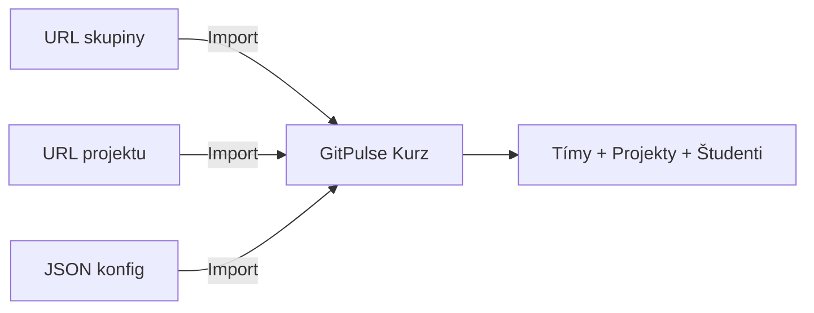


- Pre: Učiteľ
- Vyžaduje: Účet v GitPulse s rolou inštruktora

Táto stránka vás prevedie prvými krokmi pri používaní GitPulse.

## 1. Prihlásenie

1. Otvorte GitPulse dashboard na adrese poskytnutej administrátorom
2. Kliknite **"Prihláste sa pomocou GitLab"** - budete presmerovaní na váš GitLab server
3. Autorizujte aplikáciu a po úspešnom prihlásení uvidíte prehľad vašich kurzov


**Vývojársky režim.** V režime pre vývojárov je k dispozícii aj prihlásenie menom a rolou (admin / učiteľ / študent) bez GitLab OAuth.

## 2. Vytvorenie kurzu

### Možnosť A - Nový kurz

1. Na hlavnom dashboarde kliknite **"Vytvoriť kurz"**
2. Vyplňte:

| Pole | Popis | Príklad |
|------|-------|---------|
| Kód kurzu | Unikátny identifikátor | `ZSI` |
| Názov | Celý názov kurzu | `Základy softvérového inžinierstva` |
| Akademické obdobie | Obdobie, v ktorom predmet beží | `2026/2027 · Zima (aktuálne)` |
| Dátum začiatku / konca semestra | Doplní sa z oficiálneho kalendára TUKE | `2026-09-21` - `2027-02-12` |

3. Kliknite **"Vytvoriť"**

### Akademické obdobie a jeho dátumy

Každý dialóg, ktorý predmet vytvára alebo presúva - **Vytvoriť kurz**,
**Import z GitLabu**, **Upraviť kurz**, **Presun do nového semestra** aj
**Nastavenia** predmetu - sa na obdobie pýta rovnako: jedno pole
**Akademické obdobie** a za ním dva dátumy semestra.

- Zoznam ponúka obdobie, v ktorom je kalendár TUKE (označené *aktuálne*,
  medzi semestrami *nadchádzajúce*), a obdobia po ňom - nie pevný rozsah
  rokov, takže skončený rok sa omylom vybrať nedá. **Import z GitLabu**
  ponúka aj dve obdobia minulého roka, označené *ukončené*, na import
  skončeného predmetu kvôli jeho histórii.
- Výber obdobia doplní jeho **oficiálne dátumy TUKE**. Pri zmene obdobia sa
  dátumy posunú s ním - kým sú stále oficiálne. Dátumy, ktoré ste zadali
  sami, zostanú; ak potom začiatok patrí do iného obdobia, dialóg to povie.
- **Použiť oficiálne dátumy TUKE** vráti dátumy z kalendára po ručnej zmene.
- Pre obdobie, ktorého kalendár TUKE ešte nie je zverejnený, zostanú dátumy
  prázdne a dialóg povie prečo - doplňte ich, keď kalendár vyjde.
- **Presun do nového semestra** navrhne to isté obdobie o rok neskôr a nikdy
  neponúkne obdobie, v ktorom predmet už je. Ak dátumy necháte prázdne,
  prevezme dátumy tohto predmetu posunuté do nového obdobia týždeň po týždni -
  termín v piatok 5. týždňa zostane v piatok 5. týždňa.

Rovnaké pravidlá kontroluje server pri každom vstupe vrátane REST API a
importu JSON konfigurácie: akademický rok sú dva po sebe idúce roky
(`2026/2027`), semester je `winter` alebo `summer` a koniec je po začiatku.

### Možnosť B - Import z GitLabu

1. Kliknite **"Import z GitLabu"**
2. Vložte GitLab URL:
      - **URL skupiny** - importuje všetky podskupiny a projekty (napr. `https://gitlab.example.com/zsi-labs/assignments-2026/a3`)
      - **URL projektu** - importuje iba jeden projekt (napr. `https://gitlab.example.com/zsi-labs/assignments-2026/a3/mines-11679`)
3. Vyplňte kód, názov a akademické obdobie (dátumy sa doplnia)
4. Zaškrtnite **"Automatická synchronizácia"** pre okamžité stiahnutie dát
5. Kliknite **"Importovať"**


**Inteligentná detekcia štruktúry.** GitPulse automaticky rozpozná, či URL smeruje na skupinu alebo projekt. Pri importovaní skupiny sa podskupiny stávajú tímami a projekty sa automaticky prepoja. Pri importovaní jedného projektu sa vytvorí jeden tím s daným projektom.

### Možnosť C - Import JSON konfigurácie

1. Kliknite **"Import JSON"**
2. Nahrajte JSON súbor s kompletnou konfiguráciou kurzu
3. JSON obsahuje nastavenia, compliance kontroly, termíny a prahy

## 3. Pridanie projektov

### Automatický import zo skupiny

Ak máte projekty organizované v GitLab skupine:

1. Na stránke kurzu kliknite **"Import z GitLabu"**
2. Zadajte URL skupiny (napr. `https://gitlab.example.com/zsi-labs/assignments-2026/a3`)
3. GitPulse automaticky nájde všetky projekty a vytvorí tímy

### Import jedného projektu

1. Použite **"Import z GitLabu"** s URL jednotlivého projektu
2. Systém vytvorí jeden tím s priradením daného projektu
3. Študenti sú automaticky detekovaní z členov projektu

## 4. Synchronizácia dát

Po importe je potrebné synchronizovať dáta z GitLabu:

1. GitPulse automaticky začne synchronizáciu ak ste zaškrtli **"Automatická synchronizácia"**
2. Alebo kliknite **"Synchronizovať všetko"** na stránke kurzu
3. Sledujte priebeh v globálnom status bare (navrchu stránky)
4. Po dokončení sa aktualizujú metriky a compliance skóre


**Čo sa synchronizuje?.** - Issues (problémy) - všetky otvorené aj zatvorené - Merge Requests - s komentármi a review stavom - Pipelines - CI/CD výsledky a pokrytie - Commity - história a štatistiky - Členovia projektu - automatická detekcia študentov

## 5. Import študentov (Roster)

### Automatická detekcia

Študenti sú automaticky importovaní z členov GitLab skupiny/projektu počas importu. Nie je potrebný manuálny zásah. Pohľad **Súpiska** v kurze zobrazuje všetkých detegovaných študentov a dá sa exportovať do CSV.

## 6. Nastavenie compliance kontrol

### Vstavaných 13 kontrol (R01-R13)

Kontroly sú rozdelené do 4 kategórií: **Issue**, **MR**, **Review** a **CI**.

| Kontrola | Názov | Kategória | Váha | Popis |
|----------|-------|-----------|------|-------|
| R01 | Issue Assigned | Issue | 8 % | Študent má priradenú aspoň 1 issue |
| R02 | Branch + MR Created | MR | 6 % | Vetva MR dodržiava konvenciu pomenovania (napr. `issue-123-popis`) |
| R03 | Tests Written | MR | 10 % | Aspoň 1 MR obsahuje zmeny v testových súboroch |
| R04 | MR Linked to Issue | MR | 8 % | Popis MR odkazuje na issue |
| R05 | MR Description | MR | 5 % | Popis MR obsahuje povinné sekcie (napr. Description, Testing) |
| R06 | Code Review Received | Review | 12 % | MR študenta dostala review od ≥ N rôznych recenzentov (čiastočné skóre) |
| R07 | Code Review Given | Review | 12 % | Študent zmysluplne recenzoval ≥ N rôznych MR kolegov (čiastočné skóre) |
| R08 | Review Response | Review | 10 % | Autor odpovedal na review vlákna a odkazuje na commity (čiastočné skóre) |
| R09 | MR Approved | Review | 9 % | MR študenta získala ≥ N schválení (čiastočné skóre) |
| R10 | Merged by Author | MR | 7 % | Autor sám zmergoval svoj MR |
| R11 | MR + Issue Closed | MR | 6 % | MR aj issue sú uzavreté |
| R12 | Pipeline Green | CI | 7 % | Aspoň 1 pipeline prebehla úspešne s testovým jobom |
| R13 | Commit Quality | Commit | 0 % | Kvalita commitov (pomer web-editor commitov ≤ 30 %, predvolene 0 % / opt-in) |

### Konfigurácia prahov

V nastaveniach kurzu -> záložka **"Nastavenia"** -> sekcia **"Compliance"**:

- **Zelený prah** (predvolene 80 %) - tím spĺňa požiadavky
- **Žltý prah** (predvolene 50 %) - vyžaduje pozornosť
- Pod žltým prahom - **červený** stav

### Vlastné kontroly

GitPulse podporuje aj vlastné kontroly (C01+) pre špecifické požiadavky kurzu.

## 7. Prvá kontrola

Po synchronizácii:

1. Otvorte stránku kurzu - uvidíte tabuľku tímov so semaforovým stavom
2. Kliknite na tím pre zobrazenie detailov (compliance, aktivita, analytiky)
3. Kliknite na študenta pre individuálne metriky (commity, issues, MR, komentáre)


**Hotovo!.** Váš kurz je pripravený. GitPulse automaticky spracováva nové udalosti a aktualizuje metriky.

## Kontrolný zoznam

- [x] Prihlásenie cez GitLab OAuth
- [x] Vytvorený / importovaný kurz
- [x] Importované projekty a študenti
- [x] Vykonaná synchronizácia dát
- [x] Nastavené compliance kontroly a prahy
- [x] Skontrolovaný dashboard - metriky sa zobrazujú správne

## Ďalšie kroky

- [Dashboard a metriky](dashboard.md) - Naučte sa čítať metriky
- [Interpretácia výsledkov](interpretacia.md) - Pochopte význam skóre
- [FAQ](faq.md) - Riešenie bežných problémov

