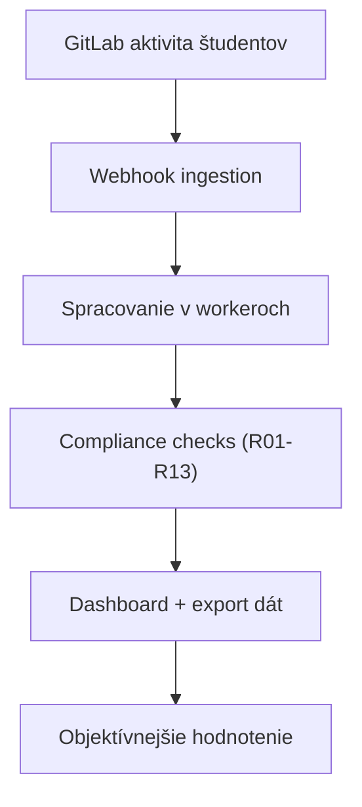


- Pre: Všetci
- Vyžaduje: Nič

GitPulse je platforma pre transparentné a škálovateľné hodnotenie tímovej práce v GitLab projektoch.

## Hlavný cieľ

Nahradiť manuálne a subjektívne hodnotenie merateľným procesom postaveným na dátach:

- automatický zber udalostí
- konzistentné compliance pravidlá
- auditovateľné výstupy pre učiteľa

## Pre koho je dokumentácia určená

- učitelia: interpretácia metrík a rozhodovanie
- vývojári: implementácia, testovanie, release proces
- operátori: nasadenie, monitoring, incident response

## Ďalšie kroky

- [Prehľad projektu](prehlad.md)
- [Ciele diplomovej práce](ciele.md)
- [Architektúra systému](architektura.md)
